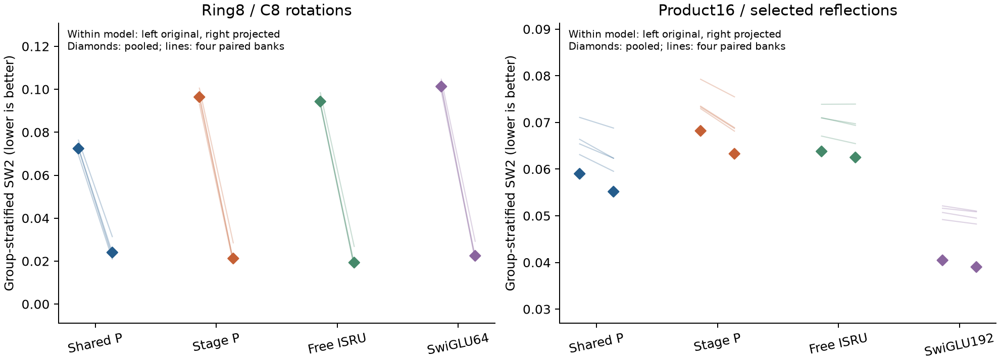
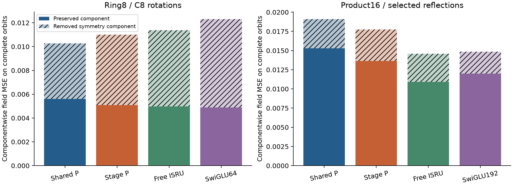
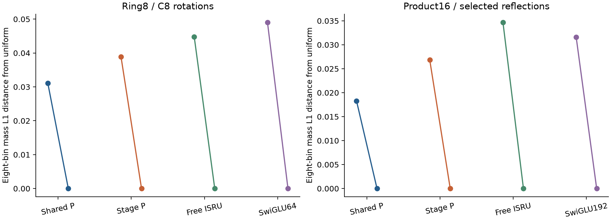
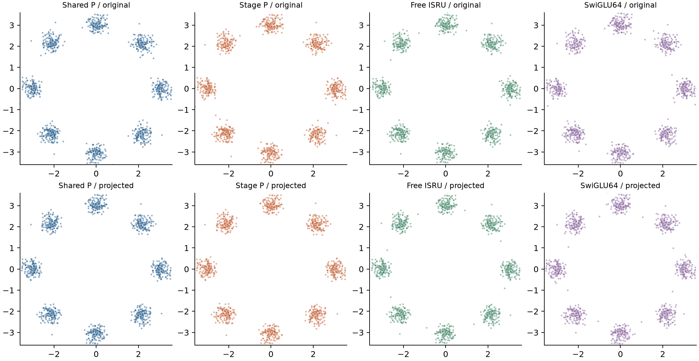

# Sharing changes the symmetry-error tradeoff

The shared generator's original sampling lead reproduces on both tasks.
After exact group projection, Ring8 reverses the comparison and Product16
retains it. A single explanation based on the tested symmetries therefore
fails. Sharing helps at the trained budget, but does not uniformly improve
the symmetry-preserving part of the learned field.

## Frozen intervention

Eight final checkpoints, four on each task, are unchanged. The native
Heun128 sampler integrates the original field and its Reynolds projection
`v_G(x,t) = mean_g g^-1 v(gx,t)`. Ring8 uses its eight 45-degree rotations;
Product16 uses the eight latent sign flips generated by axes 0,7,15.
The latter is a selected subgroup of the full coordinate-reflection group.
Both are exact symmetries of their native data law and oracle velocity.

Four new banks use stream 2026112200. Each bank starts with 4096 independent
base sources/targets and applies all eight transformations. Thus a pooled
score uses 16384 base points and 131072 correlated group points. All models
receive identical arrays. These are synthetic width 64/depth 3 velocity MLPs,
not image JiT models. Original training configurations stay fixed: Ring8
SwiGLU64 uses Muon 0.02; other rows use AdamW 0.0003.

## Generation and field errors

| Task | Model | Original SW2 | Projected SW2 | Total field MSE x1,000 | Removed symmetry MSE x1,000 |
|---|---|---:|---:|---:|---:|
| Ring8 | Shared P | **0.072** | 0.024 | 10.277 | **4.682** |
| Ring8 | Stage P | 0.096 | 0.021 | 10.998 | 5.926 |
| Ring8 | Free ISRU | 0.094 | **0.019** | 11.375 | 6.404 |
| Ring8 | SwiGLU64 | 0.101 | 0.022 | 12.310 | 7.426 |
| Product16 | Shared P | 0.059 | 0.055 | 19.102 | 3.812 |
| Product16 | Stage P | 0.068 | 0.063 | 17.763 | 4.128 |
| Product16 | Free ISRU | 0.064 | 0.063 | **14.584** | 3.652 |
| Product16 | SwiGLU192 | **0.040** | **0.039** | 14.870 | **2.861** |

Lower is better. The MSE columns describe a separate 4096-base-point field
bank expanded to complete orbits. Exact values, bank effects and configuration
labels are in [comparison.json](comparison.json) and [scores.csv](scores.csv).
Do not compare these absolute SW2 values with the earlier iid sharing cohort.



Diamonds show pooled scores; faint lines connect the four paired bank scores.
Ring8's stage-minus-shared pooled gap changes from +0.024 to -0.003. All four
banks favor sharing originally; all four favor released stages after projection.
Product16's gap changes from +0.009 to +0.008, with sharing favored in all four
banks before and after projection. The selected reflections are insufficient
to explain that remaining gap.

On each complete orbit, the following squared-error identity holds:

```text
total field MSE = projected field MSE + symmetry-breaking variance.
```

It follows by expanding the square around the group-averaged prediction;
the cross term sums to zero. It is an identity for field errors, not an
additive decomposition of SW2or a causal percentage of the sampling gap.



Sharing reduces Ring8's breaking component from 5.926 to 4.682 in MSE x1,000,
but increases its preserved component from 5.072 to 5.595. The original lead
therefore combines lower symmetry error with worse preserved-field fitting.
The registered reversal rule rejects a simple account in which sharing
uniformly improves the relevant field geometry. Product16 also has a smaller
breaking component under sharing, yet the projected stage field still fits
the oracle better: 13.635 versus 15.289. Its generation remains worse. Removing
the selected symmetry errors does not resolve the field-MSE/sampling mismatch.

## Mode balance and examples

Projection makes all eight selected partition masses exactly equal in these
group-stratified samples. Ring8 shared/stage mass-L1 imbalance falls from
0.031/0.039 to 0.000/0.000; Product16 falls from0.018/0.027 to 0.000/0.000.
Equal partition mass is therefore insufficient for equal generation quality.



The preserved eight-by-eight source-to-end matrices are in
[independent-verified-cases.json](independent-verified-cases.json). Column-minus-row
mass gives net imbalance. Total off-diagonal mass describes the learned
coupling, not an error relative to a uniquely correct trajectory.



Each panel shows the same 128 base sources in each of eight transformed
strata from bank 0: 1024 dependent points. It is an example, not a new metric
bank. [Sixteen common-source trajectories](figures/ring-paths.png) show the
corresponding field intervention. The scores above use every registered point.

## Numerical and execution checks

All eight cases exit0. Independent NumPy checks recompute 64 bank scores,
16 pooled scores,32 bounded-resolution scores, field decompositions, counts,
gap masses, trajectory bindings and flux matrices. Maximum score/decomposition
disagreement is 1.25e-16. Frozen inference source is 5e78e6a; independent
verification source is c02da14.

On 512 base-point subsets, Heun128->256 changes SW2 by at most 5.44e-4.
Endpoint coupling RMS shifts reach0.065, so individual paths are not claimed
to be numerically converged. The subset scores assess solver sensitivity;
they do not replace the full-bank comparison. Earlier full-bank outer
refinement of this pair remains in [P0](../sharing-results/full-resolution/analysis.md).

The queue used only idle physical 145 GPUs 4/5 and released both contexts.
GPUs 6/7 were occupied and skipped; 0-3 were prohibited. See
[queue receipt](queue-finished.json), [independent verification](independent-COMPLETE.json)
and [telemetry](gpu-history.json). A cross-NumPy dot-product reconstruction
check initially failed bitwise equality; exact asset hashes passed. The
reconstruction now uses its analytical floating-point forward-error bound;
the largest discrepancy is 1.78e-15. Data, inference and metric thresholds
were unchanged. [Diagnosis](numpy-orbit-roundoff-diagnosis.json).

## Decision

Retain shared nonlinear state evolution as the best tested within-family
constraint at this budget. Do not promote it as an ODE-specific advantage
over ordinary FFNs: projected Ring8 Free ISRU and both Product16 SwiGLU
evaluations remain stronger. The next question is which field-error components
actually alter the evolving density, addressed in the
[next diagnostic plan](../post-symmetry-decision.md).

## Claim candidates

- Keep: sharing has a reproducible conditional sampling advantage over the
  tested released-stage parameterization. Evidence: primary paired banks,
  full solver refinement and this new original-field cohort. The nested
  parameterization also changes optimization geometry; this does not isolate
  autonomy from every possible recurrent sharing implementation.
- Revise: symmetry explains all sharing gains. Evidence: Ring8's reversal
  and Product16's persistent projected gap. State instead that sharing changes
  the balance between breaking and preserved field errors; the selected
  symmetry alone is insufficient across tasks.
- Keep: lower average field MSE need not produce lower SW2, even after the
  tested symmetry component is removed. Evidence: projected Product16 shared
  versus stage fields. This is a frozen-checkpoint observation, not a general
  ordering theorem for architectures.
