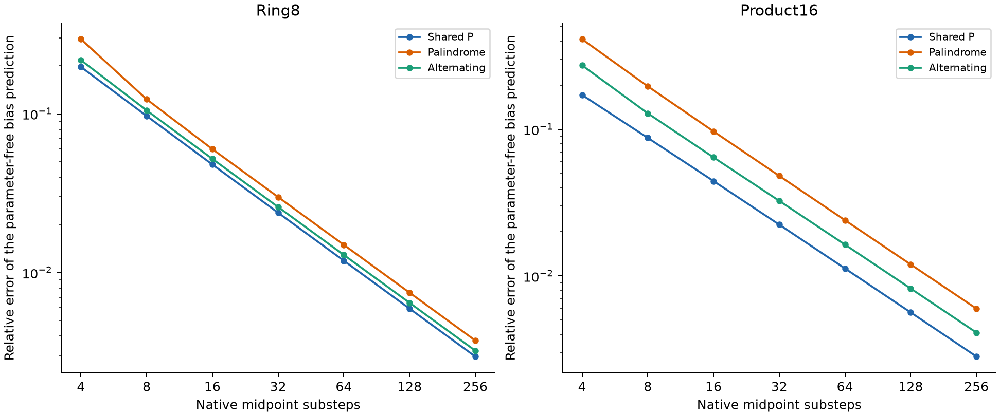
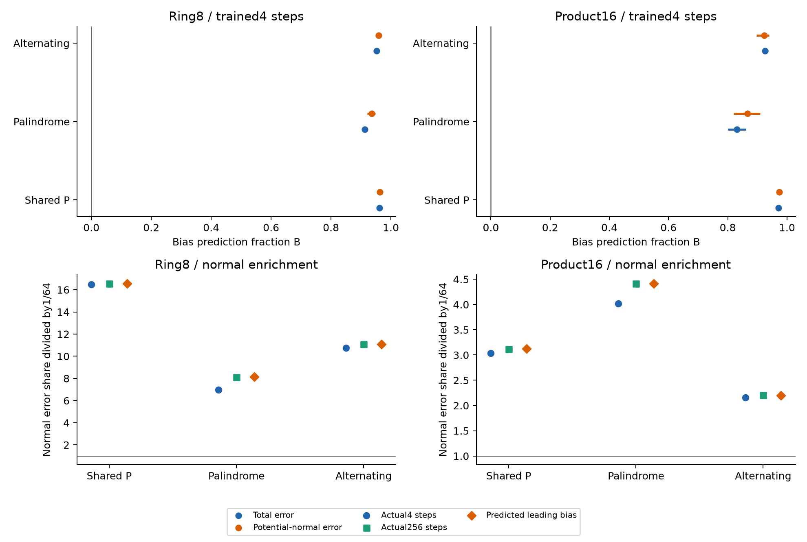

# Predicting the hidden numerical bias without fitting

**6/6 model cases qualify numerically. The trained4-step prediction
beats zero in 6/6 total-error and 6/6 normal-error
comparisons; adjusted intervals resolve positivity in 6/6 and
6/6 respectively.** The registered fine-step decrease is supported
in 6/6 numerically qualified cases.

## Prediction and scope

For the frozen hidden field f=P ISRU(y), the midpoint local defect has leading
term eta^3*g, with g=-H[f,f]/24-J(Jf)/6. Integrating z'=Jz+g along the actual
continuous hidden path predicts endpoint error z(1)/N^2. All coefficients follow
from the method; no regression or fitted scale is used. This is established
modified-equation analysis applied to the recorded trained features.
[Derivation and prior work](../solver-bias-derivation.md).

Keep all six shared/PAL/ALT models, six layers and80 inputs. Reuse native
endpoints at4/8/16/32/64/128/256; no data, checkpoint or layer is selected.
These are the state-updated midpoint models, not the image frozen-D Taylor K8.

Relative residual compares the complete predicted and measured feature-error
vectors. Fine-step accuracy verifies the asymptotic explanation, but the4-step
point must be examined separately to explain the actual trained computation.

## Trained-scale and canonical-normal prediction

Top: trained4-step prediction fractions and nominal12-contrast-adjusted input-
bank intervals. Bottom: observed and predicted potential-normal enrichment
relative to the1/64 geometric reference. These are hidden-error predictions,
not output-response or generation-quality fractions.

| Task | Model | N4 total B | Adjusted interval | N4 normal B | Adjusted interval | N4 actual enrichment | Predicted enrichment | Qualified |
|---|---|---:|---|---:|---|---:|---:|---|
| Ring8 | Shared P | 0.961 | [0.958, 0.964] | 0.963 | [0.958, 0.968] | 16.489 | 16.566 | yes |
| Ring8 | Palindrome | 0.913 | [0.903, 0.923] | 0.936 | [0.921, 0.949] | 6.954 | 8.134 | yes |
| Ring8 | Alternating | 0.953 | [0.948, 0.958] | 0.959 | [0.954, 0.967] | 10.749 | 11.067 | yes |
| Product16 | Shared P | 0.971 | [0.968, 0.973] | 0.975 | [0.969, 0.980] | 3.038 | 3.121 | yes |
| Product16 | Palindrome | 0.831 | [0.800, 0.862] | 0.867 | [0.819, 0.909] | 4.023 | 4.417 | yes |
| Product16 | Alternating | 0.925 | [0.917, 0.937] | 0.923 | [0.897, 0.940] | 2.158 | 2.202 | yes |

The signed curvature and repeated-Jacobian contributions are retained separately.
Their individual prediction fractions appear in [all resolutions](all-resolutions.md);
their RMS magnitudes must not be added because contributions can cancel.

## Independent numerical checks

Every state uses two DOP853 tolerance pairs for the state and variational terms.
A separate state-only integration of f+epsilon*g at both positive and negative
epsilon1e-4/1e-5 estimates the endpoint derivative, without solving the
variational equation. Both perturbation scales must satisfy the registered
componentwise gates. Every unresolved point remains in summary.json. Both
native entries and both independent verifiers have actual exit0.

## Research decision and claim candidates

- Claim: the recorded parameter-free bias prediction succeeds or fails at the
  trained and fine resolutions as listed, on the complete fixed cohort.
  - Evidence: all states/resolutions, source-bound endpoint arrays, two-tolerance
    integration, independent state-perturbation checks and paired bank intervals.
  - Allowed wording: quantitative prediction of hidden midpoint discretization
    error on the qualified cases; distinguish fine and trained resolutions.
  - Forbidden stronger wording: improved targetSW2, a new numerical theorem,
    or an advantage over ordinary FFNs from this diagnostic alone.
  - Uncertainty: fixed learned weights and finite input cohort; this does not
    establish performance under a newly trained solver or in the image model.
  - Next check: compare training with different faithful hidden solvers at equal
    parameter and matrix-work budgets, using ordinary controls. A solver switch
    at frozen weights cannot answer whether faithful continuous dynamics help.
  - Decision: keep the resolved prediction and use it to define that causal test.
