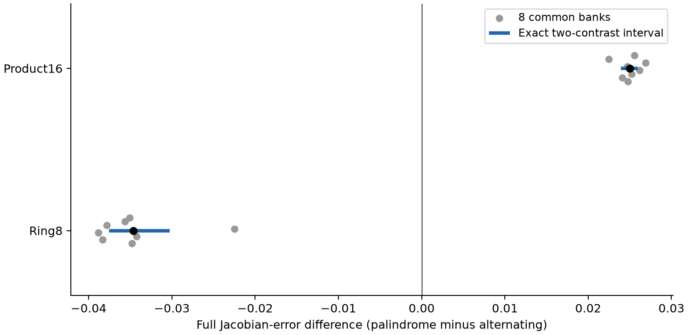
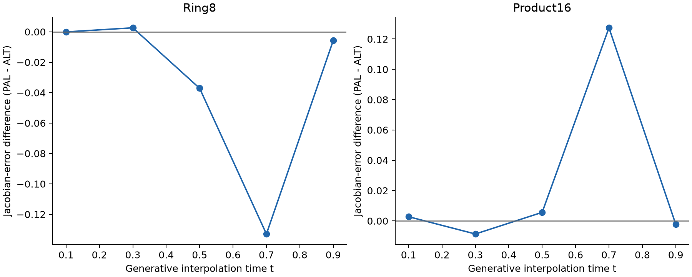

# Independent target-response confirmation

**The focal direction confirms on both tasks with all independent inputs.** This tests a within-pair association, not a general ODE advantage.

The selection observation fixed the metric before this confirmation: average
||J_v-J_v*||_F²/d, equal point/time weights. We retain all8x4096source/target
pairs from each preexisting confirmation cohort at t=.1,.3,.5,.7,.9. Four
unchanged20kseed0checkpoints give655360evaluated interpolation states. These
are five views of32768pairs per task, not independent trajectories or trainings.

| Task | PAL J error | ALT J error | Difference | Exact adjusted interval | Banks | PAL SW2 | ALT SW2 |
|---|---:|---:|---:|---|---:|---:|---:|
| Ring8 | 0.156 | 0.191 | -0.035 | [-0.038, -0.030] | 8/8 | 0.086 | 0.108 |
| Product16 | 0.261 | 0.236 | 0.025 | [0.024, 0.026] | 8/8 | 0.072 | 0.066 |

Dots are paired bank differences; bars are exact97.5% percentile bootstrap
intervals for the two-contrast family. Negative is the predicted Ring8direction;
positive is the predicted Product16direction. All bank values are retained in
summary.json. Registered10000-draw intervals and exhaustive sensitivity intervals
are both reported; exhaustive enumeration changes no population or metric.

The second figure preserves all five time slices. It describes where the
focal response difference occurs and does not substitute a selected time for
the registered average. These states follow independent linear interpolation,
not the actual learned sampling trajectory.

## What this changes

The full-output derivative is a concrete bridge from a hidden composition
constraint to the learned task field. A confirmed association would establish
that the small selection pattern survives independent inputs. It still does
not show that correcting this derivative causes the sample improvement.
The selection cohort's Product16SwiGLU samples better despite greater average
Jacobian error, so the metric cannot rank all architectures or account for
an ODE-specific advantage. The next decisive measurement is the transported
effect of field error along common oracle paths, including its mean component.

## Verification

Both native observation processes and both independent verifiers exited0.
All source/target arrays equal the complete bound NPZbanks exactly, including
bank identity/order. Every raw derivative file is hashed; both task COMPLETE
receipts and verifier reconstructions are included. The input-dependent target
identities, wrong-object controls and sampling counterexamples remain in the
preceding derivation/readiness bundle. No training or image source was changed.

## Claim candidates

- Claim: the focal average-response ordering persists on independent inputs.
  Evidence: four full arrays, every paired bank, exact intervals. Decision:
  keep within this fixed-checkpoint comparison.
- Claim: output-Jacobian error alone explains generation quality across models.
  Evidence: ordinary Product16counterexample in the selection study. Decision:
  reject that general ranking; test trajectory-weighted error next.
- Claim: hidden ODE structure is uniquely responsible for a generation gain.
  Evidence: no matched causal output-response intervention here. Decision: not established.
