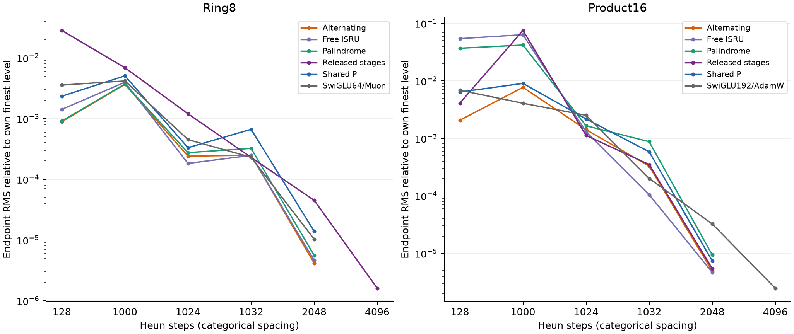
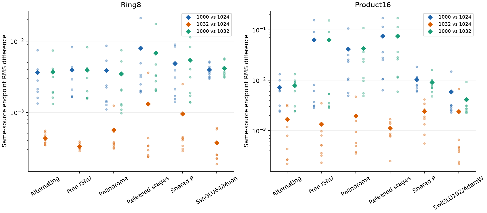

# Native-time precision on all twelve frozen models

**All twelve native endpoint calculations meet the registered component gate:
10at4096steps and2at8192. Near-equal-work grids still give
different endpoints.** These are precision results at fixed weights, not a
new sampling-performance comparison.

## Purpose and population

Separate fixed-grid numerical behavior from the continuous-field interpretation
needed for the error-transport test. Each20kcheckpoint retains all256sources:
32from each of eight original selection banks. No source/model is dropped.
Internal integration, time encoding, weights and buffers remain unchanged.
The native Heun sampler computes1000/1032/2048/4096and8192only when needed;
bound128/1024arrays are reused exactly. Both ordinary controls remain included.

| Task | Model | 1000 vs1024 RMS | 128 vsfinest RMS | 1024 vsfinest RMS | Finest | Final refinement RMS | Pass |
|---|---|---:|---:|---:|---:|---:|---|
| Ring8 | Alternating | 3.628e-03 | 8.892e-04 | 2.403e-04 | 4096 | 4.150e-06 | yes |
| Ring8 | Free ISRU | 3.929e-03 | 1.416e-03 | 1.824e-04 | 4096 | 4.631e-06 | yes |
| Ring8 | Palindrome | 3.891e-03 | 9.118e-04 | 2.747e-04 | 4096 | 5.586e-06 | yes |
| Ring8 | Released stages | 7.977e-03 | 2.822e-02 | 1.199e-03 | 8192 | 1.604e-06 | yes |
| Ring8 | Shared P | 4.846e-03 | 2.332e-03 | 3.314e-04 | 4096 | 1.391e-05 | yes |
| Ring8 | SwiGLU64/Muon | 3.947e-03 | 3.557e-03 | 4.497e-04 | 4096 | 1.033e-05 | yes |
| Product16 | Alternating | 7.247e-03 | 2.070e-03 | 1.419e-03 | 4096 | 4.897e-06 | yes |
| Product16 | Free ISRU | 6.365e-02 | 5.430e-02 | 1.300e-03 | 4096 | 4.663e-06 | yes |
| Product16 | Palindrome | 4.158e-02 | 3.693e-02 | 1.657e-03 | 4096 | 9.401e-06 | yes |
| Product16 | Released stages | 7.535e-02 | 4.109e-03 | 1.123e-03 | 4096 | 5.424e-06 | yes |
| Product16 | Shared P | 1.033e-02 | 6.392e-03 | 2.181e-03 | 4096 | 7.382e-06 | yes |
| Product16 | SwiGLU192/AdamW | 5.878e-03 | 6.883e-03 | 2.517e-03 | 8192 | 2.470e-06 | yes |

## Observations

Every row passes the original all-source componentwise atol1e-4/rtol1e-3gate
on its final refinement. Ring8released-stage and Product16SwiGLU need8192;
the others stop at4096. The plotted reference is each model's own finest
computed endpoint. Its zero by construction is omitted. A finite refinement
test establishes the registered numerical precision, not an exact solution.

The1000/1024/1032contrasts measure grid sensitivity at nearly equal work;
they do not rank which grid is more accurate. Small points are eight bank RMSs;
diamonds are RMSover every source/component, not the mean of the bank RMSs.
The endpoints differ even though these counts are close. Along with the earlier
alias construction, this justifies resolving the continuous trajectory on a
finer grid. It does not identify which embedding component causes every change.

## Consequence

The native-field obstacle is cleared under the registered gate. Next refine
the complete oracle/tangent/four-blend calculation at2048/4096/8192while
retaining all original inputs. Native qualification alone does not qualify
the tangent, nor validate the first-order explanation at full model error.
Original large-bank Heun128SW2scores remain unchanged. The256-source paired
endpoint differences are neither SW2norFIDand establish no architecture win.

## Claim candidates

- Claim: all twelve fixed native fields pass the registered endpoint precision test.
  - Source evidence: summary.json, queue-finished.json and independent-COMPLETE.json.
  - Allowed wording: twelve finite-source endpoint checks pass, ten at4096and two at8192.
  - Forbidden stronger wording: all continuous trajectories or generation scores are exact.
  - Uncertainty: gate applies to all tested256sources, not unseen sources or training.
  - Next check: oracle/tangent/four-blend refinement.
  - Decision: keep.
- Claim: nearby sampling grids produce different endpoints at fixed weights.
  - Source evidence: all five contrasts per model and the grid-sensitivity figure.
  - Allowed wording: observed grid sensitivity motivates higher-resolution qualification.
  - Forbidden stronger wording: aliasing explains the earlier architecture ranking.
  - Uncertainty: source-coupled displacement need not imply distribution degradation.
  - Next check: qualified error-transport test, preserving ordinary controls.
  - Decision: keep.
