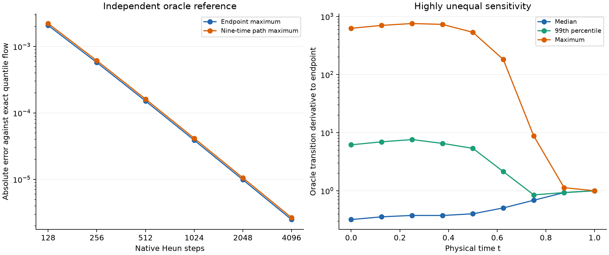
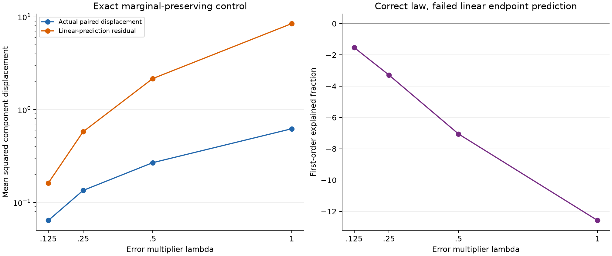

# Product16: exact flow and a distribution-preserving counterexample

**The actual Product16 law admits exact flows with nonzero velocity error and
failed first-order endpoint prediction, while every population marginal stays
correct.** This separates reference-coupled trajectory fidelity from generation.
It is a mathematical control on the project dataset, not a learned architecture.

## Exact oracle reference

In the known latent basis, both the target and Gaussian source factorize.
Each coordinate follows the unique scalar oracle flow
u_t=F_t^(-1)(Phi(u_0)). Its transition derivative from time a to b is
p_a(u_a)/p_b(u_b). The full derivation and assumptions are in
[the derivation](../product-quantile-derivation.md).

The check retains all256 original Product16 selection sources, all16 latent
coordinates and nine recorded times. The six archived model observations
have exactly the same oracle path at each common resolution, as expected.
At4096 steps the saved native oracle endpoint differs from the exact
reference by RMS 1.32e-07, maximum 2.49e-06.
Time and source derivatives of the inverse-CDF path are checked independently
by finite differences. Direct CDF conservation error is at most
4.44e-16.

The left panel is an absolute oracle error check, rather than agreement of
two numerical solvers. The right panel retains every coordinate/source and
shows strongly unequal transport sensitivity. The largest source-to-endpoint
derivative is626.415; the largest
recorded time-to-endpoint derivative is757.309.
These are target properties on fixed inputs. They do not by themselves explain
the learned-model approximation failures.

## Same actual law, different trajectories

Write Psi_t for the oracle quantile map and use paths
Psi_t(exp(lambda*t*Omega)u_0), where Omega=.2(C-C^T) and C is the fixed cyclic
coordinate shift. Gaussian rotations preserve the initial law; applying Psi_t
therefore yields exactly the native marginal at every t and lambda. The added
velocity is e_i=g_i(Omega z)_i with g_i=phi(z_i)/p_t(y_i). Its weighted
divergence div(e)+e dot grad(log p_t) vanishes identically.

Omega, all256 sources and the four multipliers were fixed before the control.
Skew symmetry, orthogonality, weighted divergence, native flow velocity and
endpoint derivatives pass their analytic and finite-difference checks.
The derivative at lambda0 is nonzero. Yet the finite-scale linear prediction
is worse than predicting no paired displacement at all four multipliers:

| Error multiplier | Paired displacement MSE | Linear residual MSE | Explained fraction | Population marginals |
|---:|---:|---:|---:|---|
| 0.125 | 0.064 | 0.162 | -1.529 | Exactly native at every time |
| 0.250 | 0.135 | 0.577 | -3.285 | Exactly native at every time |
| 0.500 | 0.268 | 2.159 | -7.051 | Exactly native at every time |
| 1.000 | 0.622 | 8.450 | -12.579 | Exactly native at every time |

Population correctness follows from the exact pushforward, not an empirical
SW2score. The finite256-source values quantify the failure of the source-coupled
linear approximation. Independent reconstruction uses the stored raw endpoints,
an independently coded mixture CDF/density and compensated energy sums; the
largest metric difference is3.55e-15.

## Research decision

Continue the registered twelve-model calibration, preserving every outcome.
Its result decides whether the endpoint approximation is useful for each model.
It cannot decide whether a model generates the correct distribution. A later
ODE-specific explanation needs a distribution-relevant intervention in the
matched trained architectures. Closeness to one oracle coupling is insufficient.

The earlier Product16 CDF control was described as only an endpoint-law map.
For this factorized law it is also the exact native oracle endpoint; this
addendum corrects that interpretation. Older arrays, scores and finalized
reports remain unchanged. No such coordinatewise equivalence is assumed for Ring8.

## Claim candidates

- Claim: the Product16 oracle path equals its coordinatewise quantile flow.
  - Evidence: derivation, all-source CDF/velocity/derivative checks and saved native paths.
  - Allowed wording: exact under the native factorized target and isotropic Gaussian source.
  - Forbidden stronger wording: every mixture oracle has a coordinatewise quantile flow.
  - Uncertainty: finite inverse-CDF evaluation and native integration errors are separately recorded.
  - Next check: use the exact reference to interpret, rather than replace, trained-model evidence.
  - Decision: keep.
- Claim: failed first-order endpoint prediction proves poor generation.
  - Evidence: actual-law counterexample has identical population marginals and negative fractions.
  - Allowed wording: this implication is false, including on Product16.
  - Forbidden stronger wording: the learned models have this special density-preserving error.
  - Uncertainty: exact counterexample is not an attribution of a trained model's behavior.
  - Next check: qualified distribution-relevant matched intervention.
  - Decision: reject the implication.
