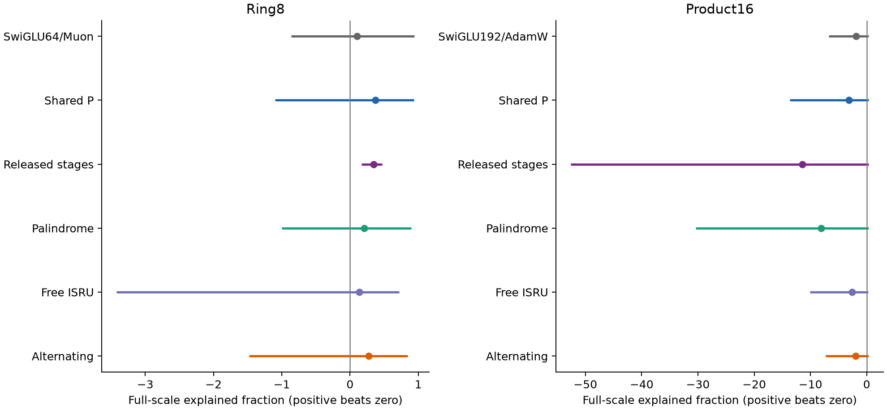
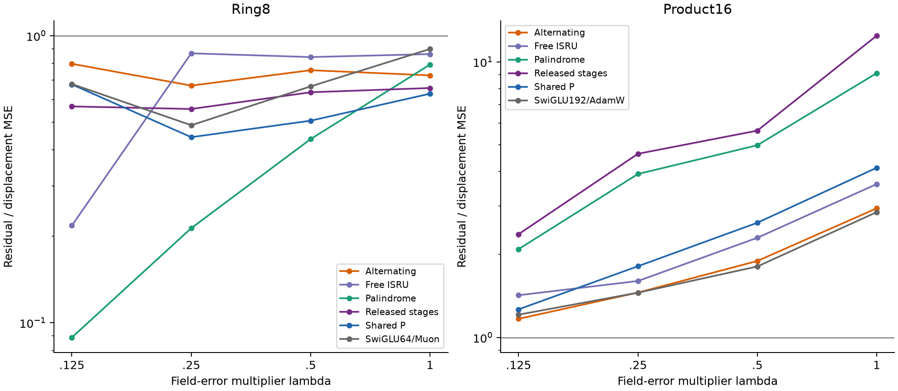

# Refined error-transport calibration

**12/12 models meet every numerical gate. At the trained error
scale, the linear endpoint prediction beats zero displacement for
6/12 qualified point estimates; 1/12 have
positive lower adjusted conditional input intervals.** Every ordinary control
and unresolved numerical outcome remains included.

## Purpose and method

Test whether propagating the learned velocity error along the exact oracle
trajectory predicts the observed model-minus-oracle endpoint displacement.
This is the necessary calibration before interpreting the propagation as a
generation mechanism. It uses every original256source per20kcheckpoint,
32from each of eight banks, without training or changing hidden integration.

The exact local sensitivity equation is z'=J_v* z+(v_model-v*), along the
oracle path, with z(0)=0. Compare z(1) with the actual endpoint difference
delta. The primary quantity is F=1-MSE(delta-z)/MSE(delta). Positive Fbeats
predicting zero displacement. Fis not an explained fraction of SW2orFID.

| Task | Model | Steps | Qualified | Displacement MSE | Residual MSE | Explained fraction | Adjusted conditional interval | Change from1024 |
|---|---|---:|---|---:|---:|---:|---|---:|
| Ring8 | Alternating | 4096 | yes | 0.015 | 0.011 | 0.273 | [-1.477, 0.841] | -0.001 |
| Ring8 | Free ISRU | 4096 | yes | 0.010 | 0.009 | 0.137 | [-3.420, 0.721] | -0.000 |
| Ring8 | Palindrome | 4096 | yes | 0.007 | 0.006 | 0.207 | [-0.997, 0.895] | -0.001 |
| Ring8 | Released stages | 8192 | yes | 0.017 | 0.011 | 0.343 | [0.167, 0.467] | -0.005 |
| Ring8 | Shared P | 8192 | yes | 0.010 | 0.007 | 0.372 | [-1.096, 0.935] | 0.001 |
| Ring8 | SwiGLU64/Muon | 4096 | yes | 0.018 | 0.016 | 0.101 | [-0.859, 0.944] | -0.000 |
| Product16 | Alternating | 4096 | yes | 0.111 | 0.326 | -1.941 | [-7.320, 0.327] | 0.012 |
| Product16 | Free ISRU | 8192 | yes | 0.131 | 0.472 | -2.602 | [-10.103, 0.274] | 0.013 |
| Product16 | Palindrome | 4096 | yes | 0.122 | 1.110 | -8.097 | [-30.407, 0.332] | -0.007 |
| Product16 | Released stages | 4096 | yes | 0.110 | 1.371 | -11.443 | [-52.583, 0.321] | -0.015 |
| Product16 | Shared P | 4096 | yes | 0.106 | 0.439 | -3.128 | [-13.648, 0.361] | -0.018 |
| Product16 | SwiGLU192/AdamW | 8192 | yes | 0.106 | 0.302 | -1.849 | [-6.753, 0.323] | 0.000 |

Points are the complete fixed-source results. Bars jointly resample the
residual and displacement energies across eight input banks, using the exact
registered bootstrap and nominal twelve-contrast adjustment. Grey crosses,
if present, remain numerically unresolved and support no approximation verdict.

Below the horizontal line, the linear prediction beats zero. These are the
same sources at each multiplier, not independent training repeats. Good
small-error behavior cannot replace the decision at lambda=1.

## Precision and provenance

The original1024cap and its unresolved rows remain untouched. This separately
registered extension reuses those arrays and computes2048/4096, then8192only
when needed. Every endpoint, oracle and tangent component must satisfy
atol1e-4/rtol1e-3; full-scale Fmust change by at most.01between final levels.
Passing a global RMSalone is insufficient. All available fine-grid native
lambda1endpoints and nine-time paths agree exactly with the independent
native-only qualification. Packed execution changes only batching.

All twelve native cases and twelve NumPyverifiers exit0. Independent summary
error is at most2.13e-14. COMPLETEand
bindings retain every source, raw array hash, frozen source and actual exit.

## Decision

Interpret positive and nonpositive outcomes model by model, and interpret
unqualified rows as unresolved. A positive prediction identifies a useful
source-coupled error approximation; it does not identify an ODE-specific gain.
The Gaussian rotation control already shows that paired displacement can
change while the law remains fixed. Original large-bank native SW2and ordinary
controls therefore remain the generation evidence. Any next mechanism test
must connect timing/direction of transported error to distribution-relevant
changes and retain those controls. No new architecture is promoted here.

## Claim candidates

- Claim: first-order transport predicts trained-scale endpoint displacement.
  - Evidence: every qualified model's F, numerical gates and bank intervals.
  - Allowed wording: model-specific positive or nonpositive prediction benefit.
  - Forbidden stronger wording: linear theory explains generation quality across models.
  - Uncertainty: conditional input-bank intervals; source coupling is fixed.
  - Next check: distribution-relevant transport for models where the approximation is useful.
  - Decision: retain model-specific outcomes.
- Claim: ODE structure provides a general generation advantage.
  - Evidence: not established by this fixed-weight observer.
  - Allowed wording: continuous sensitivity is a diagnostic shared by all models.
  - Forbidden stronger wording: positive Fdemonstrates ODE architecture superiority.
  - Uncertainty: ordinary controls can also have positive F.
  - Next check: a separately registered matched causal intervention.
  - Decision: not established.
