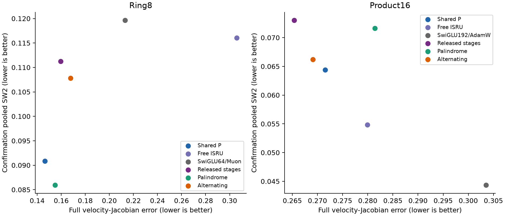
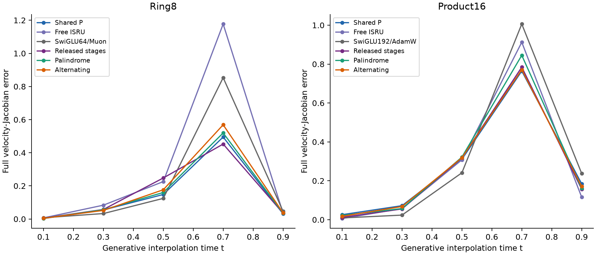

# Frozen target-geometry observation

**The registered point direction holds on both tasks, but both conditional input-bootstrap intervals span zero. The association remains unresolved at this selection budget.**

## Question and unit

The prior matched schedules improve sampling in opposite task directions.
This observation asks whether full output response error reproduces that pattern.
All twelve existing20k checkpoints are retained. Each uses128 common selection
source/target pairs at five fixed times:640 interpolation states. Training is
seed0. The twelve checkpoints are six model/settings per task, not twelve
independent training replicates. The ordinary controls retain their documented
optimizer settings. These synthetic velocity MLPs are not the image JiT model.

## Registered primary comparison

Full J error is mean ||J_v-J_v*||_F²/d, equally weighted across points and times.
Difference is palindrome minus alternating. Sampling scores come from the
existing common-bank confirmation cohort; no samples were regenerated here.

| Task | Palindrome J error | Alternating J error | Difference | Expected sign | SW2 difference |
|---|---:|---:|---:|---|---:|
| Ring8 | 0.155 | 0.168 | -0.013 | negative | -0.022 |
| Product16 | 0.281 | 0.269 | 0.012 | positive | 0.005 |

## Complete context

| Task | Model | Field MSE | Full J error | Image skew energy | Negative symmetric energy | Pooled SW2 |
|---|---|---:|---:|---:|---:|---:|
| Ring8 | Shared P | 0.009 | 0.146 | 0.001 | 0.000 | 0.091 |
| Product16 | Shared P | 0.019 | 0.272 | 0.003 | 0.001 | 0.064 |
| Ring8 | Free ISRU | 0.010 | 0.306 | 0.002 | 2.473e-06 | 0.116 |
| Ring8 | SwiGLU64/Muon | 0.012 | 0.213 | 0.001 | 0.000 | 0.120 |
| Product16 | Free ISRU | 0.015 | 0.280 | 0.003 | 2.087e-05 | 0.055 |
| Product16 | SwiGLU192/AdamW | 0.016 | 0.304 | 0.003 | 1.143e-04 | 0.044 |
| Ring8 | Released stages | 0.010 | 0.160 | 0.002 | 0.000 | 0.111 |
| Product16 | Released stages | 0.018 | 0.265 | 0.003 | 5.121e-05 | 0.073 |
| Ring8 | Palindrome | 0.009 | 0.155 | 0.002 | 0.000 | 0.086 |
| Ring8 | Alternating | 0.009 | 0.168 | 0.002 | 0.000 | 0.108 |
| Product16 | Palindrome | 0.021 | 0.281 | 0.004 | 2.801e-04 | 0.072 |
| Product16 | Alternating | 0.019 | 0.269 | 0.003 | 1.236e-04 | 0.066 |

Each point is an existing trained checkpoint, with no fitted regression line.
Read the matched schedule pair first. Cross-family locations are descriptive
and do not isolate architecture from optimizer or capacity. Image skew and
negative symmetric energy concern J_m=I+(1-t)J_v; eigenvalues are of sym(J_m),
not singular values or eigenvalues of an arbitrary nonsymmetric Jacobian.
On Product16, SwiGLU has the best sampling here despite the highest average
Jacobian error. Therefore this metric does not provide a general cross-model
ranking, even though the two focal point directions agree.

The time profile retains every registered slice. It can locate response errors
but cannot override the equal-time primary decision. These are interpolation
states, not generated trajectories, so this observation cannot establish which
errors actually accumulate along sampling paths.

## Verification and resulting action

Native predictions, restored runtime buffers, FP64 conversion, central-difference
JVPs, batch separability and unchanged tensors all pass for twelve models.
Separate NumPy reconstruction agrees within 1.11e-16.
See native-rows.json for all bindings and actual precision errors. Native oracles
and mathematical counterexamples are checked separately before this observation.

The next design decision must address the full task, not an internal spectrum
proxy. A failed primary association redirects measurement toward trajectory-
weighted error and mean bias; a passed association first needs a matched causal
intervention. Neither outcome alone promotes another architecture to CelebA.

## Claim candidates

- Claim: the exact Bayes target supplies a measurable whole-output response.
  Source: derivation.md and the native oracle checks. Decision: keep.
- Claim: lower average output-Jacobian error explains the schedule sampling gap.
  Source: the registered paired table above. Decision: unresolved association; confirm on independent inputs.
- Claim: hidden ODE structure provides a general image-generation benefit.
  Source: absent in this observation. Decision: unsupported; no image promotion.
