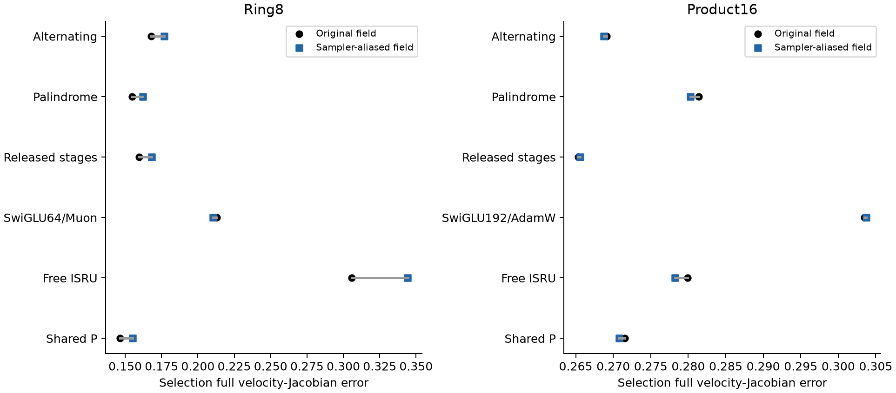
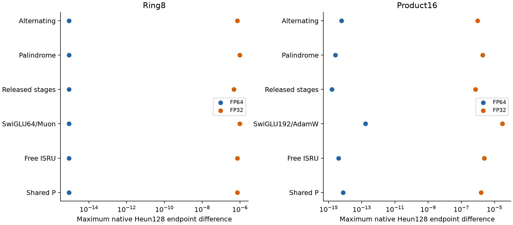

# Temporal aliasing in the existing synthetic model

**The previously used dyadic sampling checks cannot distinguish two different
continuous fields constructed from each existing checkpoint.** This is a
measured numerical blind spot, not a new architecture or a demonstration that
all earlier sampling differences were caused by aliasing.

## Purpose and exact construction

The native time embedding includes frequency1000.000122cycles/unit t. Replace
only this nonpersistent buffer value by-23.999878, leaving every weight fixed.
At Heun stages t=i/N for Ndividing1024, the two phases differ by an integer
multiple of2*pi. Their sine/cosine features and entire network functions agree
there in exact arithmetic. Checks at128/256/512/1024therefore share this blind spot.

All twelve checkpoints retain their source/config/data bindings. Each uses
1025grid predictions, all4096cached continuous-time field pairs, sixteen native
Heun128source endpoints and the original128-pair/five-time selection Jacobians.
Both FP32andFP64are checked. The frequency and all tensors are restored exactly.

| Task | Model | Original J error | Alias J error | Off-grid change / fit RMS | FP64 endpoint max | FP32 endpoint max |
|---|---|---:|---:|---:|---:|---:|
| Ring8 | Shared P | 0.146 | 0.155 | 0.130 | 8.882e-16 | 7.153e-07 |
| Product16 | Shared P | 0.272 | 0.271 | 0.070 | 7.383e-15 | 1.550e-06 |
| Ring8 | Free ISRU | 0.306 | 0.344 | 0.100 | 8.882e-16 | 7.153e-07 |
| Ring8 | SwiGLU64/Muon | 0.213 | 0.210 | 0.117 | 8.882e-16 | 9.537e-07 |
| Product16 | Free ISRU | 0.280 | 0.278 | 0.071 | 3.997e-15 | 2.384e-06 |
| Product16 | SwiGLU192/AdamW | 0.304 | 0.304 | 0.059 | 1.652e-13 | 3.016e-05 |
| Ring8 | Released stages | 0.160 | 0.168 | 0.154 | 8.882e-16 | 4.768e-07 |
| Product16 | Released stages | 0.265 | 0.266 | 0.063 | 1.554e-15 | 7.153e-07 |
| Ring8 | Palindrome | 0.155 | 0.162 | 0.120 | 8.882e-16 | 9.537e-07 |
| Ring8 | Alternating | 0.168 | 0.177 | 0.140 | 8.882e-16 | 7.153e-07 |
| Product16 | Palindrome | 0.281 | 0.280 | 0.066 | 2.554e-15 | 1.907e-06 |
| Product16 | Alternating | 0.269 | 0.269 | 0.069 | 5.884e-15 | 9.537e-07 |

## Observations

FP64grid predictions agree within5.15e-14, and native
endpoints within1.65e-13. FP32endpoint differences
are at most3.02e-05. The off-grid velocity
change is0.059--0.154of each model's oracle-fitting RMSerror.
This measures learned use of the feature rather than inferring use from its
presence. Raw off-grid fitting MSEs remain in rows.json.

For Ring8Free ISRU, the measured selection Jacobian error changes0.306->0.344
while FP64native endpoints remain the same to numerical rounding. The focal
palindrome/alternating ordering does not reverse under this intervention.
Thus the earlier spatial association remains an observation, but cannot alone
identify a continuous-field cause of the sampler's output.

The construction is exact over real arithmetic. Finite FP32/FP64differences
are reported separately, not called bit-identical. The endpoint witness uses
sixteen sources per checkpoint; the algebra, not a sixteen-sample performance
estimate, explains the shared-grid identity. No new SW2orFIDis claimed.

## Consequence and next action

Keep all original fixed-grid sampling scores. Restrict earlier outer-resolution
claims to the tested dyadic grids. The separate256-source sensitivity calibration
also remains numerically unresolved at its1024cap, so it cannot yet establish
whether the linear transport explanation works. The alias construction does not
prove that this one frequency causes those failures.

Next qualify native fields on non-dyadic and above-bandwidth grids before a
continuous-flow interpretation. Keep weights, hidden integration, source arrays
and ordinary controls fixed. Do not introduce an activation, optimizer or new
training recipe to repair a numerical explanation.

## Verification and claim scope

The fresh documented native and independent NumPy commands exit0/0. Independent
summary reconstruction agrees within2.78e-16; raw hashes and all
twelve cases are retained. No across-model significance test is needed for this
deterministic construction. It does not establish training reliability, general
generation improvement or an ODE-specific advantage.
