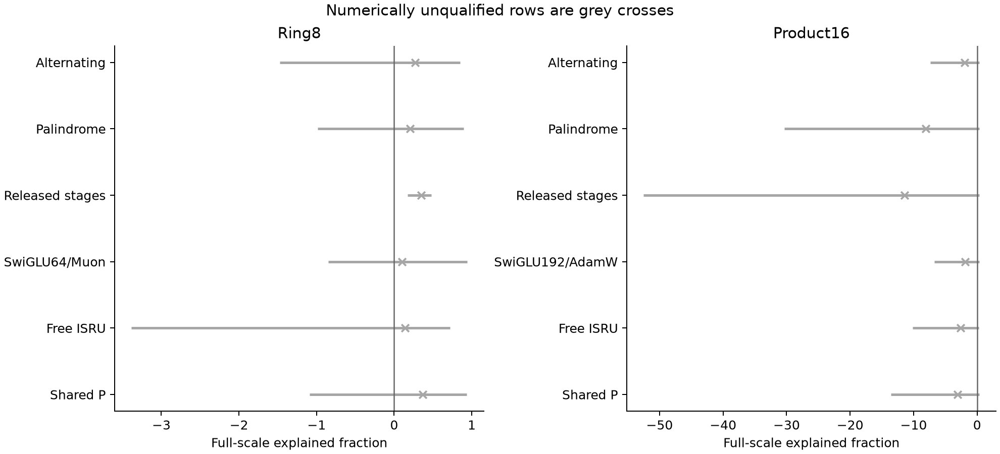
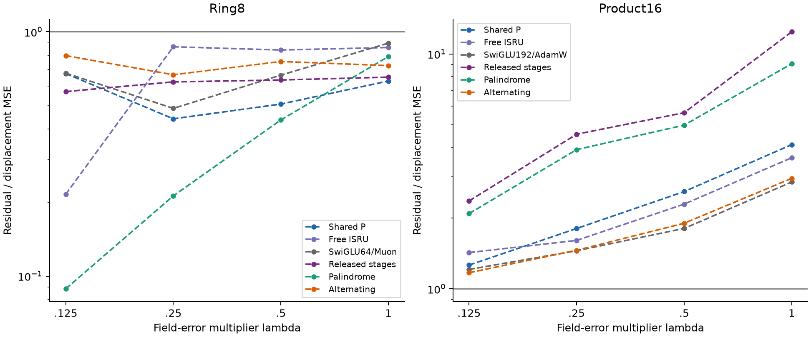
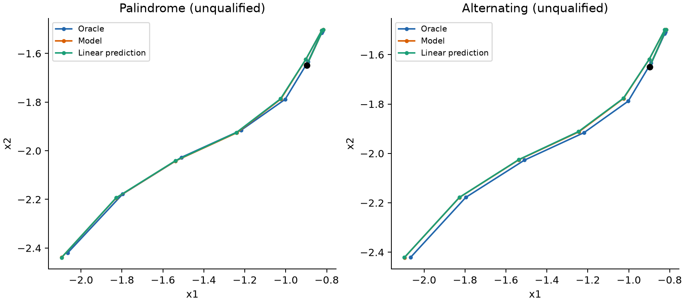

# Transported-error calibration

**0/12 models qualify numerically; keep the others unresolved before interpreting the approximation.** 0/12 have a positive lower adjusted conditional
input interval. This calibrates an approximation, not a new architecture.

## Question and primary quantity

For each existing20kcheckpoint, transport its velocity error along the oracle
path with z'=J_v*z+e. Compare z(1) with the actual model-minus-oracle endpoint
delta from the same source. Explained fraction is1-MSE(delta-z)/MSE(delta):
positive beats predicting no displacement; zero ties that prediction; negative
is worse. All twelve models retain all256sources,32from each of eight fixed
selection banks. Field multipliers.125/.25/.5/1share those sources and weights.
These are synthetic velocity MLPs, not image JiTmodels or training replicates.

| Task | Model | Heun steps | Qualified | Displacement MSE | Remainder MSE | Explained fraction | Adjusted conditional interval |
|---|---|---:|---|---:|---:|---:|---|
| Ring8 | Shared P | 1024 | no | 0.011 | 0.007 | 0.371 | [-1.090, 0.932] |
| Ring8 | Free ISRU | 1024 | no | 0.010 | 0.009 | 0.138 | [-3.386, 0.721] |
| Ring8 | SwiGLU64/Muon | 1024 | no | 0.018 | 0.016 | 0.102 | [-0.852, 0.942] |
| Ring8 | Released stages | 1024 | no | 0.017 | 0.011 | 0.348 | [0.171, 0.478] |
| Ring8 | Palindrome | 1024 | no | 0.007 | 0.006 | 0.208 | [-0.987, 0.895] |
| Ring8 | Alternating | 1024 | no | 0.015 | 0.011 | 0.273 | [-1.477, 0.847] |
| Product16 | Shared P | 1024 | no | 0.106 | 0.437 | -3.110 | [-13.571, 0.361] |
| Product16 | Free ISRU | 1024 | no | 0.131 | 0.474 | -2.615 | [-10.149, 0.274] |
| Product16 | SwiGLU192/AdamW | 1024 | no | 0.106 | 0.301 | -1.849 | [-6.749, 0.322] |
| Product16 | Released stages | 1024 | no | 0.110 | 1.369 | -11.428 | [-52.519, 0.321] |
| Product16 | Palindrome | 1024 | no | 0.122 | 1.109 | -8.090 | [-30.373, 0.333] |
| Product16 | Alternating | 1024 | no | 0.111 | 0.328 | -1.953 | [-7.366, 0.327] |

Bars are conditional bank-bootstrap intervals adjusted over the twelve-model
family. Unqualified rows stay visible and do not support an approximation claim.
All original levels, banks and values remain in the bound numerical records.

Below the horizontal line, the linear prediction beats no displacement. A good
small-error result cannot replace the full-scale decision. The same input bank
is reused across multipliers, so these points are repeated measurements.

This is source0of bank0, chosen by index rather than the observed outcome. It
compares actual accepted states at nine registered times for the two focal
schedules. The black point is the source. It illustrates the approximation;
the table uses every source rather than this one example.

## Numerical and interpretation limits

Refinement starts128/256and stops only after all registered endpoint/tangent
and fraction-change gates pass, or at1024. The all-source nominal fraction
change is retained per model. Independent NumPy reconstruction differs by at
most2.66e-14. Both native tasks and both independent verifiers exit0.
Oracle JVPs, exact Gaussian solutions, native FP32anchors, FP64conversion and
discrete-tangent finite differences pass in the separate readiness bundle.

A positive explained fraction concerns a particular source-to-endpoint coupling.
It is notSW2and does not imply better generation: the Gaussian rotation control
changes paired endpoints while preserving the exact law. The preexisting
large-bank SW2and ordinary controls remain authoritative for generation.

## Decision

Keep all twelve outcomes model specific. If any numerical rows remain unresolved,
resolve them before claiming a failure of the linear theory. For qualified models
with useful full-scale predictions, a separate distribution-level transport test
is permitted by the prior protocol. Other models reject use of this first-order
approximation at their trained error scale. No new architecture or training
follows from a local Taylor expansion alone.

## Claim candidates

- Claim: this sensitivity equation predicts the learned field's endpoint error.
  Evidence: full-scale calibration and its numerical gates. Decision: model specific.
- Claim: smaller paired endpoint error guarantees lowerSW2.
  Evidence: no; the rotational-law control separates those objects. Decision: reject.
- Claim: these observations establish an ODE-specific generation advantage.
  Evidence: no matched architectural intervention here. Decision: not established.
