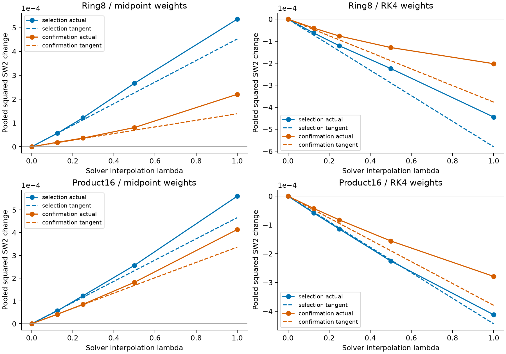
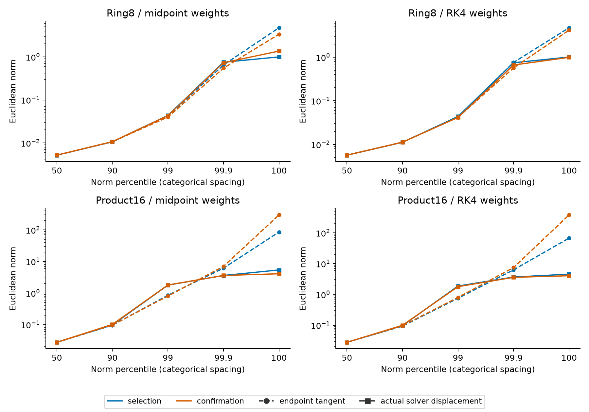
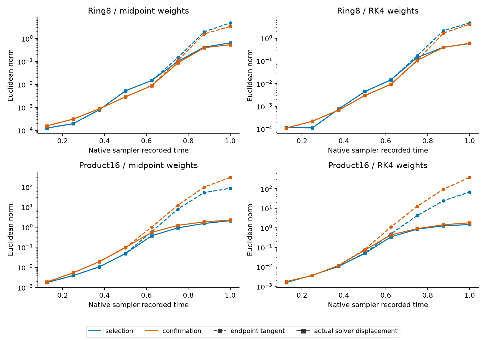

# Distributional response and particle sensitivity are different

The unfitted derivative of the target loss predicts the direction of all eight
pooled solver-substitution effects on fresh evaluation banks. It also beats a
zero-change prediction in every case. Individual endpoint prediction behaves
very differently: it is worse than zero displacement in seven cases, largely
because a few trajectories have very large local sensitivities.

This connects the measured solver perturbation to distribution quality. The
remaining ODE-specific question is whether the analytically derived local
defects can predict that perturbation and its useful distributional component.

## Controlled experiment

Keep four trained20k seed0 models, their weights and the native Heun128sampler
fixed. Substitute only the internal midpoint/RK4method, then interpolate the
resulting complete fields at lambda=.125,.250,.500,1.000. Each task has two
fresh evaluation streams, eight shared4096-source banks and256projections.
Differentiate the actual learned-field sampler and the same empirical squared
SW2functional. No coefficient is fitted to the observed outcome.

The scalar prediction is lambda*L'(0), with L=SW2squared. Its score below is
1-(prediction-actual change)^2/(actual change)^2. Endpoint score instead compares
lambda*u against the actual same-source displacement. Both scores compare
against zero change; they are not explained variance or confidence levels.

| Weights | Split | Native SW2 | Crossed SW2 | Scalar score | Endpoint score |
|---|---|---:|---:|---:|---:|
| Ring8 midpoint | selection | 0.076 | 0.080 | 0.976 | -0.539 |
| Ring8 midpoint | confirmation | 0.068 | 0.070 | 0.863 | 0.031 |
| Ring8 RK4 | selection | 0.076 | 0.073 | 0.908 | -1.393 |
| Ring8 RK4 | confirmation | 0.068 | 0.066 | 0.254 | -1.180 |
| Product16 midpoint | selection | 0.053 | 0.058 | 0.972 | -5.481 |
| Product16 midpoint | confirmation | 0.047 | 0.051 | 0.965 | -34.448 |
| Product16 RK4 | selection | 0.053 | 0.048 | 0.994 | -2.481 |
| Product16 RK4 | confirmation | 0.047 | 0.044 | 0.870 | -49.172 |

These fresh-bank scores are a within-model intervention. They must not be
ranked against ordinary models evaluated on the older bank streams.

The Product16RK4case reproduces the midpoint sampling benefit that the earlier
field-MSEforecast missed. Its scalar prediction remains useful at full scale,
although it overestimates the confirmation improvement. Across individual
banks, the corresponding squared-error scores are0.922and0.425. All16primary
banks improve; their adjusted mean-change intervals exclude zero. Complete
conditional paired-bank statistics are in summary.json and stats-appendix.md.

## What failed numerically, and what the independent check establishes

All eight native evaluators and eight independent reconstructions exit0.
Four bank-level target finite-difference checks fail their original epsilon1e-4
threshold; their flags and the original false primary decision remain in the
record. The sign/zero-predictor conditions themselves hold on both primary splits.

The complete72-bank/pooled derivative audit agrees with independent Torch
autograd within1.09e-18. Exact sorting corrections account for the finite-step
discrepancies: the fixed perturbations cross projection-order boundaries.
No sample or original threshold is changed. This resolves the derivative-code
question, rather than making the original registered Boolean result pass.

## Why an accurate scalar response does not predict each particle

Applying the exact metric to X0+u is not a better finite predictor on Product16.
For the RK4confirmationcase, the exact decomposition at lambda1is

    actual loss change                  = -2.789e-4
    linear loss prediction              = -3.795e-4
    actual loss - metric(X0+u)           = -3.240e-1
    metric(X0+u) - baseline - prediction = +3.241e-1

The last two signed terms nearly cancel. Thus a good scalar first variation
does not imply a small endpoint or target-functional remainder separately.
The [complete accounting](functional-remainder/analysis-report.md) retains
every case and all four intervention sizes; native Torch reconstructs all288
metric rows within4.45e-16.

The pooled Product16RK4confirmationcase contains32,768sources. Its median
tangent norm is0.028, close to the median actual displacement0.028. But one
source has tangent norm381.359 and actual displacement1.801. That source alone
contributes82.385%of tangent squared norm; the largest ten contribute97.072%.
No source is removed. This tail explains why mean squared particle prediction
can fail while most sample responses remain much smaller.

Each panel deliberately shows the maximum endpoint-tangent source on each
split, with all nine saved times. The Product16RK4confirmationexample grows
from tangent norm0.078at t=.5 to381.359at t=1; its finite displacement grows
from0.072to1.801. The original first64-per-bank derivative probes did not include
these eight extreme sources. Their actual local differentiability and sampler
resolution dependence are therefore the next targeted numerical check.

## Next decision

First verify those exact extreme trajectories at small perturbations and
nearby/finer outer resolutions, with median/probe controls. This distinguishes
genuine local amplification from a numerical derivative or time-resolution
effect. It does not add an endpoint-accuracy condition to the original scalar
test. Then test the ODE-derived forcing through the complete field and the
target functional; do not replace that target question with average field MSE.

The complete-model defect observer already passes independent algebra/JVP/FD
controls. Its CUDAimplementation agrees with CPU within2.23e-16primal and
2.17e-19tangent; a4096-input probe is about49xfaster than the same one-thread
145CPUcalculation, including transfers. No new architecture is promoted here.
