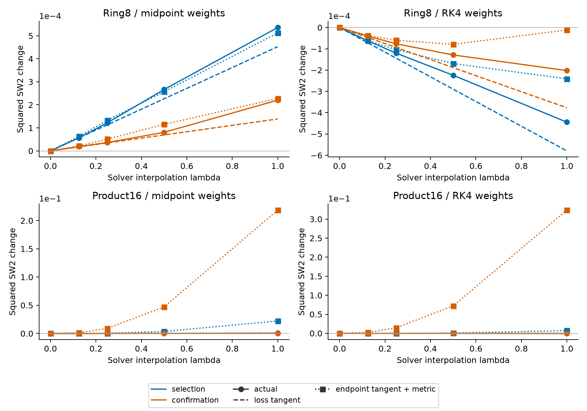
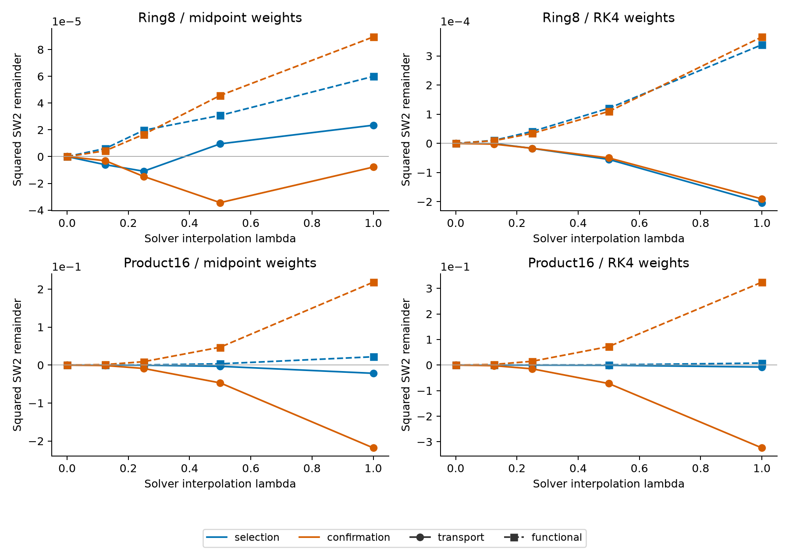

# Endpoint transport versus target-functional remainder

Complete secondary accounting of all four frozen cases, both splits and every bank. The original primary result remains False.

The dotted prediction applies the unchanged empirical target metric to X0+lambda*u. It uses no fitted coefficient. Comparison with the dashed loss tangent separates functional nonlinearity from trajectory nonlinearity.

Solid curves are target error due to endpoint linearization. Dashed curves are the exact functional remainder along the linearized endpoints, including sorting changes. Their signed sum equals the original loss-tangent error. No bank, direction or layer is selected.
