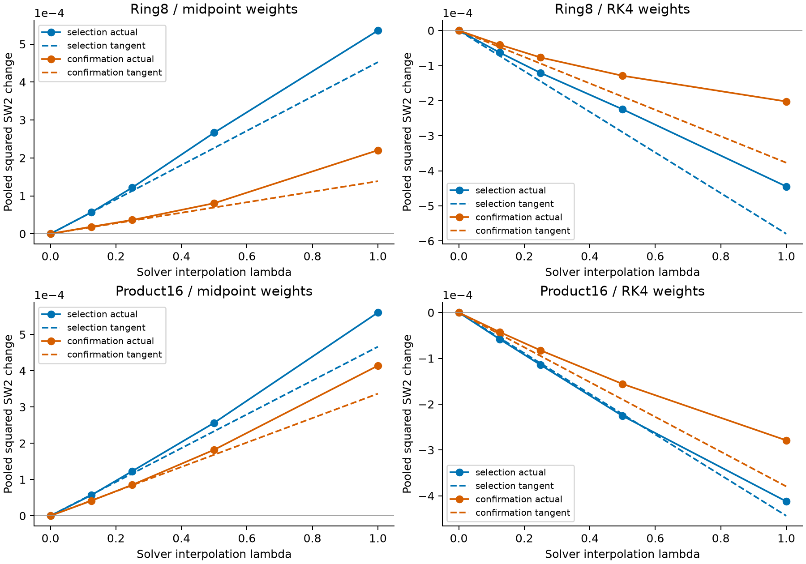
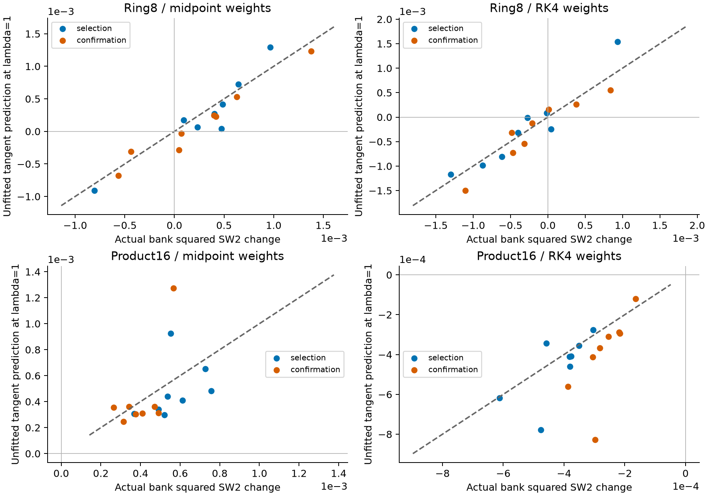

# Does the learned-field tangent explain the solver effect?

The unfitted learned-field tangent fails the registered primary full-scale explanation on at least one split. Keep the observed solver effect; reject this full-scale linear explanation.

All four frozen20k models, both new splits and every source are retained. No model was trained. Numerical calibration and target-quality explanation are separate.

Solid lines are actual pooled target-functional changes; dashed lines are the derivative prediction with no fitted scale. A small-lambda agreement cannot establish an explanation at lambda1.

| Case | Split | Native SW2 | Crossed SW2 | Predicted sign | Target fraction | Numerical |
|---|---|---:|---:|---|---:|---|
| ring_midpoint_trained | selection | 0.076 | 0.080 | correct | 0.976 | qualified |
| ring_midpoint_trained | confirmation | 0.068 | 0.070 | correct | 0.863 | qualified |
| ring_rk4_trained | selection | 0.076 | 0.073 | correct | 0.908 | qualified |
| ring_rk4_trained | confirmation | 0.068 | 0.066 | correct | 0.254 | qualified |
| product_midpoint_trained | selection | 0.053 | 0.058 | correct | 0.972 | unresolved |
| product_midpoint_trained | confirmation | 0.047 | 0.051 | correct | 0.965 | unresolved |
| product_rk4_trained | selection | 0.053 | 0.048 | correct | 0.994 | qualified |
| product_rk4_trained | confirmation | 0.047 | 0.044 | correct | 0.870 | unresolved |

Each point is one paired source/target bank. The diagonal denotes an exact full-scale prediction; the axes separate sign failures from magnitude failures. These banks are conditional evaluation draws, not independent model training runs.

## Claim candidates

- Claim: The registered primary full-scale transport account fails.
  - Evidence: Complete bank outputs, independent NumPy reconstruction, numerical gates and both pooled splits.
  - Allowed wording: The unfitted first derivative predicts, or fails to predict, these controlled same-weight solver changes.
  - Forbidden stronger wording: A general ODE-specific architecture advantage or image-generation improvement.
  - Uncertainty: Fixed learned weights, finite target samples and a local expansion.
  - Next check: Inspect whether finite solver interpolation needs nonlinear transport before replacing measured field changes by an ODE defect.
  - Decision: reject the full-scale linear explanation; preserve the discrete effect.
