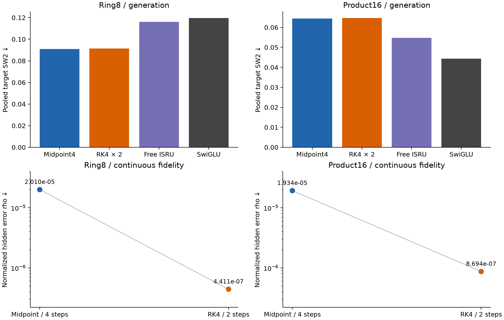
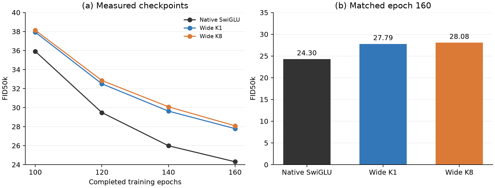

# ODE-FFN: experiment review through 17 November 2026

The project has not produced an ODE-FFN that consistently improves on native
SwiGLU. ISRU-D and state-dependent flows have useful synthetic results, but
those gains depend on the target distribution and comparison. On the qualified,
parameter-matched CelebA128 test, native SwiGLU leads K1 and K8 at every shared
checkpoint. The clearest mechanism result is that the hidden numerical solver
changes the learned output field in a quantitatively predictable way; greater
ODE accuracy alone does not improve generation.

This review organizes existing evidence. It does not modify finalized Reports
1 or 2, retrain models, or announce a new experiment. The
[complete ledger](experiment-ledger.md) retains the historical E001–E127
records and indexes later studies. [inventory.json](inventory.json) binds the
source documents by SHA256. Entries describe evidence families and analyses,
not independent training runs; multiple documents can describe the same run.

## 1. The question and the three different operators

The original idea replaces an unconstrained FFN with a transformation motivated
by a continuous hidden-state evolution. For a scalar entrance clock s(h), the
professor's original layer uses the truncated series

```text
F_K(h) = h + s(h) P h + s(h)^2 P^2 h / 2! + ... + s(h)^K P^K h / K!
```

P is shared across terms. With s held at its entrance value, the infinite
series is the solution of y' = P y at duration s. The matrix exponential
converges for every finite P. The issue is finite-order accuracy, amplification
and the derivative of the input-dependent clock, rather than a geometric-series
condition requiring eigenvalues below one.

Later work must distinguish two operators:

```text
Frozen-diagonal ISRU-D:
  d_i(h) = 1 / sqrt(1 + 1.2 h_i^2)
  A(h) = P diag(d(h))
  F_K(h) = sum_{k=0}^K A(h)^k h / k!
  D is computed once, at the layer entrance.

State-dependent hidden flow:
  dy/ds = P q(y),    q(y) = y / sqrt(1 + 1.2 y^2)
  q is recomputed at each numerical stage.
```

Their first-order increments agree, but their higher-order dynamics differ.
The image K1/K8 models use the first definition. Recent midpoint/RK4 synthetic
models use the second. Hidden evolution time s is distinct from the global
flow-matching time t. Calling both an ODE does not establish a useful
relationship between them and the image-generation dynamics.

Implementation: [image FFNs](../../../ffn.py),
[synthetic state flow](../../../studies/muon_pd_20261102/coefficient_20261116/state_trial.py),
[RK4 control](../../../studies/muon_pd_20261102/coefficient_20261116/rk4_trial.py).
The [mathematical comparison](../2026-11-16-ode-mechanism/mathematical-basis.md)
records the precise distinction.

## 2. What was tested, in research order

| Route | Purpose and interventions | Observation | What it tells us |
|---|---|---|---|
| Original P, clock and Taylor order | K1/K2/K4/K8; fixed, learned, input- and time-dependent clocks; spectral caps; P trajectories | Some early K2 wins over SwiGLU, but ordinary SiLU can win the same task; later matched studies do not show a general high-order benefit | Taylor order and a smaller P are hypotheses to test, not automatic advantages |
| Operator/controller design | Additive rates, DP/PD/sandwich placement, affine forcing, low-rank/augmented states, gate coordinates, identity placement and paired backbones | Improvements over weak ODE parents do not consistently beat ordinary controls; placement interacts with optimizer and task | PD(h) is an expressive design option, not an established improvement over s(h)P |
| Readout, objective and geometry | Full-gradient/conservative readouts, explicit adjoints, derivative orientation, teacher/frozen-feature probes, depth sharing, thin/thick manifolds and input-dependent frames | Full-gradient fitting and thin-manifold frames can help; ordinary controls explain substantial gains, and thicker targets change rankings | Output geometry and parameterization matter; these results do not isolate an ODE-specific benefit |
| Exact nonlinear flow and ISRU | Cubic-flow solution, ordinary Free ISRU, ISRU-D and checkpoint sampling audits | ISRU-D fits Ring8 well; ordinary ISRU nearly matches it and does better on Product16 | A bounded feature response explains part of the result |
| Muon and spectra | Official Muon, AdamW, norm-matched momentum, matrix decay, cold/frozen spectral flattening, update and weight ranks | Broad updates can coexist with poorly conditioned or lower-entropy-rank weights; shrinking/flattening P often hurts fitting | Update geometry, final weight spectrum and actual response covariance are different objects |
| Response and order screen | Eight responses crossed with K1/K8; shortlist checked on independent sample banks | Arctan K1 helps Ring8; no confirmed candidate wins both Ring8 and Product16 against SwiGLU | Response search did not yield a justified image candidate |
| ODE structure controls | Free Taylor coefficients, free step coefficients, shared versus stage-specific P, mean-preserving coordinates, stage-order/bracket controls | Shared P helps some synthetic comparisons; freeing Taylor/solver coefficients changes little; stage order helps one task and hurts another | Sharing is a useful constraint in this family, but accurate exponential/ODE coefficients are not its demonstrated source |
| Numerical mechanism | Midpoint versus RK4 at equal P work; hidden energy/direction, dimension controls, whole-field exposure, error transport and analytic modified-equation forecasts | RK4 is much more accurate internally without better generation; an unfitted ODE correction predicts whole-field changes | Solver bias has a measurable mechanism, but this has not become an architecture advantage |
| Image transfer and reproduction | Early CIFAR, partial CelebA64, author-derived CelebA128, widened K1/K8 and native baseline continuation | Early high-FID/partial runs cannot rank methods; the completed matched CelebA test favors native SwiGLU | Image evidence currently rejects promoting the tested frozen-D K8 as an improvement |

The older ledger also includes exact-ODE realizations of ordinary SwiGLU,
prediction-space bridges, dependent product laws, local regression and
implementation audits. Those records remain visible in the full ledger rather
than being presented as successful architecture trials. Archived ImageNet
configurations have no recovered completed-result binding.

## 3. Data and evaluation: which numbers are comparable?

Synthetic data are sampled from specified probability laws. Ring8 consists of
eight Gaussian modes on a circle; Product16 uses rotated independent bimodal
coordinates. Gaussian, Moons, thin/thick embedded manifolds and dependent-law
controls occur in earlier protocols. These targets allow oracle-field or
geometric diagnostics that image data do not provide.

Most recent mechanism studies train width-64, depth-3, time-conditioned velocity
MLPs for 20k updates. They are controlled FFN experiments, rather than the full
JiT image architecture. Image runs use the pinned, author-derived JiT trainer
and its image-prediction objective. Training remains seed 0 as requested.

- **Field MSE** measures oracle velocity fitting on the named input distribution.
- **SW2** measures generated-versus-target distribution discrepancy. Bank means
  and one pooled statistic are different estimands. Different bank streams
  create different comparison cohorts and are kept separate below.
- **Mode counts, gap mass and qualified joint density/KL** inspect failures that
  an average sliced discrepancy can hide.
- **Image FID50k** uses the recorded torch-fidelity protocol. The matched CelebA
  rows share EMA 0.9999, seed 0, native Heun50, CFG0 and the same reference.

Paired bank intervals in the source analyses describe sampling variation for
fixed trained weights. The review introduces no new significance tests or
cross-cohort ranking. Numerical qualification failures remain in their original
records, including later refinements that passed.

## 4. The decisive comparisons

### ISRU-D: a useful local result, not a cross-task winner

At 20k updates, the completed cycle-14 eight-bank comparison gives:

| Model and selected optimizer | Ring8 field MSE | Ring8 bank-mean SW2 | Product16 field MSE | Product16 bank-mean SW2 |
|---|---:|---:|---:|---:|
| ISRU-D / AdamW | 0.010 | 0.171 | 0.016 | 0.089 |
| Free ISRU / AdamW | 0.010 | 0.179 | 0.015 | 0.086 |
| SwiGLU64 / Muon | 0.011 | 0.171 | — | — |
| SwiGLU192 / AdamW | — | — | 0.016 | 0.084 |

ISRU-D's Ring8 MSE is 2.25% below Free ISRU before rounding. Its sampling is
essentially tied with the selected SwiGLU64/Muon control on this protocol.
Free ISRU and SwiGLU192 are stronger on Product16. The
[complete analysis](../../autoresearch/professor-20261103/cycle14-results-complete/analysis-report.md)
retains the bank deviations and all optimizer settings. This compares the
labeled configurations; it does not isolate optimizer effects.

The later response screen used a different cohort. Independent confirmation
gave arctan-K1 pooled SW2 0.126 versus SwiGLU 0.142 on Ring8, but 0.063 versus
0.040 on Product16. Softsign's attractive selection result did not enter the
fixed confirmation shortlist. [All K1/K8 responses and confirmation](../2026-11-15-response-screen/current-comparison.md).

### What the shared operator contributes

The stage-release study keeps the response and matrix work fixed and releases
one shared P into stage-specific operators. On that study's common banks:

| Model | Ring8 pooled SW2 | Product16 pooled SW2 |
|---|---:|---:|
| Shared P | 0.091 | 0.064 |
| Stage-specific P | 0.111 | 0.073 |
| Mean-preserving stage release | 0.104 | 0.072 |
| Free ISRU | 0.116 | 0.055 |
| SwiGLU | 0.120 | 0.044 |

Sharing helps the tested synthetic family with fewer parameters. Changing the
release coordinates recovers part of the Ring8 gap, so the first release
comparison also contains an optimization-coordinate effect. Product16 ordinary
controls remain better. The density follow-up does not show a shared-P joint-KL
advantage. [Sharing](../2026-11-16-ode-mechanism/sharing-results/analysis-report.md),
[coordinate control](../2026-11-16-ode-mechanism/coordinate-control/analysis-report.md),
[density](../2026-11-16-ode-mechanism/density-transport/population-analysis.md).

Releasing Taylor coefficients or midpoint stage coefficients does not produce
a material quality loss on the earlier matched cohort. Thus shared computation
is currently a more useful explanation than preserving exact exponential
coefficients. [Complete coefficient comparison](../2026-11-16-ode-mechanism/completed-comparison.md).

### Accurate hidden dynamics are insufficient

Replacing four midpoint steps by two RK4 steps uses the same parameters and
eight P applications per solve. Hidden solver error falls by 45.580x on Ring8
and 22.245x on Product16. Confirmation pooled SW2 is approximately
0.091 versus 0.091 on Ring8 and 0.064 versus 0.065 on Product16. The registered
prediction of better generation fails. [Matched solver training](../2026-11-16-ode-mechanism/rk4-results/analysis-report.md).



The figure separates a successful numerical intervention from its absent
generation benefit. This makes "more faithful ODE solution" an insufficient
justification for a new FFN design.

### CelebA128: native SwiGLU wins the completed matched comparison

| Epoch | Native SwiGLU | Wide ISRU-D K1 | Wide ISRU-D K8 |
|---|---:|---:|---:|
| 100 | 35.918 | 37.925 | 38.136 |
| 120 | 29.476 | 32.502 | 32.851 |
| 140 | 25.986 | 29.629 | 30.082 |
| 160 | 24.304 | 27.789 | 28.083 |

Native has 130,405,632 parameters; both widened ODE models have 130,402,560.
At epoch 160, K1 trails by 3.485 FID and K8 by 3.780. All three improve from
140 to 160; the table describes the matched training budget. Cross-device job
durations are not a speed comparison. The earlier smaller K8 also trailed
native at epoch 100, 43.908 versus 35.918.
[Completed matched results and source bindings](../../celeba128-wide-20261114/continuation-160/matched-results.md).



There is no current image evidence for an ODE convergence/FLOP advantage. The
earlier claim of matching baseline FID with 23% fewer total training FLOPs is
not supported by this completed comparison and should not be reused.

## 5. Answers to the professor's questions

**Muon and the spectrum.** We measured update stable rank, weight stable and
entropy ranks, condition numbers, and earlier checkpoint spectral trajectories.
For Product16 Free ISRU, Muon versus AdamW raises mean update stable rank from
4.567 to 32.776, while weight entropy rank falls from 55.547 to 43.789 and
condition number rises from 109.267 to 690.632. ISRU-D stable and entropy ranks
do not even move in the same direction. A high-rank update does not guarantee
a well-conditioned or more full-rank accumulated weight.
[Rank/condition measurements](../2026-11-15-professor-execution/spectrum-findings.md).

**Various PD(h) designs.** We tested scalar, DP, PD, sandwich, nonlinear and
affine controllers; raw, absolute and normalized diagonals; bounded responses;
and K1/K8. PD can outperform DP at one optimizer rate and lose at another.
Equal pointwise conditional spectra can accompany different feature responses.
The practical quantity is Pq(h), together with its input derivative, not only
the singular values of P or PD. [Placement/decay results](../../research-muon-pd-2026-11-02/wave2/results/findings.md),
[cycle map](../../autoresearch/professor-20261103/research-map.md).

**Ring8 rotational equivariance and mode imbalance.** An exact Ring8 velocity
field should be equivariant under 45-degree rotations. A frozen C8 projection
of each learned field markedly improves generated balance across ODE and
ordinary models. For ISRU-D, pooled SW2 changes 0.133 to 0.053 and sector L1
0.055 to 0.006 on that diagnostic cohort. Projection costs eight field calls.
The checkpoint analysis shows decreasing symmetric error can coexist with
increasing asymmetric error and worse generated balance. This explains a
Ring8 failure mode rather than establishing an ODE-specific cure.
[Symmetry and response results](../2026-11-15-professor-execution/findings.md).

**Is the ODE-derived ISRU response essential?** Scaled tanh gives comparable
results and can win some cells; arctan and softsign also help selected cases.
The eight-response screen confirms that ISRU is not necessary for these gains.
This answers the necessity question; it does not make any replacement a
cross-task winner. [Response screen](../2026-11-15-response-screen/analysis-report.md).

## 6. What the latest mechanism work actually adds

The work has moved beyond changing activations. It traces a concrete causal
chain with fixed weights:

```text
hidden numerical solver
  -> hidden-state error
  -> complete predicted velocity field
  -> transport of that change
  -> generated-distribution discrepancy
```

The hidden energy/direction analysis finds that tangential corrections explain
much of the local output response. A matched 63-dimensional null control
explains still more, so the claim of special tangential sensitivity fails.
Oracle-trajectory first-order endpoint prediction also fails as a general
trained-scale explanation. These controls prevent a geometric description from
being mistaken for a mechanism unique to ODE layers.
[Direction/null result](../2026-11-16-ode-mechanism/hidden-null-results/analysis-report.md),
[trajectory calibration](../2026-11-16-ode-mechanism/target-geometry/refined-trajectory-results/analysis-report.md).

The stronger positive result uses a modified-equation correction derived from
the hidden solvers. Propagating both solver defects through the unchanged
network predicts the complete field difference without fitting its scale.
Prediction scores are 0.957–0.983; both Product16 RK4 streams score 0.962, with
relative RMS error 0.196 and alignment 0.987. The score is one minus squared
prediction error relative to predicting no field change.
[Complete analytic-field test](../2026-11-16-ode-mechanism/learned-defect-field-results/analysis-report.md).

The corresponding **measured** generation effect survives outer-resolution
checks through Heun2048. With fixed Product16 RK4-trained weights, midpoint
inference changes pooled SW2 from 0.053 to 0.049 on selection and 0.048 to
0.045 on confirmation; all eight banks improve in each stream. Field MSE
worsens slightly. This is a same-weight solver effect, not evidence that this
architecture beats SwiGLU. [Complete population test](../2026-11-16-ode-mechanism/population-resolution-results/analysis-report.md).

Predicting the target-loss change from the **analytic** correction is less
complete. The finished Heun128 diagnostic has forecast scores 0.966/0.758 on
the two pooled streams, with one retained numerical failure among 16 banks.
The primary Heun2048 analytic test has only four completed selection banks;
the next four were canceled at the user's request. It has no final pooled
confirmation result. This must stay separate from the completed Heun2048
generation test above.

## 7. Disposition and current execution

Keep the original motivation, the useful shared-P result, the measured symmetry
failure, and the analytic connection between hidden solver bias and the output
field. Retire the claims that ISRU is essential, that smaller/flatter P is
automatically better, or that high-order accuracy already explains an image
advantage. Neither another response sweep nor an unchanged K8 image run has a
new evidence-based justification.

The next scientific decision, if the project is resumed, is whether a specific
ODE constraint predicts a repeatable generated-distribution improvement over
ordinary controls on the **same** banks and comparable compute. A successful
prediction of numerical behavior alone answers a different question.

Execution at this review's snapshot:

- Four owned 145 workers were terminated by SIGTERM. Their CUDA contexts are
  released; dispatcher 1477869 remains stopped and 104 unstarted tasks are
  blocked. Partial files are preserved. [Cancellation receipt](../2026-11-16-ode-mechanism/user-canceled-four-workers-20261117.json).
- Existing Mac mini CPU evaluations continue: all-source reference checks and
  ordinary controls on the current sample banks. Their full combined comparison
  is pending. No additional experiment was launched for this review.
- Subsequent synthetic work belongs on Mac mini. Autonomous research remains
  paused. [Read-only job snapshot](job-status.json).
- Reports 1 and 2 and the five native image files are unchanged.

## Artifact index

- [Full experiment/evidence ledger](experiment-ledger.md): original IDs, later
  purposes and observations, source links, completion status and evidence type.
- [Machine-readable inventory](inventory.json): original records preserved,
  later records, canonical analysis-source coverage and SHA256 bindings.
- [Verification](verification.json): source/link/protection checks for this
  review. These checks bind existing evidence; they do not rerun training.
- [Current project handoff](../../../STATUS.md) and
  [historical finalized Report2](../../../reports/report2/README.md).
