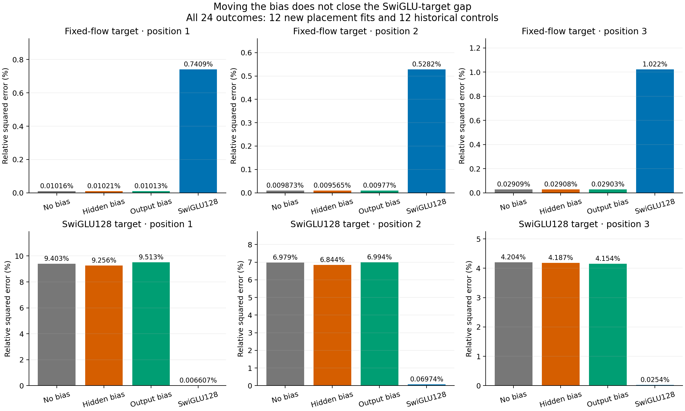
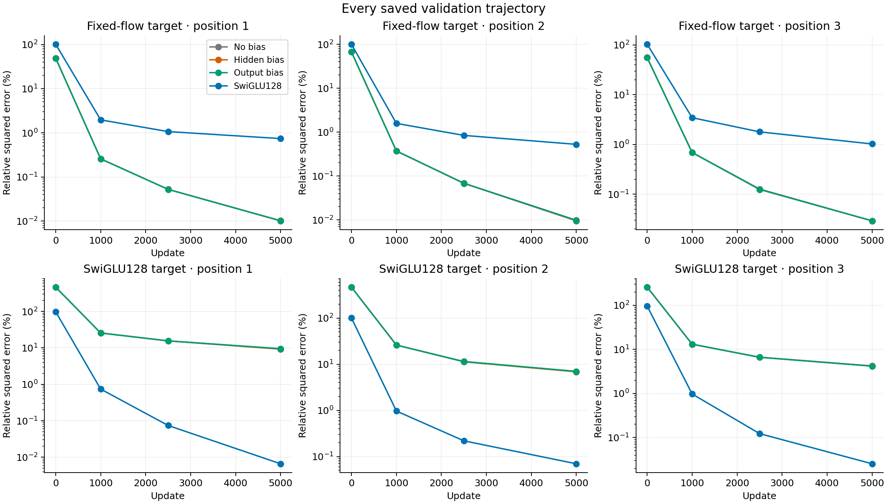
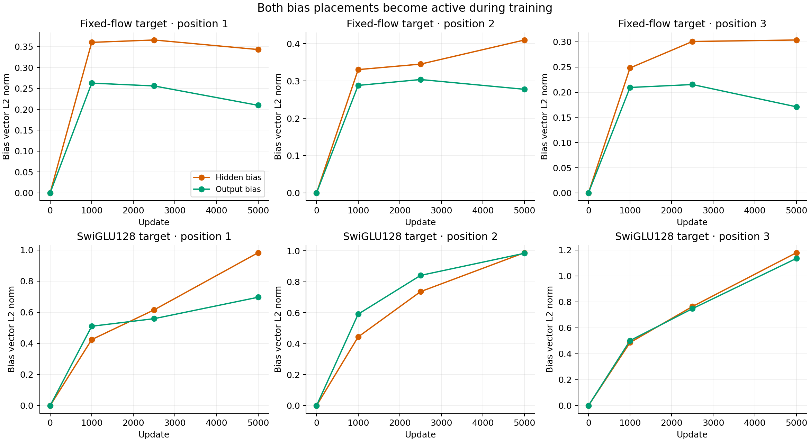

# Bias placement does not close the local fitting gap

Moving one 64-dimensional bias before SiLU changes the available nonlinear response, but does not materially recover the remaining SwiGLU-target gap. Both new placements become active during training. The registered substantial hidden-specific pattern fails at all three positions.

This follows the [P-versus-effective-matrix study](../research-effective-map-2026-10-26/analysis-report.md). The two new cores are `W2 SiLU(W1 h + b)` and `W2 SiLU(W1 h) + b`. Both start from the same W matrices and zero b, with bitwise identical initial values and input Jacobians to the historical no-bias core. The two placements have the same 8256 parameters and matrix work. Targets, actual inputs, update stream and budget are unchanged.

| Target | Position | No bias | Hidden bias | Output bias | SwiGLU128 |
|---|---:|---:|---:|---:|---:|
| Fixed flow | 1 | 0.010161% | 0.010209% | 0.010127% | 0.740879% |
| Fixed flow | 2 | 0.009873% | 0.009565% | 0.009770% | 0.528209% |
| Fixed flow | 3 | 0.029087% | 0.029075% | 0.029028% | 1.021723% |
| SwiGLU128 | 1 | 9.403121% | 9.255549% | 9.512743% | 0.006607% |
| SwiGLU128 | 2 | 6.978599% | 6.844170% | 6.994446% | 0.069739% |
| SwiGLU128 | 3 | 4.203729% | 4.186713% | 4.154163% | 0.025396% |

Entries are mean squared error divided by target energy, expressed as percentages, on all 20000 validation rows. They are neither relative RMS errors nor generative quality scores. The fixed-flow targets have explicit exact representers in all three SiLU cores. Representability of the unchanged SwiGLU targets in these smaller cores is unknown. Twelve placement fits are new; the no-bias and SwiGLU columns are twelve explicitly reused historical controls.

Hidden bias improves SwiGLU-target risk by only 1.57%, 1.93% and 0.40% relative to the no-bias risk. These are relative reductions, not percentage-point reductions. It is slightly worse than output bias at position 3. None reaches the registered 1% target-error threshold or halves both competing SiLU risks. The known-representer controls remain accurate, with no large placement-specific learning failure.

Derivative errors also remain large. Relative squared input-Jacobian errors for hidden bias are 2.8560, 1.5608 and 0.9185 on the three SwiGLU targets, versus 0.0211, 0.0130 and 0.0066 for the strong SwiGLU control. Complete absolute and relative quantities, all five time panels and all saved training windows are exported.

For example, at SwiGLU target position 2 the hidden bias reaches norm 0.9884 and the output bias 0.9846, while their risks remain 6.84% and 6.99%. Across all SwiGLU positions hidden-bias norms reach 0.983–1.179 and output-bias norms 0.697–1.135. Both vectors moved from zero; inactivity is not an explanation. All twelve new fits have zero clipping fraction in the final 500 updates, which describes that recorded window rather than the entire optimization history.

The algebraic distinction remains valid: `SiLU(u)-SiLU(-u)=u`, so a no-bias core and an output-biased core have a globally linear odd component; a hidden bias can break that identity. Actual common features are not assumed centrally symmetric. The negative fitting result weakens a movable-threshold account at this fixed width and budget. It does not prove a function-class lower bound, exclude all optimization effects, or authorize another affine-forcing rescue in the original ODE.

The two bias placements cost 8192 matrix MACs per example, or 4194304 at batch 512; their forward/backward batch-512 count is 10485760. The strong SwiGLU control has 16554 parameters and 8355840 forward MACs at batch 512. The equal-cost claim applies between placements; the SwiGLU reference is deliberately stronger, not parameter matched. Pointwise operations are excluded from these MAC counts.

All new training completed in 30.2 seconds with two one-thread Mac CPU children; no GPU was reserved. The independent audit completed in 10.6 seconds and passed native checkpoint, panel, derivative, matrix, offset and full consumed-stream checks. The [statistical scope](stats-appendix.md), [protocol](protocol.md), [decision](decision.json) and [next question](next-question.md) preserve the interpretation. This generic diagnostic establishes no new ODE method improvement.
