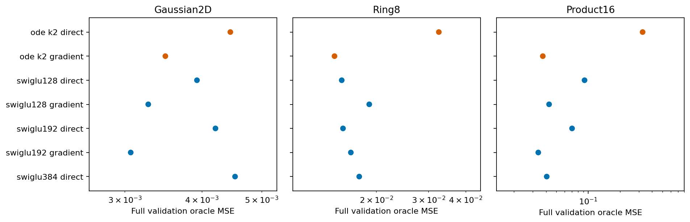
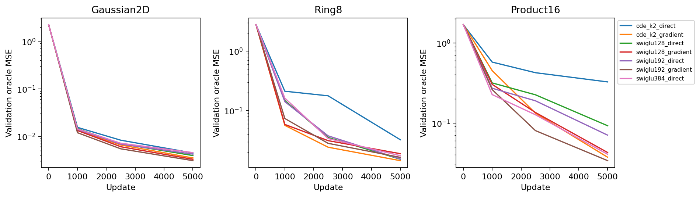
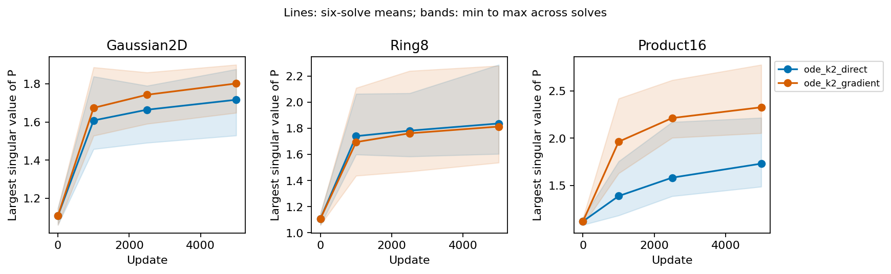

# A complete gradient readout substantially reduces the original ODE's deficit

Keeping the professor's two K2 solves and middle SiLU unchanged, the complete-field gradient readout reduces ODE field MSE by 55.5% on Ring8 and 88.5% on Product16. This is a substantial improvement over its direct-output parent. It does not yet establish an ODE advantage over the full generic frontier: the same readout gives SwiGLU192 a lower Product16 error, and Gaussian generation worsens.

The registered continuation rule fails. Preserve this evidence for understanding the useful derivative computation, while stopping this exact potential-readout setting without tuning or a longer-training rescue.

## One architectural factor, with its required controls

Let G be the original complete vector network. The direct arm predicts G. The gradient arm predicts

```text
Phi(x,t) = .5 * dot(x,G(x,t))
v(x,t) = grad_x Phi(x,t) = .5 * [G(x,t)+J_G(x,t)^T x].
```

Under the project's independent Gaussian-source path, the optimal conditional velocity is a potential gradient at each open time. This supplies a complete-field structural hypothesis. A symmetric hidden P would not ensure that property. The readout is a known energy-parameterization construction, not a new ODE method; primary sources and their negative training evidence are in [notes](../notes.md).

All backbones use the same cached-bank pair-velocity objective, draws, optimizer and 5000-update endpoint. ODE K2 and SwiGLU128/192 each receive direct and gradient readouts. A fixed direct SwiGLU384 accounts for the extra computation. The loss, original clocks, internal maps, SiLU and normalization are unchanged. Direct/gradient weights and raw initialization match; their parameter responses differ once differentiated. Initial zero outputs alone are not an NTK equivalence.

## Field fitting and the generic frontier

Full-validation oracle MSE, lower is better:

| Model | Gaussian2D | Ring8 | Product16 |
|---|---:|---:|---:|
| ODE K2 direct | .004449 | .032503 | .325527 |
| ODE K2 gradient | .003490 | .014462 | .037320 |
| SwiGLU128 direct | .003927 | .015296 | .092326 |
| SwiGLU128 gradient | .003274 | .018940 | .042770 |
| SwiGLU192 direct | .004208 | .015448 | .070423 |
| SwiGLU192 gradient | .003067 | .016419 | .033826 |
| SwiGLU384 direct | .004528 | .017522 | .040639 |



ODE's improvement is not solely a generic benefit shared on every task. On Ring8 the gradient readout improves ODE while worsening both smaller SwiGLU families. On Product16 it improves all three, with the larger relative reduction for ODE. Against the near-matrix-compute direct SwiGLU384, gradient ODE has lower Ring8 and Product16 error. However, gradient SwiGLU192 is still 9.36% lower than gradient ODE on Product16; equivalently, ODE is 10.33% higher. Its Ring8 improvement over the best generic is only 5.45%, below the fixed 10% continuation requirement.

The complete learning curves retain every logged validation point. On Product16, gradient ODE reaches .45034 at step1000 and .13246 at2500 before ending at .03732; the new computation improves fitting at the saved nonzero checkpoints. These are fixed-budget observations, not proof of convergence or a reason to extend a failed setting.



## Derivatives and generation do not tell the same story

| Model | Ring8 Jacobian error | Ring8 SW2 | Product16 Jacobian error | Product16 SW2 |
|---|---:|---:|---:|---:|
| ODE direct | 1.62537 | .27044 | 59.30564 | .12440 |
| ODE gradient | .46543 | .21702 | 8.89278 | .09317 |
| SwiGLU128 direct | .73685 | .22636 | 24.88991 | .09572 |
| SwiGLU128 gradient | .78263 | .23466 | 14.00507 | .09465 |
| SwiGLU192 direct | .54074 | .23355 | 19.88407 | .09271 |
| SwiGLU192 gradient | .70168 | .23422 | 11.47084 | .09993 |
| SwiGLU384 direct | .58930 | .22319 | 12.39043 | .10168 |

Gradient ODE has the best nonlinear Jacobian errors in this comparison and the best Ring8 SW2. Product16 SW2 is close to the best generic, rather than an independent generation advantage. Gaussian SW2 rises .07972→.09498, 23.0% above the best generic .07720; the other gradient families also worsen Gaussian sampling. Improved average field error therefore cannot replace the generation checks. No unmeasured endpoint/tail mechanism is asserted.

The Product16 case makes the mechanism boundary precise. The direct ODE's Jacobian error decomposes into symmetric error 58.81430 and skew error .49134. Skew accounts for only 0.83%. The gradient model's error is 8.89278, almost entirely symmetric, with numerical-zero skew. Merely deleting the old skew component while holding its symmetric part fixed could not explain this improvement. Training changed the learned symmetric response as well. Exact conservativity, derivative feature computation and changed parameter optimization remain competing explanations; this experiment does not isolate them.

## What P and the resource measurements show

On Product16, mean largest singular value across the six learned P matrices increases from 1.732 in direct ODE to 2.327 in gradient ODE, while field and Jacobian errors decrease substantially. The final ranges are 1.489–2.217 and 2.054–2.776. This further weakens a universal explanation based on shrinking raw P norms. It is not evidence that enlarging P causes the gain or is a useful intervention.



Lines average six actual matrices; bands span those matrices, not statistical uncertainty. The source and all singular/eigenvalue records are preserved. Ring8's final clipping fraction changes 100%→58.6%, but Product16 changes .6%→8.4%; improved fitting does not uniformly coincide with less clipping.

Product16 counts include the executed input differentiation:

| Model | Parameters | Velocity matrix MACs | Loss forward/backward matrix MACs |
|---|---:|---:|---:|
| ODE direct | 83,862 | 106,944 | 317,696 |
| ODE gradient | 83,862 | 183,104 | 545,152 |
| SwiGLU192 gradient | 108,624 | 182,336 | 542,848 |
| SwiGLU384 direct | 183,120 | 180,288 | 537,728 |

Gradient ODE adds 71.2% inference matrix work over its own parent. Its matrix counts are close to the two larger-work generic comparators, but equal matrix work is not equal latency. In the isolated initialization preflight, batch512 velocity evaluation took about3.19ms for gradient ODE,2.45ms for gradient SwiGLU192 and2.02ms for direct SwiGLU384. These are initial-function preflight timings, not final isolated performance claims. Concurrent full training intervals are around62/41 seconds for the first two on Product16 and cannot establish a precise hardware speed ratio.

## Decision and verification

The exact setting fails: Ring8 misses the10% field margin; Product16 and Gaussian field errors exceed their5% generic margins; Gaussian sampling also regresses. No potential variant, scale, distillation or longer continuation is selected. This does not erase the large ODE fitting gain, nor establish a new useful ODELayer. A distinct mechanistic question about the transpose-Jacobian computation is recorded in [next-question.md](../next-question.md).

Independent replay verifies all21 full fields and105 full input-Jacobian panels, all84 checkpoints, and36 exact direct-control historical model/optimizer/RNG states. Input streams are regenerated from the actual cached data. For gradient arms, a separate implementation explicitly constructs J_G and evaluates .5*(G+J_G^T x), rather than differentiating the scalar potential. Complete float64 fields/Jacobians agree to maxima9.10e-15/3.40e-14. All21 saved sample trajectories replay exactly; SW2 is independently recomputed in NumPy float64.

Mac mini ran two one-thread CPU workers, with39 telemetry snapshots, peak worker RSS355MiB and at least4.705GiB available memory. All training and analysis sessions are terminal. Lenovo remained offline. The source-v1 launch-interface error occurred before any formal run; the separately frozen v2 supervisor passed actual two-child smoke validation, and formal training launched once. The earlier source, preflight, all prior studies and submitted Report1 are preserved.
