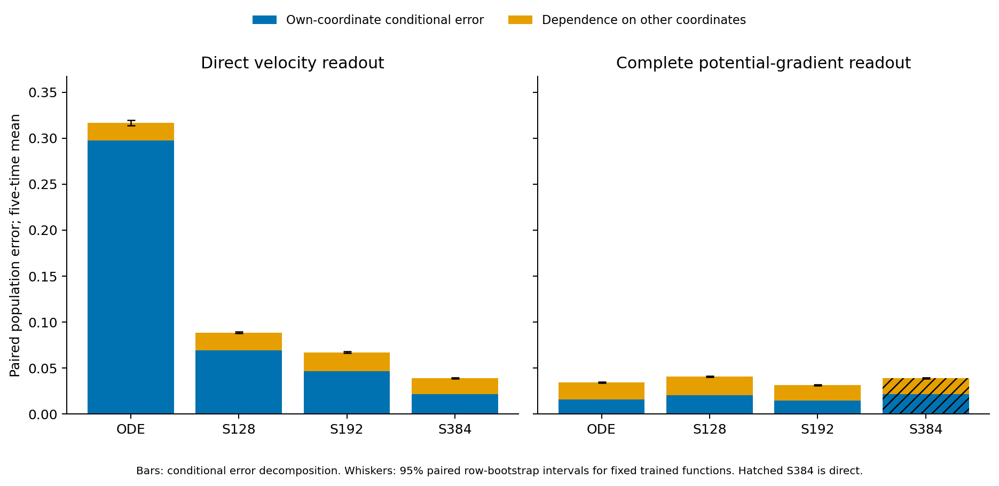
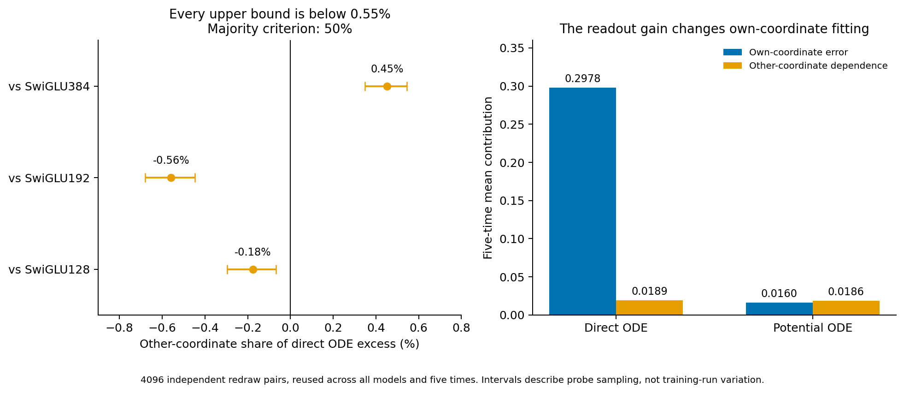

# The direct ODE misses the own-coordinate response

The Product16 deficit is not mainly caused by dependence on unrelated coordinates. Across three direct SwiGLU references, that dependence explains between−0.56% and0.45% of the direct ODE's excess population error. Every upper Monte Carlo interval bound is below0.55%, far below the declared50% majority criterion. The excess instead lies almost entirely in the conditional response to the coordinate that should determine each output.

This is a frozen-function diagnosis on new population probes, not a new trained method. The earlier architecture stopping decisions remain unchanged.

## A functional test rather than a local derivative test

In the known rotated coordinates of Product16, inputs are independent and the analytic oracle output i depends only on input coordinate i and time. For each fresh independent pair A,B, keep A_i and replace the other15 coordinates with B's values. This gives H_i with the same population law. Compare output i at A and H_i.

With errors eA,eH against the same oracle value, the row/output measurements are:

```text
T = (eA²+eH²)/2
C = eA*eH
D = (eA-eH)²/2
T = C+D.
```

In expectation, C is squared conditional-mean error given the own coordinate; D is conditional variance from all other coordinates. C includes nonlinear own-coordinate responses and bias, not just affine error. D also includes additive leakage, so it is broader than a higher-order interaction index. The oracle cancels from D: it can be computed from predictor differences alone.

All seven unchanged final Product16 models were evaluated on4096 independent row pairs at the five fixed times. Common draws pair models and times. The known rotation is used only in diagnostics. The35 old native float32 panels replay exactly; new evaluations use promoted float64 weights, with the potential readouts checked against explicit adjoints. The population independence used here does not hold for the exact conditional mean of the cached joint training bank.

## Main results

Five-time mean error contributions on the paired population probes:

| Predictor | Total T | Own-coordinate C | Other-coordinate D |
|---|---:|---:|---:|
| ODE direct | .316705 | .297768 | .018937 |
| SwiGLU128 direct | .088685 | .069347 | .019338 |
| SwiGLU192 direct | .067145 | .046815 | .020330 |
| SwiGLU384 direct | .039185 | .021503 | .017681 |
| ODE potential gradient | .034596 | .016003 | .018593 |
| SwiGLU128 potential gradient | .040470 | .020624 | .019846 |
| SwiGLU192 potential gradient | .031187 | .014819 | .016368 |

The direct ODE has similar D to all three generic references despite a much larger total error. For example, against SwiGLU192 its excess total is.249560, its excess C is.250953, and its excess D is−.001393. The negative difference is retained rather than forced into a percentage partition between0 and100.

| Direct reference | D share of ODE excess |95% paired Monte Carlo interval |
|---|---:|---:|
| SwiGLU128 | −.176% | [−.296%,−.067%] |
| SwiGLU192 | −.558% | [−.679%,−.448%] |
| SwiGLU384 | .452% | [.348%,.544%] |

These intervals describe probe-sampling uncertainty for the fixed functions. They do not measure training-run variation. Every reference rejects the operational majority-dependence explanation without changing coordinates, sample count or time selection.



## Case study: what the successful readout changed

The previously trained complete-potential readout takes ODE's C from.297768 to.016003, while D changes only from.018937 to.018593. About99.88% of this readout-associated risk decrease lies in C. This arithmetic is a post-result description, not a newly registered mechanism test.



Thus the earlier ODE readout gain is poorly described as suppressing unwanted coordinate mixing. It mostly changes how accurately the model represents the relevant conditional response. This is compatible with an effect of derivative features or optimization, but does not isolate either cause. The models co-adapted during their separate matched training runs.

There is also a useful limit: the remaining ODE-potential gap to SwiGLU192-potential is much smaller, and about65.3% of that particular positive gap lies in D. It cannot replace the primary direct-readout question or reopen the stopped potential study. ODE-potential is better than the other two listed references on this probe risk, which also does not override the original full quality/cost/transfer screen.

## Consequence for design

The raw-affine falsifier localized most direct ODE excess outside affine raw-input functions. This separate population experiment now localizes it to the own-coordinate conditional response rather than excess dependence on other coordinates. The two studies use different banks and decompositions; their percentages must not be multiplied or treated as one exact three-way partition.

A proposal justified only by reducing coordinate mixing or by making hidden P diagonal/symmetric is unsupported by the primary result. A more relevant question is whether the original layer's primal/adjoint computation can provide useful nonlinear response features locally, at the existing computation budget. A [separate mathematical note](next-question.md) defines one possible local construction and its essential generic controls; it selects no training and claims no performance or novelty.

Independent reconstruction verified every saved decomposition and all512 row-bootstrap resamples. The [appendix](stats-appendix.md), [figure catalog](figure-catalog.md), [full model table](means.csv), [time table](times.csv), [contrasts](contrasts.csv), and [registered protocol](protocol.md) preserve scope and provenance. The research goal remains active.
