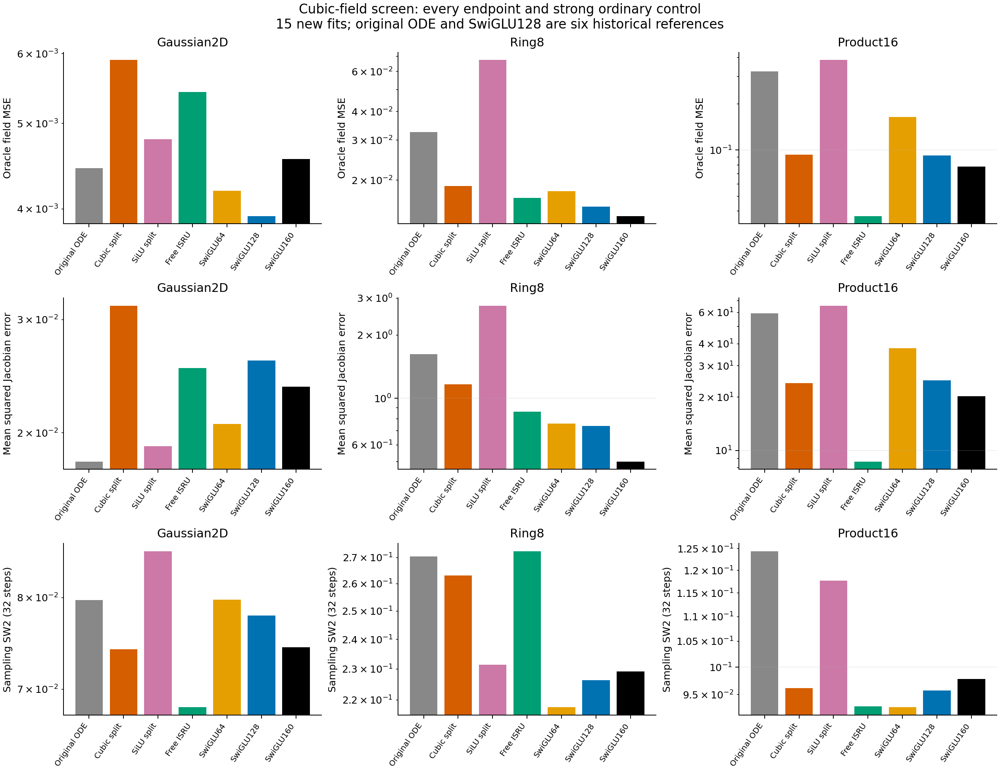
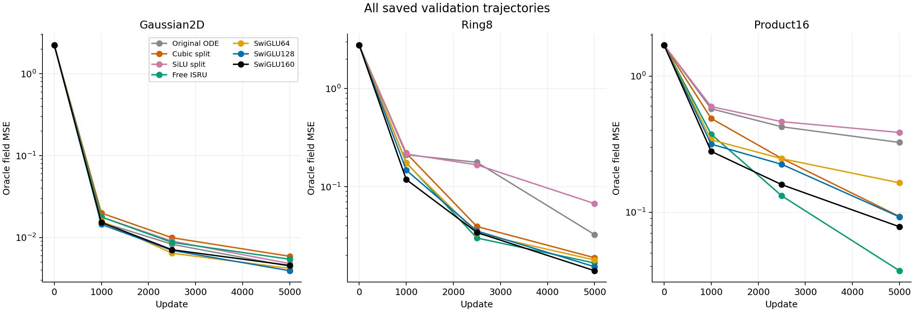
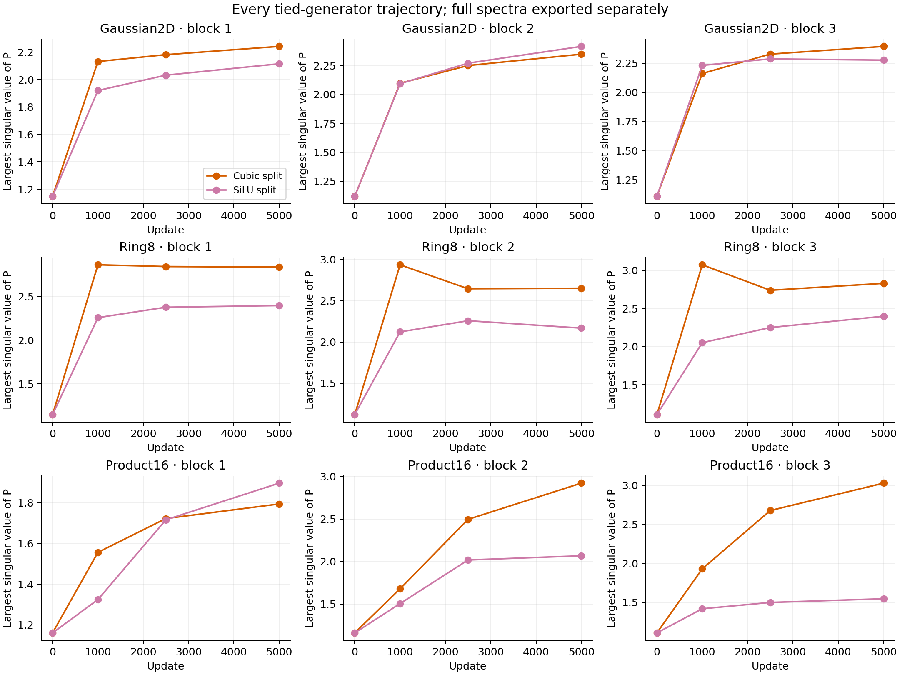

# A nonlinear local flow improves the old ODE but loses to ordinary controls

The registered cubic-field candidate fails its advancement rule. On Product16 it reduces oracle velocity-field MSE from the original ODE's0.325527 to0.092938, but the near-compute SwiGLU160 reaches0.078178. An ordinary free-matrix ISRU network reaches0.037159 with fewer parameters and matrix MACs. This last result is a useful nonlinear-response lead, not an ODE-specific gain.

The candidate approximates the endpoint of `y' = P y - y^3` using two tied linear half-flows around the exact cubic subflow. One original P/controller is retained per FFN; the scalar duration is selected at the input. The pointwise response is known ISRU. Its [mathematical derivation and prior art](prior-and-theory.md) distinguish continuous boundedness, finite-map consistency and actual prediction quality.

All15 new fits use the same seed0/native surrounding initialization, 5000 updates, batch512, pair-velocity FM loss, AdamW3e-4, weight decay0 and clip1. Six original-ODE/SwiGLU128 trajectories are historical references, verified and explicitly reused. The same input streams and evaluation banks are used throughout. Uniform-time field evaluation uses10000 rows on Gaussian/Ring8 and20000 on Product16.

| Model | Gaussian2D MSE | Ring8 MSE | Product16 MSE |
|---|---:|---:|---:|
| Original ODE, historical | 0.004449 | 0.032503 | 0.325527 |
| Cubic split | 0.005900 | 0.018883 | 0.092938 |
| Matched SiLU split | 0.004798 | 0.067334 | 0.385403 |
| Ordinary free ISRU | 0.005429 | 0.016694 | 0.037159 |
| SwiGLU64 | 0.004192 | 0.017904 | 0.164398 |
| SwiGLU128, historical | 0.003927 | 0.015296 | 0.092326 |
| SwiGLU160 | 0.004557 | 0.013921 | 0.078178 |

The candidate beats its parameter/work-matched SiLU composition on both nonlinear tasks, but is worse on Gaussian. It is41.9% below original ODE risk on Ring8 and71.4% below it on Product16. Neither improvement establishes practical superiority: relative to the best ordinary SwiGLU field risk, its ratios are1.50,1.36 and1.19 across the three tasks. All three field guards fail.

Derivative and sampling evidence also matter. Product16 mean squared Jacobian errors are24.0138 for the candidate,20.2263 for SwiGLU160 and8.6602 for free ISRU. On Ring8 the candidate's derivative error is2.33 times the best SwiGLU value, and its sampling SW2 is0.2632 versus the best ordinary SwiGLU's0.2177. On Product16, free ISRU's much lower field error gives only a small sampling difference,0.09290 versus SwiGLU64's0.09276. Field fitting and sample quality should not be equated. All105 time-panel records and all21 common-source sampling replays are retained.

For a concrete contrast, the candidate and SiLU split have exactly the same58899 full-network parameters and94464 forward matrix MACs per Product16 example. Changing their middle response yields a large fitting difference. Yet the ordinary free ISRU has58512 parameters and57408 forward MACs, and fits more accurately. This prevents attributing the gain to the generator coupling or to a numerically solved ODE. The free control also changes matrix independence and removes the adaptive clock; this comparison does not isolate the unique cause.

SwiGLU64 has58572 parameters and57024 forward MACs; SwiGLU160 has95820 and93888. Thus one controls the parameter budget and the other approximately controls forward matrix work. Pointwise arithmetic is excluded, and no cross-device latency claim follows from these counts.

The candidate's final P largest singular values are1.79,2.92 and3.03 across Product16 blocks, with mean durations0.933,0.733 and0.718. These finite spectra are not a stability certificate for the complete network or a causal explanation of the risk ordering. Its final-window clipping fraction is0.976; free ISRU's is0.980, while the poorer SiLU split's is0.000. Clipping is recorded for interpretation; the result does not select a clipping or learning-rate rescue.

The fixed setting stops. The ordinary ISRU result merits understanding, especially whether its Product16 advantage depends on this target family, initialization or independent feature maps. It is not yet a replacement ODE method, and its Gaussian/Ring8 deficits remain visible. No larger-order, duration, coefficient, width, stage or optimizer continuation is selected.

All training completed in160.6 seconds with two one-thread Mac CPU workers, using at most0.807GiB observed aggregate RSS in the sampled monitor. The independent audit passed in12.7 seconds, including native outputs/buffers, complete streams, saved matrices, full Jacobians and sampling. The [protocol](protocol.md), [decision](decision.json), [statistical scope](stats-appendix.md) and [figure catalog](figure-catalog.md) preserve the evidence. The useful original-ODELayer successor goal remains unachieved.
