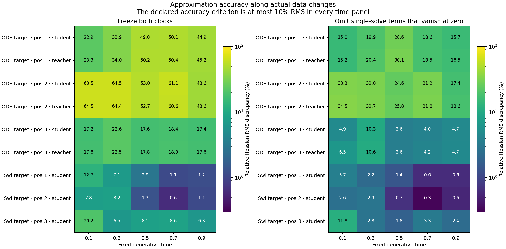
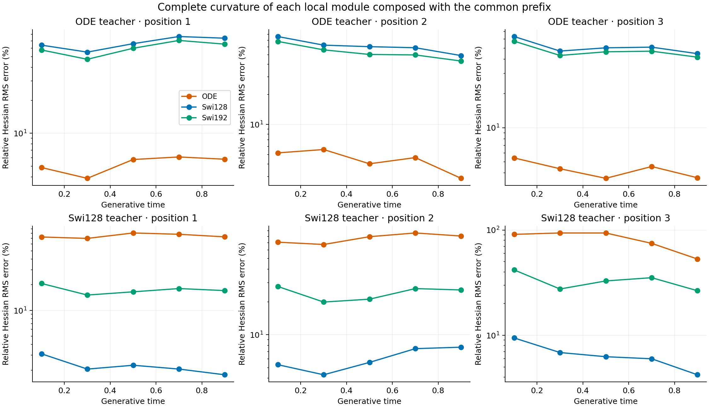
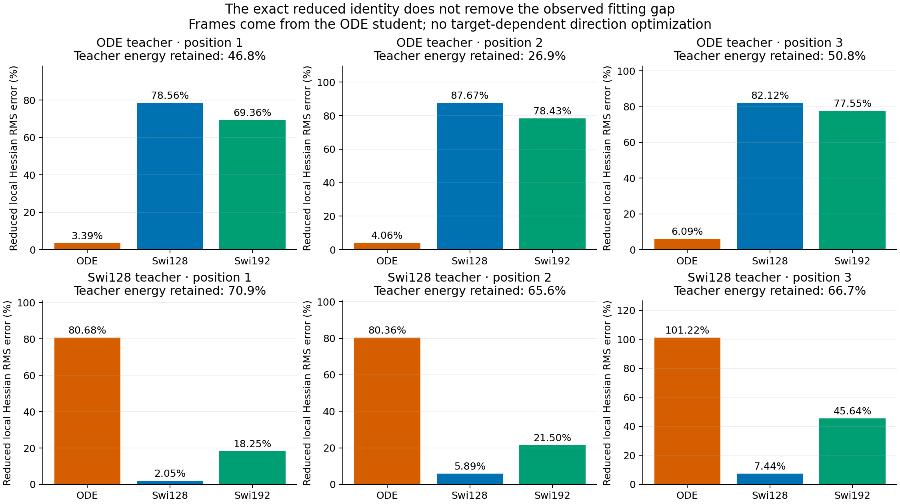

# Clock activity depends on the target; the reduced core retains the fitting gap

The original ODEFFN can learn substantial clock-dependent nonlinear behavior on its own teacher functions. On the SwiGLU targets, however, the learned clocks are often near their upper limit and contribute much less to the local curvature. Fixing those clocks globally to 1 changes the three fitted functions moderately and leaves the main fitting deficit. This narrows the next question to the polynomial linear-map parameterization versus the single-SiLU response family; it does not yet choose a replacement.

## Check the explanation where the data actually lie

The previous origin calculation was exact but did not establish relevance to normalized inputs. This diagnostic evaluates every final module from the [local-FFN study](../research-local-ffn-teacher-2026-10-26/analysis-report.md) along its common feature distribution. The physical input has sixteen coordinates. Its frozen SwiGLU prefix produces the 64-dimensional FFN input. The complete second derivative includes both the module's curvature along that prefix and the curvature of the prefix itself. Both were retained.

We use the first sixteen existing inputs at each of five times, with all eighteen students and six local targets. All weights stay fixed. Exact stored parameters and buffers are promoted to float64 for derivative algebra; native float32 prefixes replay the historical panels bitwise. This is a conditional derivative diagnostic, not another training or generation result.

## A frozen-clock description is not uniformly valid

At each anchor, hold both native clock values fixed and differentiate the resulting map through the same nonlinear prefix. Compare its complete Hessian with the actual module's. The declared descriptive tolerance is 10% relative RMS discrepancy in every time panel.

For students trained on ODE targets, freezing clocks changes curvature by 17.2%–64.5% RMS across the panels. Their teacher controls show the same behavior. Omitting only the terms that vanish at the origin also fails the uniform criterion. The origin simplification is therefore not a general account of trained ODE modules.

For students trained on SwiGLU targets, freezing-clock discrepancies are below 10% in thirteen of fifteen position-by-time panels. The exceptions are positions 1 and 3 at time 0.1, at 12.7% and 20.2%. Only position 2 meets the uniform criterion across all five times. These are continuous descriptive measurements; calling every clock inactive would be wrong.

The route energies include cross terms. A clock's separate squared norm is not a uniquely allocated share of total curvature. All route inner products are retained in [route-gram.csv](route-gram.csv), alongside [every approximation](clock-approximation.csv).

## The data-composed nonlinear response still fits poorly

The following values are complete Hessian error RMS divided by teacher Hessian RMS, pooled over the fixed eighty anchors. They measure second derivatives with respect to physical input x, including the prefix. They are not the earlier function-MSE percentages.

| Local target | Position | ODE | SwiGLU128 | SwiGLU192 |
|---|---:|---:|---:|---:|
| Original ODE | 1 | 5.652% | 68.895% | 62.458% |
| Original ODE | 2 | 4.415% | 59.087% | 50.139% |
| Original ODE | 3 | 4.079% | 50.270% | 46.378% |
| SwiGLU128 | 1 | 77.988% | 2.121% | 17.314% |
| SwiGLU128 | 2 | 81.852% | 6.487% | 23.803% |
| SwiGLU128 | 3 | 81.881% | 5.953% | 33.170% |

The own-family contrast from function fitting also appears in these derivatives. The ODE's inaccurate response on SwiGLU targets is not merely an artifact of perturbing hidden features in arbitrary directions away from the data manifold. It still does not distinguish optimization difficulty from a restriction of the finite function family.

## An exact any-input statement replaces the origin shortcut

The [general derivation](theory.md) retains the full gate Hessians. At any anchor, the Jacobian difference from the anchor-frozen map factors through two output vectors. Removing the two corresponding physical-input clock-gradient directions and projecting away those two output vectors makes the remaining local curvature exactly equal to that of the frozen SiLU core. No small-clock assumption is required.

A separately derived [corollary](theory-addendum.md) extends the equality to the complete data-composed Hessian: the same output projection also removes the difference multiplying the prefix Hessian. All observed physical prefix Jacobians have rank sixteen; every constructed frame retains fourteen input directions and sixty-two output directions. The identity passes independent native checks throughout the fixed panel.

The frame is defined by the current ODE student, without optimizing directions against the target. In the supplementary complete-Hessian version, it retains 67.9%–68.5% of the SwiGLU teacher's curvature energy. ODE relative RMS errors in that remaining space are 81.407%, 79.805%, and 80.921%; SwiGLU128 errors are 2.063%, 6.475%, and 5.885%. Substantial target response therefore remains after removing the clock-specific directions, and the current ODE core fits it poorly.

These are anchor-dependent frames. Retraining can rotate them and change the remaining features. The identity is not an architecture-wide approximation lower bound, and a projected mismatch is not proof that no ODE weights can fit the target. [reduced-composed-aggregate.csv](reduced-composed-aggregate.csv) preserves both target families and every student.

## Saturation suggests a controlled core comparison

On the SwiGLU-target students, 54.375% of the sampled solve durations exceed 0.99; none do on the self-target students. The median sigmoid logit derivative, divided by its maximum possible value, is 0.0353 versus 0.9026. This is a slope measurement, not a complete controller gradient or a causal optimization diagnosis.

Small local derivative changes do not establish one globally fixed clock function. An explicitly [post-result fixed-weight intervention](protocol-upper-clamp.md) therefore sets both clocks to the existing upper endpoint, 1, everywhere and evaluates all 20000 common validation inputs.

| SwiGLU target position | Original relative MSE | Both clocks fixed to 1 | Function change, relative RMS |
|---|---:|---:|---:|
| 1 | 8.7541% | 9.1438% | 6.7033% |
| 2 | 7.5728% | 7.9460% | 6.2134% |
| 3 | 5.0377% | 5.7960% | 8.8314% |

Clamping does not improve these fits and does not remove the gap. On the ODE self-target students, the same intervention changes the functions by 42.1%–125.6% RMS and raises relative target MSE to 17.8%–157.8%. Thus dynamic clocks are useful for those functions. The current evidence concerns their different learned roles, not a recommendation to delete them.

## The P screen does not identify a universal spectral failure

The [exploratory polynomial-differential screen](exploratory-branch-question.md) uses the actual durations and all eighteen P matrices in the nine ODE modules. The normalized differential eigenvalues are `1+(a/2)(lambda_i+lambda_j)`. The smallest observed modulus is 0.0154. One second solve has a condition-number lower bound of 128.6, while no row meets the declared combined screen of modulus below 0.01 and ratio above 100. Nonnormality prevents treating the eigenvalue ratio as the exact condition number; losing a symmetric-part certificate does not establish singularity.

This supplies a specific parameterization question, not a new spectral cap or proof that series terms diverge. A matrix exponential converges for every finite P, and the chosen K2 polynomial's learned function and differential are separate issues.

## Next experiment

The next useful comparison is a constant-duration P-parameterized core versus a direct effective-map core of the same width, starting from exactly the same function. Include a fixed-clock ODE teacher that is explicitly representable by both and the existing SwiGLU targets. That distinguishes a finite-budget learning difficulty in a known representable control from an unsupported capacity explanation. The [design question](next-question.md) keeps this separate from a proposed generative method: a successful ordinary SiLU core would be a diagnostic control, not an ODE contribution.

The formal diagnostic took 6.07 seconds with two one-thread CPU workers; independent native differentiation took 46.05 seconds on one thread. Largest sampled summed RSS was 0.696 GiB for the diagnostic and 0.494 GiB for its audit. All work is local, Lenovo remained unreachable, and no GPU or new training was used. Sources, checkpoints, earlier reports and the dirty worktree are preserved. The original useful-architecture goal remains active.
