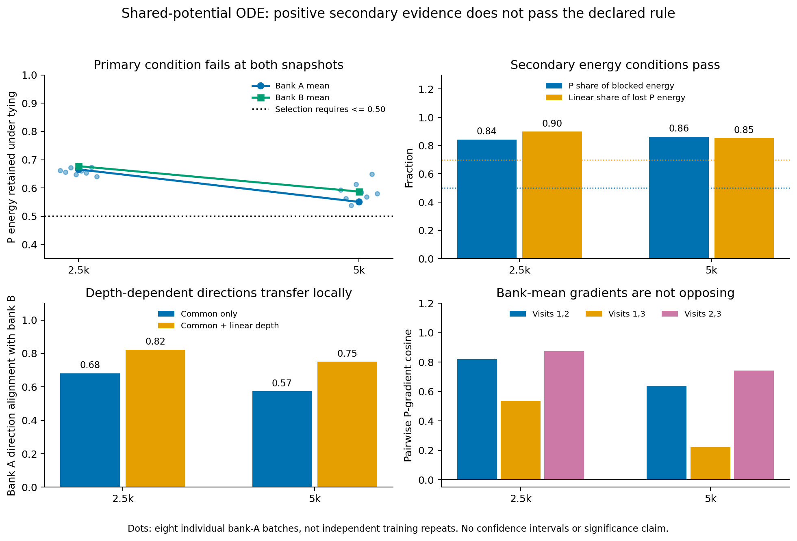
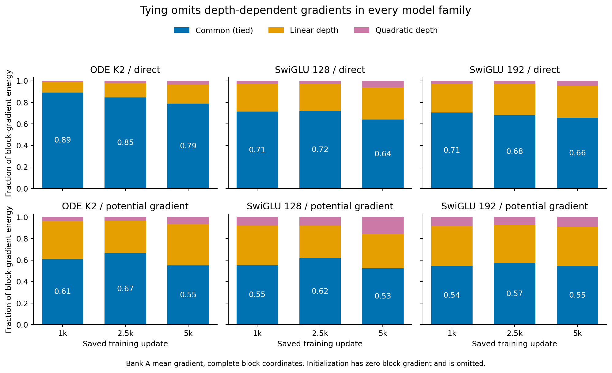

# Sharing restricts depth directions, without an ODE-specific cancellation signal

The frozen diagnostic does **not** select affine-in-depth P training. At the two prespecified late snapshots, sharing retains 66.59% and 55.10% of P-gradient energy, above the required maximum of 50%. The other selection conditions pass. Keep those positive secondary observations, but do not change the cutoff or launch a substitute group/mode.

This closes one explanation for the stopped shared-potential experiment. It does not establish a successful architecture or a global limitation of ODE models.

## Question and matched comparison

The preceding cold experiment found Product16 field MSE .233525 for the shared ODE potential predictor versus .034229 for its independently trained cloned-layout control, despite equal initial functions. Here, instead of comparing two differently trained endpoints, we take each **actual shared checkpoint** and make three independent parameter copies at exactly the same learned values. Predictions and input Jacobians remain identical. Only the allowed parameter variations change.

For independent-copy gradients `g1,g2,g3`, the shared gradient is their sum. Under a Euclidean norm that charges all three parameter copies, the common direction retains

```text
R = ||g1+g2+g3||² / (3*(||g1||²+||g2||²+||g3||²)).
```

Orthogonal constant, linear and quadratic depth modes split the remaining energy exactly. These depth modes concern the three block visits, **not** the Taylor order inside an ODELayer. A low R can reflect different magnitudes or directions; it need not mean opposing gradients.

The diagnostic covers ODE K2 and both SwiGLU budgets, direct and complete-potential-gradient readouts, at updates 0/1000/2500/5000. Each state uses two successive banks of eight batches of 512 drawn from its checkpoint's training RNG. A defines directions and B checks their first-order transfer. The targets retain the original noisy pair labels; there is no oracle-teacher substitution or optimizer step.

## Selection result

| Shared-potential ODE snapshot | P retained | P share of blocked block energy | Linear share of lost P energy | Common transfer A→B | Affine transfer A→B |
|---|---:|---:|---:|---:|---:|
| 2500 | .665904 | .843197 | .899697 | .681647 | .822658 |
| 5000 | .551035 | .862555 | .853754 | .573086 | .750174 |
| Required | <= .50 | >= .50 | >= .70 | reference | >= .20 and gain >= .05 |

The P-retention requirement fails at both snapshots. None of the eight individual A batches passes the complete rule at either snapshot. Bank B gives the same qualitative retention result. Nevertheless, most blocked block-gradient energy lies in P, a linear depth mode covers much of that lost P energy, and its direction transfers better to B than the common-only direction. These are real local observations, not a completed training result.



The upper-left panel is the decision-changing observation. The other panels explain why the branch was plausible and why that plausibility should not replace the declared rule. Points are individual batches, not independent training experiments or confidence intervals.

## The limitation is not specific to ODE

Complete-block retained fractions for the bank-A mean gradient are:

| Family/readout | Update 2500 | Update 5000 |
|---|---:|---:|
| ODE direct | .8466 | .7883 |
| SwiGLU128 direct | .7207 | .6397 |
| SwiGLU192 direct | .6815 | .6568 |
| ODE potential gradient | .6655 | .5504 |
| SwiGLU128 potential gradient | .6188 | .5253 |
| SwiGLU192 potential gradient | .5730 | .5466 |

At the final snapshot, the potential-gradient fractions are similar across all three families. ODE does not lose a uniquely large fraction of these coordinate-gradient directions, even though its cold sharing penalty was much larger. Thus this fraction alone cannot explain that quality difference. Native parameter coordinates and function classes differ, so the table is descriptive rather than a coordinate-invariant architecture ranking.



The orange/pink portions show directions excluded by tying; they occur in the generic controls too. Step-zero block gradients vanish behind the zero output head, so fractions there are undefined and omitted rather than plotted as zero.

## Case study: different directions need not be opposing

For ODE P at update 5000, the three pairwise bank-A mean-gradient cosines are .637, .220 and .744. At 2500 they are .819, .536 and .875. All are positive. The local restriction is therefore not a bank-mean sign-conflict signal at these snapshots.

A further **post-result descriptive factorization**, applied to every group and state without changing selection, separates gradient magnitudes from directional alignment:

```text
r_i = ||g_i||
amplitude factor A = (r1+r2+r3)² / (3*sum_i r_i²)
direction factor D = ||g1+g2+g3||² / (r1+r2+r3)²
R = A*D.
```

For the complete ODE block at update 5000, the visit-gradient norms are .27283, .11258 and .07021; A=.7518 and D=.7321. SwiGLU128 has A=.9643 and D=.5447, while SwiGLU192 has A=.9086 and D=.6016. ODE has more unequal visit magnitudes but better directional alignment by this factor. A and D are coupled descriptive quantities, not an additive causal allocation of error. The full [factor table](amplitude-direction-factors.csv) retains both banks, all groups and zero-gradient cases.

## Verification and allowed conclusion

The driver checked matched functions, complete input Jacobians, all common gradients and summed block gradients on actual saved states. A separate NumPy implementation then reconstructed every saved mode, transfer, selection and analytic finite direction from the raw gradient arrays, without importing the model helpers. It verified the source/checkpoint/data bindings, float32 interpolation and velocity arrays, and all input hash chains. Maximum summary disagreement is 5.11e-15. Its scope is precise: it checks saved finite-difference values against independently reconstructed analytic directions, without claiming a second full model replay.

The supported conclusion is that tying excludes transferable depth-dependent P directions but the stated severity criterion fails, and the observed gradient restriction is not an ODE-specific explanation of the performance gap. Do not launch P-depth training, change the threshold, choose another group after seeing results, or reopen the stopped recurrence experiment through supervision/solver tuning. This does not forbid a distinct, independently motivated research question.

See the [registered protocol](protocol.md), [mathematics](mathematics.md), [statistical scope and audit](stats-appendix.md), and [figure catalog](figure-catalog.md). No old checkpoint, report or training source was changed. The broader useful-ODELayer goal remains active.
