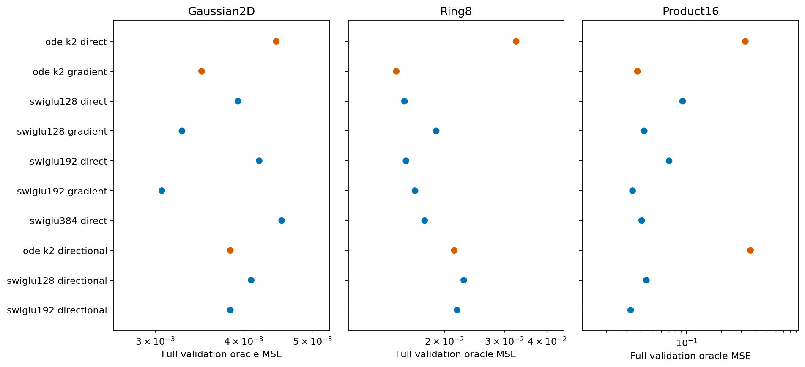
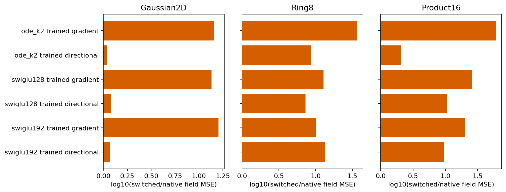
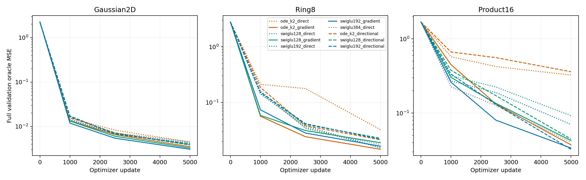
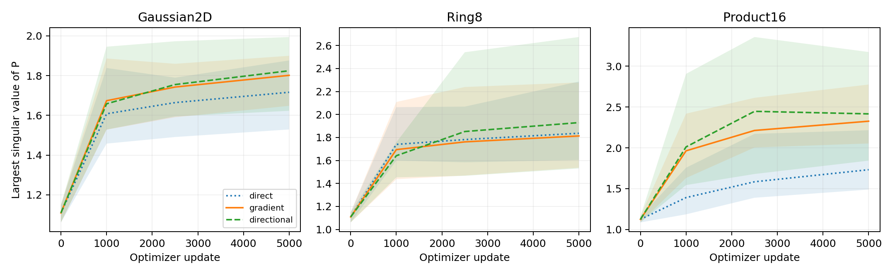

# Input derivatives help differently in the original ODE and SwiGLU

The radial directional readout fails the registered ODE screen. It does not recover the previous complete-gradient result on Product16, although the same construction works well with SwiGLU192. The next mathematical question is what the transposed sensitivity actually adds to the original ODE computation; this study does not justify another direction or coefficient sweep.

For an unchanged raw network G, compare:

```text
direct: G
A: .5*(G + J_G^T x) = grad_x[.5*dot(x,G)]
B: .5*(G + J_G x)
```

Only B was newly cold-trained: three backbones on three tasks. All use the original 5000-update paired training setup, with unchanged two K2 solves, scalar gates, SiLU, normalization, time conditioning and head. Twenty-one saved direct/A controls were reused after source, input and checkpoint verification. B's tangent remains input-dependent. A and B differ in feasible functions, optimization geometry and actual execution cost; this is not a controlled isolation of conservativity alone.

| Backbone/readout | Gaussian2D | Ring8 | Product16 |
|---|---:|---:|---:|
| ODE direct | .004449 | .032503 | .325527 |
| ODE A | .003490 | .014462 | .037320 |
| ODE B | .003832 | .021408 | .361073 |
| SwiGLU128 A | .003274 | .018940 | .042770 |
| SwiGLU128 B | .004101 | .022822 | .044678 |
| SwiGLU192 A | .003067 | .016419 | .033826 |
| SwiGLU192 B | .003832 | .021828 | .032544 |

Values are final full validation oracle field MSE, lower is better. [comparison.csv](comparison.csv) includes every direct, A and B control, parameter counts, derivative errors, SW2 and executed dense MACs.



For ODE, B's Product16 error is 9.68 times A's and exceeds its direct parent's error. In contrast, SwiGLU192 B slightly improves on A's field MSE. Adding input-derivative computation therefore does not suffice to explain the original ODE's A improvement. The orientation matters within this parameterization; hard conservativity is not shown necessary for all good predictors.

## Fixed weights cannot interchange the readouts

| ODE weights trained with | Evaluated as | Gaussian2D | Ring8 | Product16 |
|---|---|---:|---:|---:|
| A | A | .003490 | .014462 | .037320 |
| A | B | .049987 | .529030 | 2.257527 |
| B | A | .004171 | .187768 | .749759 |
| B | B | .003832 | .021408 | .361073 |

These are canonical float64 evaluations of every full validation input. On both nonlinear ODE tasks, changing either native readout after training substantially worsens the field. The raw network co-adapts to the chosen readout. The identity `A-B=.5*(J_G^T-J_G)x` holds, but this is not a post-training recipe for recovering the good predictor. [switch-risk.csv](switch-risk.csv) retains the exact finite-change alignment and squared-change terms. No crossover is eligible as a candidate.



## Prediction quality and cost remain separate

ODE B's Product16 Jacobian error is 52.94 and SW2 is .1452, versus A's 8.89 and .0932. Gaussian B also misses the generic sampling comparison. Neither A nor B establishes a useful ODE architecture across tasks and strong generic controls.

The observed Product16 dense inference MACs per example are 106944 for direct ODE, 183104 for A and 259264 for B. The current forward-AD path executes additional zero-weight-tangent matrix work; no equal-cost claim is made. Matrix counts exclude pointwise operations. Preflight timing concerns initial functions and is not a final isolated latency benchmark.





P trajectories and full singular/eigenvalue records remain available throughout training. They describe learned internal matrices, not complete-field stability certificates or an explanation of the orientation gap.

## Implementation validity and next question

Before formal training, finite differences exposed incorrect higher input derivatives through the installed native LayerNorm JVP path. Native scalar-potential reverse derivatives passed. B uses the identical native LayerNorm primal with explicit exact backward/JVP formulas. Actual old A and new B checkpoints passed finite-difference checks, and independent complete-Jacobian formulas reproduced both operators. Scope and numerical limits are in [stats-appendix.md](stats-appendix.md) and [implementation-errors.md](../implementation-errors.md).

The exact adjoint of each original ODE solve contains both transposed P powers and a rank-one gate-derivative contribution. Their formulas were derived and checked on actual learned matrices in [adjoint-mathematics.md](../adjoint-mathematics.md). A complete explicit primal/adjoint implementation could separate these contributions and test execution overhead without changing the successful mathematical function. Such an implementation is not yet a new quality result. No new training direction is selected from these results alone.
