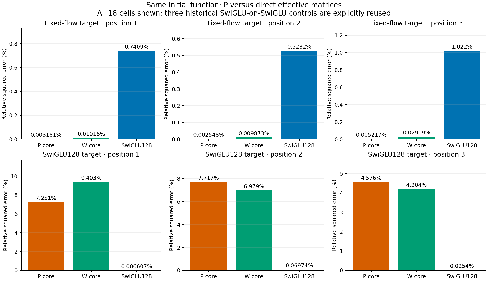
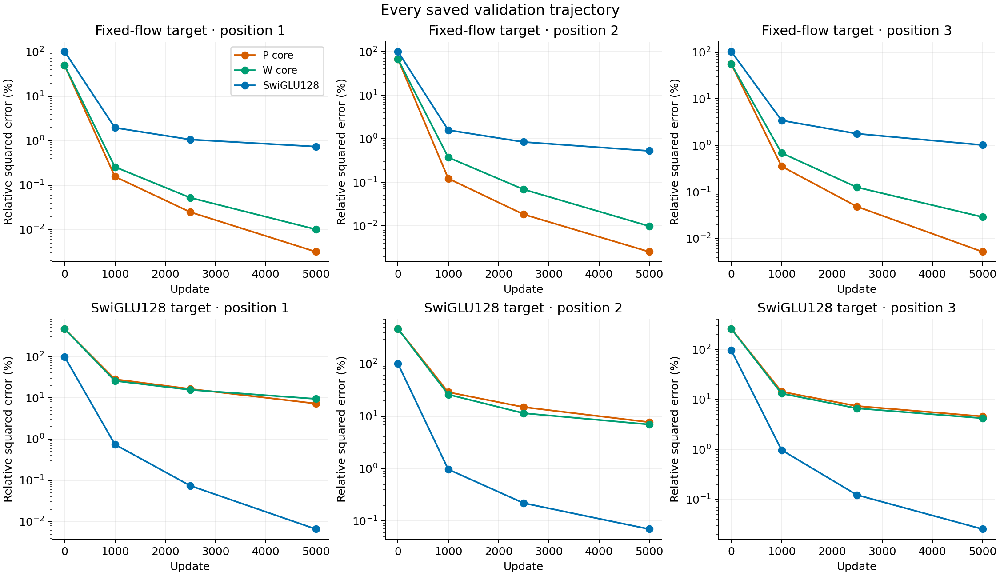
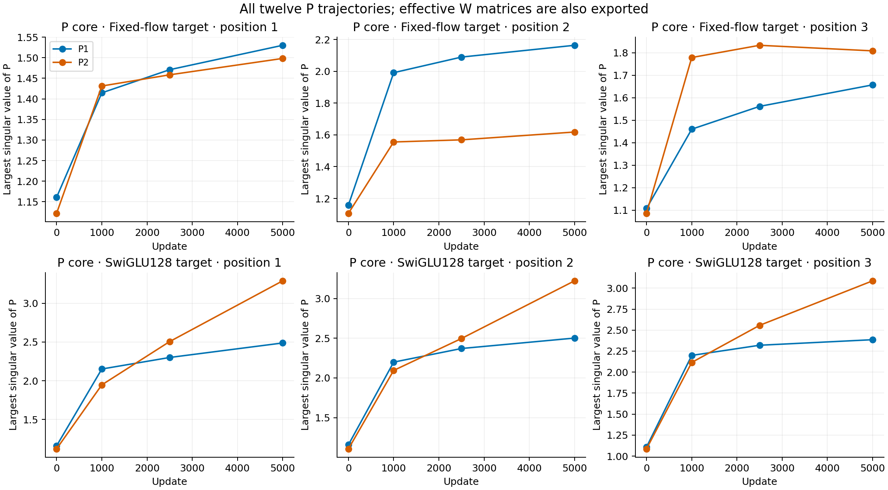

# Freeing the effective matrices does not close the fitting gap

Direct effective-matrix learning does not outperform the P parameterization on the known representable targets, and it does not recover the SwiGLU-target fit. This weakens a general explanation based on P being hard to optimize. It leaves the shared nonlinear core as the more useful next object of study, without proving that core has an approximation lower bound on the observed inputs.

## The paired comparison

Both cores have 8192 parameters and compute two 64-dimensional linear maps around SiLU. The P arm learns matrices through Q(P)=I+P+P²/2. The W arm learns the effective matrices directly. At initialization, their values and input Jacobians are bitwise identical. All cells use the same common feature inputs and index stream, 5000 updates, AdamW 3e-4, weight decay 0 and clip 1.

The fixed-flow targets are formed from frozen original teacher P matrices using the same Q convention. Both learner classes have an explicit exact representer for these targets. The second target family is the unchanged local SwiGLU128 teacher; its representability in either fixed-width core is unknown. Fifteen cells were newly trained; three identical SwiGLU-on-SwiGLU controls are explicitly reused after full provenance and stream checks.

| Target | Position | P core | Direct W core | SwiGLU128 |
|---|---:|---:|---:|---:|
| Fixed flow | 1 | 0.003181% | 0.010161% | 0.740879% |
| Fixed flow | 2 | 0.002548% | 0.009873% | 0.528209% |
| Fixed flow | 3 | 0.005217% | 0.029087% | 1.021723% |
| SwiGLU128 | 1 | 7.250683% | 9.403121% | 0.006607% |
| SwiGLU128 | 2 | 7.716776% | 6.978599% | 0.069739% |
| SwiGLU128 | 3 | 4.576171% | 4.203729% | 0.025396% |

Values are validation MSE divided by the corresponding target energy, expressed as percentages; they are not RMS errors or generation scores. All 20000 validation inputs are included. The three SwiGLU-target SwiGLU rows are historical references, not new trajectories.

On all three known-representer targets, P is more accurate than W. The predeclared substantial coordinate-difficulty pattern does not occur. This does not establish that P is universally easy to optimize; it rejects that specific pattern for these functions and budget.

On the SwiGLU targets, W is worse at position 1 and only modestly better at positions 2 and 3. Its local Jacobian error is worse at every position: relative squared errors 2.887/1.597/0.926 versus P's 2.338/1.314/0.877 on the fixed derivative panel. Extra effective-matrix freedom therefore does not repair the measured response gap.

The ordinary SwiGLU control has more parameters, 16554, versus 8192 for either core. The P-versus-W contrast is parameter matched; the SwiGLU comparison is a strong reference, not an equal-capacity claim. Feature count, multiplicative structure, biases and optimization remain possible explanations for the large residual contrast.

## The matrix restriction exists, but it is not a demonstrated cause

The [derivation](theory.md) shows that det Q(P) is nonnegative and that the P core's origin Jacobian has nonnegative determinant. The direct W class can violate that property. During this experiment, the final W cores at SwiGLU positions 2 and 3 do have negative origin-Jacobian determinants. Their minimum origin-Jacobian singular values are 4.31e-5 and 2.16e-4; independent NumPy checks agree on the signs.

These learned W functions have escaped the P core's global orientation restriction, yet their fitting errors remain large. The first W core has two negative effective-matrix determinants but a positive product; an individual factor's sign alone is not a function-class certificate. Zero is also away from much of the normalized input distribution. The observation does not turn an origin restriction into an on-distribution lower bound or a successful method.

All raw P and effective-W spectra are retained. A P differential condition-number lower bound can exceed 100 in a poor SwiGLU fit, but it is also about 91 in a highly accurate fixed-flow fit. Such a scalar indicator does not determine prediction error. The final 500-update clipping fraction is zero in every cell; that window does not characterize the entire optimization history.

## Implication

The results do not justify a matrix reparameterization or another spectral constraint as the next method. Both cores share a bias-free single SiLU stage. Its exact global odd component is linear, while the common input distribution need not be symmetric. That fact motivates a small placement control, not an immediate explanation of the measured gap.

The [next question](next-question.md) compares one learned 64-vector before SiLU with the same-sized vector after the output, starting from the same function. This checks whether movable activation thresholds help more than an output offset. It leaves the original ODE settings and their previous negative results intact. A result on this generic control would still need a separate ODE mechanism and ordinary FM/transfer/cost evidence.

Training completed in 41.16 seconds using two one-thread Mac CPU workers; largest sampled summed RSS was 1.044 GiB. Independent audit took 9.54 seconds. The first audit attempt stopped on a timer-name bug before numeric checks; its source is preserved, and the corrected audit ran from a separate version directory. No training cell was restarted. Lenovo remained unreachable and no GPU was reserved. The useful-ODELayer objective remains active and unachieved.
