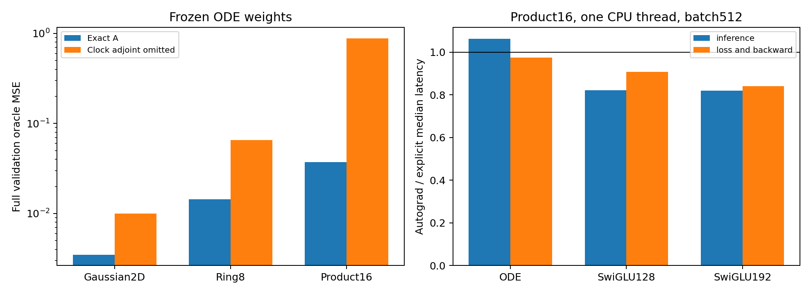

# The clock sensitivity is part of the learned ODE predictor

An explicit primal/adjoint sweep reproduces the complete potential-gradient field, including all six original ODE solves, their scalar gates, middle SiLU, normalization, FiLM, residuals and projections. It adds no parameter and calls no input-autograd routine internally. Ordinary differentiation of its tensor operations reproduces the original field's input, time and parameter derivatives.

All18 learned A/B network states across the three families/tasks passed full-field and five-panel comparisons. Maximum float64 value/input-Jacobian discrepancies are8.89e-15/7.11e-14. All-parameter/time loss gradients differ by at most2.99e-13; actual cloned AdamW updates differ by at most1.36e-14. Float32 field values are numerically compatible, with maximum observed discrepancy4.30e-6; bitwise cold-training equivalence is not claimed. Seven focused unit cases passed before the frozen evaluation. The source and input hashes are retained in the runtime and input-bindings.json.

## Removing a specific adjoint contribution

For the unchanged original solve,

```text
L(h)=h+aPh+a²/2 P²h
J_L^Tq=q+aP^Tq+a²/2(P^T)²q
        +grad(a)*dot(Ph+aP²h,q).
```

The last term sends sensitivity through the learned clock. Removing it from every reverse solve defines a different vector function while retaining the actual input-dependent gate values. No parameter is retrained in this comparison.

| Task | Exact A MSE | Clock-adjoint omitted MSE |
|---|---:|---:|
| Gaussian2D | 0.003490 | 0.010031 |
| Ring8 | 0.014462 | 0.065347 |
| Product16 | 0.037320 | 0.882490 |

On Product16, omission raises field MSE from.03732 to.88249. The finite switch's squared change contributes.84922, while its signed residual alignment is-.00405; their sum exactly explains the risk difference. The native predictor therefore depends strongly on this clock sensitivity after learning. It is not merely applying transposed P powers. These frozen-weight cases do not prove the term caused the cold-training gain: the other weights can co-adapt, and a newly trained omission model might compensate.



## Implementation cost

Product16 explicit ODE inference takes a median2.882ms versus3.064ms for the original autograd construction: about1.06x speedup in this isolated CPU measurement. Its loss/backward takes9.617ms versus9.379ms, so this implementation does not improve training throughput. SwiGLU explicit versions are slower than their autograd counterparts in these tests. Repeated raw timings, quartiles and all tasks remain in timings.json; no hardware-general speed claim is made.

Dense inference MACs are182720 versus183104 for explicit/autograd ODE, and training MACs544000 versus545152. Counts exclude pointwise work. This is essentially the same matrix-work budget, not a cheaper architecture with the same quality. The explicit version also works under inference_mode, but those calls are not substituted into the matched no_grad timing comparison.

## Next bounded question

The useful next test is whether cold training can compensate for removing the clock-adjoint pathway, with the same operation applied to the analogous gate path in SwiGLU. That would test necessity under retraining, rather than turning this frozen penalty into a design claim. Paired full-explicit controls must be trained too: mathematical equivalence of implementations does not imply bitwise float32 training histories. The potential/readout success claim remains unestablished, and this experiment nominates no practical architecture.
