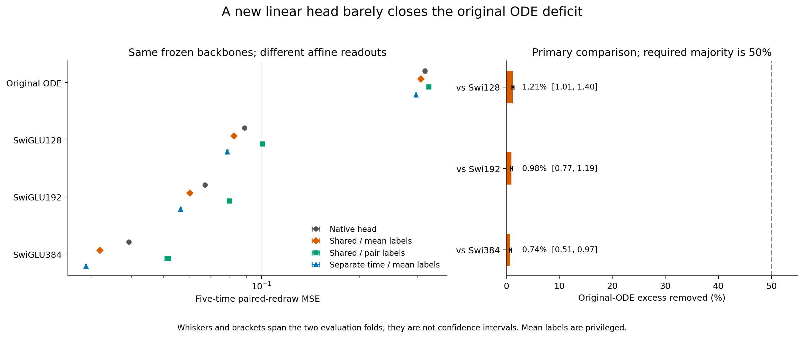
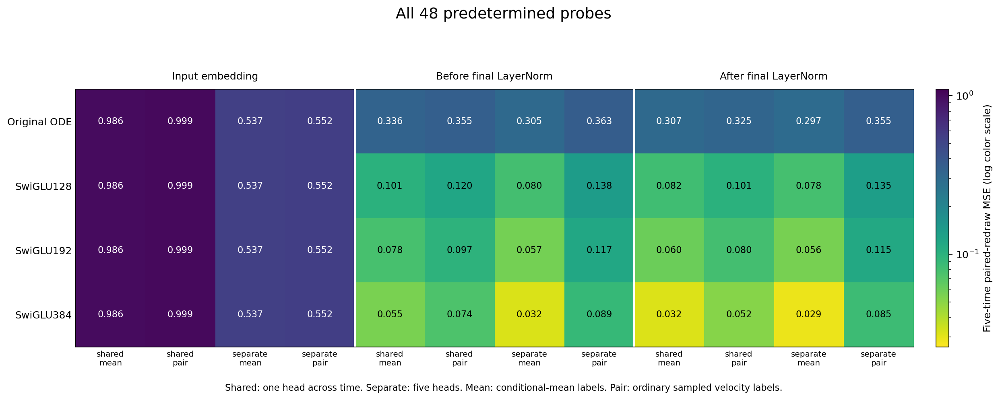

# The final linear readout does not explain most of the ODE deficit

Refitting an affine head on the original ODE's frozen final features lowers paired Product16 error from .316705 to .307352. The identical probe lowers SwiGLU192 from .067145 to .060244. Only about1% of the original gap closes. The registered majority-accessibility condition fails on both folds against all three generic references.

This follows the previous [response-shape diagnosis](../research-mode-response-2026-10-26/analysis-report.md). That experiment showed that a known nonlinear basis could explain the error, but could not show that the network had learned an accessible version of that basis. The present result supplies no evidence that changing only the final linear weights can recover it.

## What was held fixed

Each backbone and its original gates, P matrices, normalization and time conditioning remain frozen at step5000. A rows from one half of the4096 saved population paths fit the head; the opposite half's A points and coordinate-retaining hybrids evaluate it. The halves then swap. No hybrid or evaluation target enters calibration.

The primary probe fits one head across five times using exact conditional-mean velocity labels. The labels are privileged diagnostics. Ordinary pair labels are fitted on exactly the same inputs as a control. Both calibration laws differ from the cached-bank training objective, so the results cannot isolate the original optimizer as a cause.

## Fixed final-feature comparisons

Five-time paired-redraw MSE, lower is better:

| Frozen backbone | Native head | Shared head, mean labels | Shared head, pair labels | Separate-time heads, mean labels |
|---|---:|---:|---:|---:|
| Original ODE | .316705 | .307352 | .325268 | .297398 |
| SwiGLU128 | .088685 | .082089 | .100758 | .078394 |
| SwiGLU192 | .067145 | .060244 | .079619 | .056441 |
| SwiGLU384 | .039185 | .031902 | .051557 | .028900 |

These are fixed-model diagnostic fits, not newly trained backbone results, and differ from the uniform-time primary training metric.

Relative to Swi128/192/384, the primary probe closes1.21%,.98% and.74% of the native excess on average over the two folds. Their fold ranges are[1.01,1.40]%,[.77,1.19]% and[.51,.97]%. None approaches the fixed50% majority threshold. These are descriptive fold ranges, not confidence intervals.

The original ODE's conditional own-coordinate error remains .284202 after the primary fit, versus .297768 before it. Other-coordinate error rises from .018937 to .023150. Thus most of the missing conditional response remains, rather than being repaired by an output rotation or traded away invisibly through another component.

## Two rival explanations also remain unsupported

Separate-time heads reduce ODE error to .297398, while the corresponding Swi192 error is .056441. This does not supply a large recovery hidden by the requirement for a common head across time. Separate-time heads have five sets of coefficients and are capacity diagnostics, not a same-budget native architecture.

Reading the hidden state before final LayerNorm also fails to recover the gap. Its mean-label ODE errors are .336190 with a shared head and .304987 with separate-time heads. The corresponding Swi192 values are .077569 and .057048. Final normalization is therefore not concealing a strong linear readout of these saved pre-normalization states under this probe.

The input-embedding probes produce the same affine-only function class in every backbone, with shared/separate mean-label errors .986347/.537292. The later representations improve on this substantially, including for the ODE. The result is not that the ODE learned no nonlinear features; its learned final features do not offer a strong empirical linear repair for the remaining deficit.

## Consequence for the next design question

The evidence now favors examining how useful nonlinear features form and propagate through the ODE blocks, rather than fitting another final-head correction. It still does not distinguish insufficient architecture capacity from a feature-learning failure under the finite training procedure. A different training trajectory can change the features.

The [next-question note](next-question.md) identifies a bounded way to inspect the original controller's scalar compression without assuming that a rank-one local derivative proves a network-wide bottleneck. Earlier vector-clock failures must remain counterevidence. No new architecture or backbone training is selected by this result.

Claim boundaries:

- Keep: these fixed features do not support a majority gap closure through the registered linear probes. Evidence: all six held-out primary contrasts and independent functional replay. Do not strengthen this into an architecture-wide impossibility or a proof of absent nonlinear features.
- Keep: separate-time and pre-normalization probes do not expose a large recovery here. Evidence: the complete48-setting table. Do not claim that time-dependent heads or normalization changes can never help after retraining.

The [full table](all-probes.csv), [fold aggregates](fold-aggregates.csv), [all-time/fold records](all-times-and-folds.csv), [primary contrasts](primary-contrasts.csv), [audit appendix](stats-appendix.md) and [figure catalog](figure-catalog.md) retain the evidence. Submitted Report1 is unchanged. The useful-ODELayer objective remains open.
