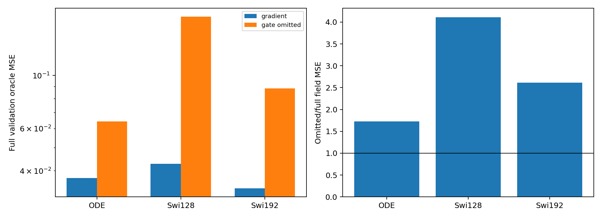
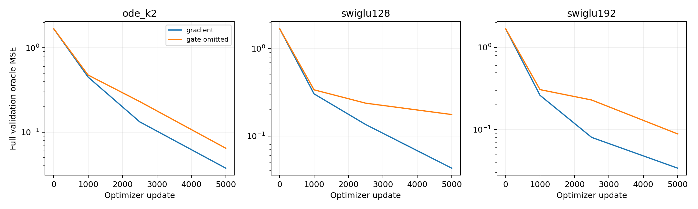
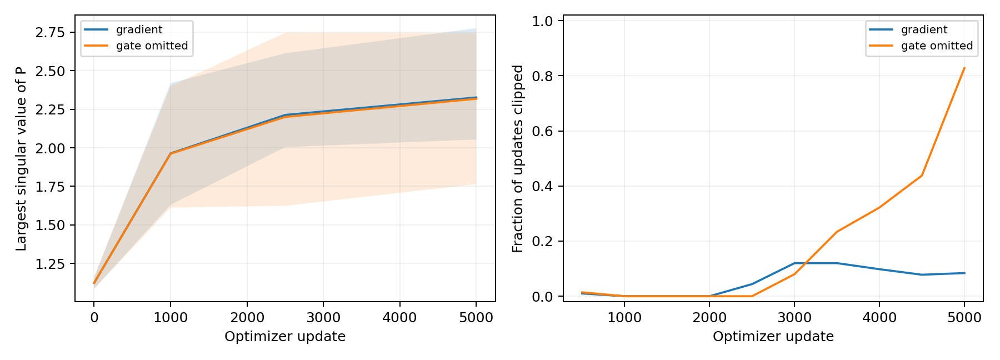

# Cold training compensates for part of the omitted gate sensitivity

The six-cell Product16 experiment does not support an ODE-specific gate-adjoint explanation. Removing the gate-sensitivity pathway worsens all three backbones, with a larger relative penalty for both SwiGLU controls. The registered two-task extension is not triggered; the setting stops without coefficient, clipping or training-length changes. No practical architecture is nominated.

Each backbone was cold-trained with the same full explicit adjoint or with its gate branch omitted. ODE retains both original scalar K2 solves and SiLU. SwiGLU omits the analogous channel-gate sensitivity while retaining its value pathway. Actual gate values and every ordinary derivative of the resulting vector function remain live. This is a changed forward function, not a surrogate training gradient. Full-explicit controls avoid treating mathematical identity as bitwise float32 training equivalence.

| Backbone | Full field MSE | Gate-path omitted field MSE | Omitted/full |
|---|---:|---:|---:|
| ode_k2 | 0.037320 | 0.064383 | 1.725 |
| swiglu128 | 0.042770 | 0.175889 | 4.112 |
| swiglu192 | 0.033825 | 0.088348 | 2.612 |

All are final full uniform-time validation oracle MSEs. Seed0,5000updates,batch512,AdamW3e-4/wd0/clip1 and all actual input streams are paired. The new full ODE matches the old A field error within0.000060% relative. Thus the numerical implementation reproduces the old operating point closely; the omitted model's.06438 error is not explained by a failed full control.

## What the case study changes

In the preceding frozen-weight experiment, deleting clock sensitivities from the old A ODE raised MSE from.03732 to.88249. Cold training the omitted function reaches.06438. This is a different learned weight state, not a finite switch of the same checkpoint. It shows that other parameters can compensate for much of the frozen deletion penalty under this training setup. The residual1.73x gap still supports a useful contribution, but does not establish a unique representational necessity or an ODE-specific advantage. Swi128/Swi192 suffer4.11x/2.61x penalties under their analogous gate-path removal. Their gate families differ, so those ratios are an interaction observation, not identical interventions on equivalent functions.

The ODE without clock adjoints remains much better in field MSE than the old direct ODE (.32553), while costing158144 versus106944 dense inference MACs. It still contains a complete reverse computation through transposed P polynomials, SiLU, normalization and residuals. The improvement cannot be assigned to clock derivatives alone, or claimed at equal compute. The old strong generic controls remain in context-controls.csv: Swi192 radial reaches.03254, below full ODE's.03732.

## Derivatives, samples and optimization

ODE omission worsens Jacobian error8.89→15.77 and SW2 .09317→.10697. For Swi128, Jacobian error worsens14.01→39.60, while SW2 improves.09465→.09043. Swi192 similarly has worse field/Jacobian fit but lower SW2 (.09993→.09258). These metrics measure different objects; the sampling score does not erase the field-fitting failures. Full six-arm values and actual MACs remain in comparison.csv.

Both ODE arms have almost the same mean final largest P singular value:2.3267 full versus2.3180 omitted, with individual ranges2.054–2.776 and1.764–2.744. These internal spectra do not explain the field gap or certify network stability. Optimization differs: over the final500 updates, clipping fractions are.084 full and.828 omitted. We therefore do not interpret the outcome as a pure expressivity test or change clipping to rescue it.

## Validation and scope

The independent audit replayed all six full fields, all30 complete Jacobian panels and all six generated-sample arrays bitwise in native float32. It regenerated the actual training stream and checked24 checkpoints and48 P matrices. A separate native-network partial-Jacobian construction reproduces complete float64 output fields within9.77e-15. Thirty independent input finite differences and six parameter finite differences pass, with maximum relative errors3.45e-10 and2.86e-11. The reference fixes gate values only for the inner value computation and recomputes them at every finite perturbation; it is not a training rule. Sources, inputs and analyzers are hash-bound.

Two one-thread Mac mini workers completed the six cold runs, with ten-second process telemetry. Lenovo remains offline, confirmed by current Tailscale state and a direct SSH timeout. No idle GPU allocation or previous run modification occurred. The original submitted Report1 stays unchanged.

The protocol required an ODE omission/full ratio above2 and more than twice both generic ratios, with the generic ratios at most2, before expanding the same factor to Gaussian/Ring. That ODE-specific interaction is absent. The cold results weaken an explanation based on a uniquely useful ODE clock pathway; the broader search for a useful original-ODE architecture remains open.
