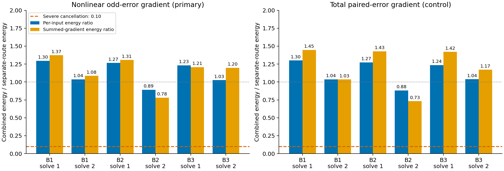

# The trained K2 polynomial does not show severe gradient-route cancellation

The proposed obstruction is absent in this frozen predictor. Its linear and quadratic P routes do not nearly cancel in either the nonlinear-error or total-error gradient. All six matrices also admit a positive lower bound on the local matrix-polynomial differential throughout the original allowed duration interval. These findings do not identify a better architecture or establish good conditioning of the complete network.

The original layer uses `Q_a(P)=I+aP+a²P²/2`. Its matrix derivative in direction H is `aH+a²(PH+HP)/2`. At `P=-I/a` the derivative vanishes although the forward map is `I/2`. The earlier project theory already contained this stationary-point example. This study asks whether that mechanism is visible in the actual trained scalar K2 model.

We use all five population panels and all 4096 antithetic row pairs from the preceding [parity study](../research-parity-2026-10-26/analysis-report.md). The measured adjoints include the complete downstream network and all later gates. The primary objective is the nonlinear odd-error component, whose raw-linear projection and envelope derivative are kept explicit. No predictor is changed or optimized.

For each P, we sum the squared norms of its two derivative routes and compare them with their combined squared norm. A ratio of one means zero net cross term; above one means constructive interaction. The registered severe-cancellation threshold is 0.10. Per-input energies and coherent sums across all rows/times are reported separately.

| Original solve | Per-input energy ratio | Coherent-gradient ratio |
|---|---:|---:|
| Block 1, solve 1 | 1.2958 | 1.3729 |
| Block 1, solve 2 | 1.0361 | 1.0849 |
| Block 2, solve 1 | 1.2657 | 1.3068 |
| Block 2, solve 2 | 0.8909 | 0.7809 |
| Block 3, solve 1 | 1.2319 | 1.2068 |
| Block 3, solve 2 | 1.0260 | 1.1969 |

All six primary ratios are far above the threshold. Local ratios range from 0.891 to 1.296; coherent ratios range from 0.781 to 1.373. The second solve in block 2 has some destructive interaction, but its coherent ratio is 0.781, not a near-zero response. Across all 30 individual primary time/solve panels, the minimum coherent ratio is 0.626. Total-error controls reach the same qualitative conclusion; every row is retained in [the time table](all-time-routes.csv).



There is also an algebraic conditioning certificate for these particular frozen matrices. Let mu be the smallest eigenvalue of `(P+P^T)/2`. In the Frobenius inner product, the normalized differential `T(H)=H+a(PH+HP)/2` satisfies

```text
<H,T(H)> >= (1+a*mu)*||H||_F²
||T(H)||_F <= (1+a*||P||2)*||H||_F.
```

Whenever the lower factor is positive, Cauchy–Schwarz bounds the minimum singular value by that factor. This argument does not require P to be normal. Each measured mu is greater than -1, so the certificate extends to every a in the declared (.2,1) interval. The following uniform bounds are an algebraic corollary calculated after inspecting the final matrices, not a replacement for the registered gradient criterion.

| Original solve | Uniform normalized singular lower bound | Uniform condition upper bound |
|---|---:|---:|
| Block 1, solve 1 | 0.1314 | 19.94 |
| Block 1, solve 2 | 0.2253 | 11.31 |
| Block 2, solve 1 | 0.1223 | 26.29 |
| Block 2, solve 2 | 0.1907 | 13.05 |
| Block 3, solve 1 | 0.1684 | 16.12 |
| Block 3, solve 2 | 0.1915 | 14.64 |

The smallest uniform lower bound is 0.1223; the largest condition upper bound is 26.29. These concern P-to-Q matrix sensitivity at a fixed duration. Applying Q to a particular input, differentiating clocks, composing normalization and other blocks, and optimizing the loss introduce different conditioning questions. The table does not certify the complete field Jacobian or the history between saved training checkpoints.

The result therefore provides no support for selecting a new P parameterization solely to remove K2 route cancellation. It also does not prove that the function class is adequate or that training has reached its best solution. The preceding evidence still places the large direct-model deficit in useful nonlinear fitting; a future design needs a different, specific mechanism and practical comparison with strong SwiGLU controls.

The main analytic sums match complete-network autograd to 7.59e-19. Independent explicit per-row outer products reproduce every panel, aggregate and decision, with maximum matrix discrepancy 3.47e-18. The main took 1.79 seconds and the independent replay 16.72 seconds on one Mac mini CPU thread. Lenovo SSH timed out, so no remote job or GPU was reserved. No training, optimizer update, commit or push occurred; earlier results and submitted Report1 remain unchanged.

The [protocol](protocol.md), [mathematical details](mathematics.md), [aggregate table](aggregate-routes.csv), [uniform bounds](uniform-differential-bounds.csv), and [source/execution notes](notes.md) preserve the scope and evidence. No architecture is nominated, and the useful-ODELayer goal remains active.
