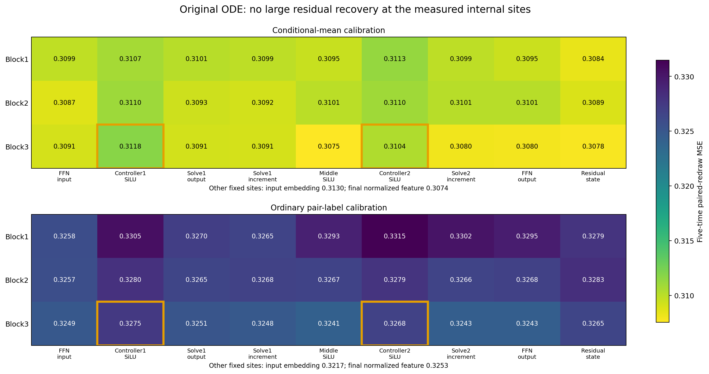
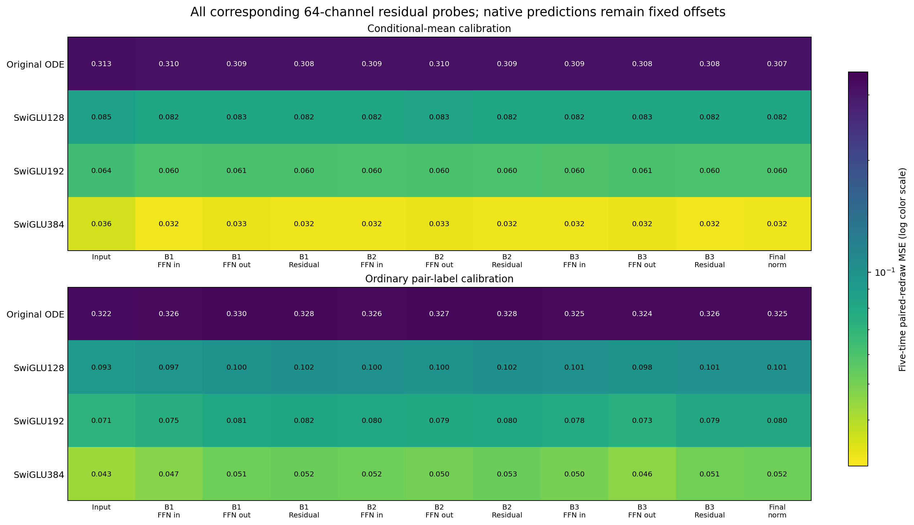

# Internal controller features do not expose a large linear residual correction

The final block's two controller SiLU representations give mean-label probe errors .311811 and .310387, compared with .307352 from the final normalized feature. Both primary sites fail the registered majority-recovery rule against every generic reference on both folds. This does not support the proposed account that a useful missing response is already present as a linearly readable controller feature.

The result concerns these fixed models and single-site affine probes. Useful information could be distributed across sites, require nonlinear decoding, or arise after different training. No architecture-wide expressivity limit is established.

## What was tested

The preceding [final-feature experiment](../research-frozen-features-2026-10-26/analysis-report.md) found that refitting the output alone barely closes the gap. Here an affine probe at each internal site fits the remaining velocity error, while retaining the entire native prediction as a fixed offset. Every feature has64 channels and every probe has the same number of free coefficients. No feature banks are concatenated.

Both exact population mean labels and ordinary sampled pair labels use the same calibration inputs. A half of the existing population paths calibrates the probe; the other half's original and hybrid states evaluate it, then the halves swap. Only mean labels define the primary question. These population calibration laws differ from the original cached-bank objective.

At the final normalized feature, residual fitting is algebraically equivalent to the previous ordinary head refit. Every old A/H prediction, for both labels and all four models/times, is reproduced within6e-14. Other sites provide a different correction class around the fixed native field; they are not standalone64-feature models or proposed same-cost architectures.

## Primary sites and a local case

Five-time paired-redraw MSE for the original ODE:

| Correction feature | Mean-label calibration | Pair-label calibration |
|---|---:|---:|
| Final normalized feature | .307352 | .325268 |
| Last block, first controller SiLU | .311811 | .327531 |
| Last block, second controller SiLU | .310387 | .326779 |
| Last block, middle SiLU | .307532 | .324122 |

The uncorrected native error is .316705. The final-feature mean-label reference errors are .082089 for Swi128, .060244 for Swi192 and .031902 for Swi384. The new probes remain far from those references.

For the two primary controllers, the fraction of the remaining ODE gap removed ranges from−2.13% to−1.49% and−1.37% to−1.09%, respectively, across references and folds. Negative values mean that the controller probe is worse than the final-feature probe. All12 predetermined contrasts fail the50% requirement; values are not clipped to zero.

The orange outlines mark the preselected primary sites. The two middle SiLU and solve paths are also shown at every depth. Across all27 internal mean-label probes, risks range from .307532 to .311811. There is no strong recovery at an earlier controller, solve increment or residual state that was hidden by inspecting only the final head.

The last-block middle SiLU's pair-label error is slightly below the corresponding final-feature pair-label result, but this is a secondary descriptive contrast. It neither passes the fixed mean-label primary criterion nor approaches the generic frontier, and is not selected as a new winning site.

## Generic controls and interpretation

The common conditioned-input, FFN-output and residual-state probes keep the large ODE/generic separation visible throughout depth. Input-embedding entries are residual corrections around different native functions; they should not be confused with the earlier standalone affine-input predictors.

The scalar controller's local Jacobian contribution has rank at most1, but the actual middle activation and repeated blocks remain nonlinear. Earlier vector-clock tests also failed. Neither that rank identity nor this probe supplies evidence for adding gates or a controller bypass. The present result weakens a simple transmission-only explanation at the tested sites, while leaving feature learning and nonlinear composition unresolved.

A separate [parity question](parity-question.md) records an exact activation identity that may help specify a subsequent mechanism test. It has not been validated against these learned preactivations and selects no new architecture or activation change.

Claim boundary: keep the finite finding that no tested single64-channel controller feature supplies a majority linear residual recovery. Do not claim that information is absent from the network, that training reached a global optimum, or that all ODE architectures fail.

The [full site table](all-sites.csv), [fold results](fold-aggregates.csv), [time/fold rows](all-times-and-folds.csv), [primary contrasts](primary-contrasts.csv), [audit appendix](stats-appendix.md) and [figure catalog](figure-catalog.md) retain the evidence. No new backbone training or architecture nomination follows. The broader useful-ODELayer objective remains active; submitted Report1 is unchanged.
