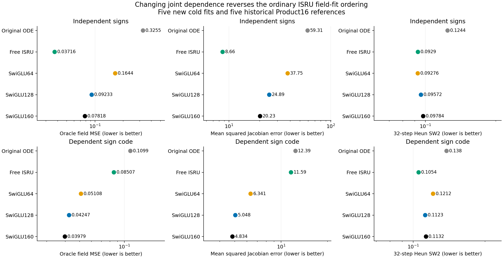
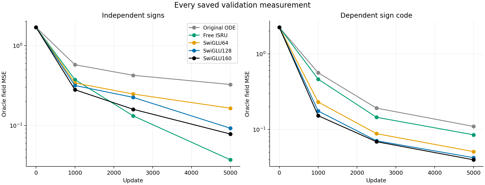
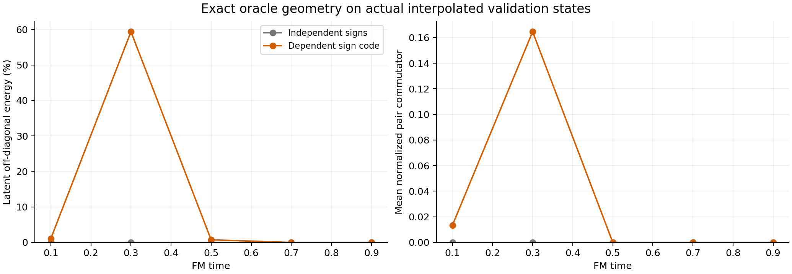
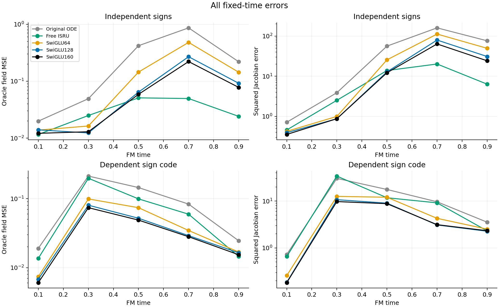
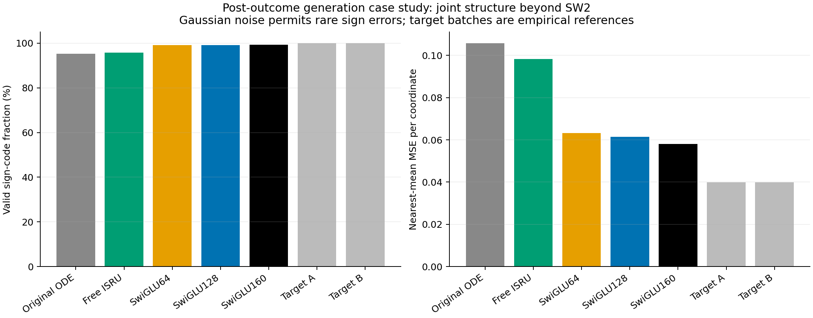
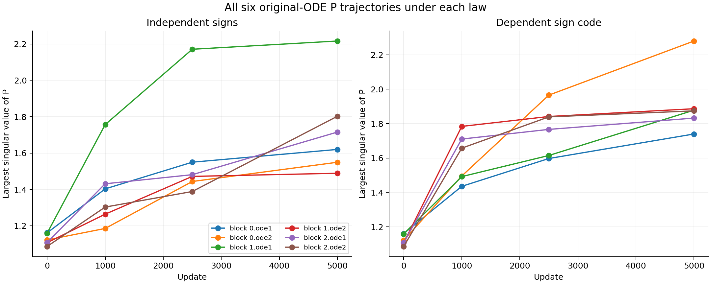

# The ordinary ISRU advantage does not transfer to dependent component signs

After retraining every architecture from the same cold state, ordinary ISRU changes from the best field fit on independent-sign Product16 to worse than all three SwiGLU controls on the dependent-sign mixture. The original ODE remains worse than the ordinary controls. This experiment does not establish a new ODE method; it narrows the interpretation of the previous ISRU observation.

| Model | Independent signs: field MSE | Dependent signs: field MSE | Dependent signs: Jacobian error | Dependent signs: SW2 |
|---|---:|---:|---:|---:|
| Original ODE | 0.325527 | 0.109867 | 12.3946 | 0.137989 |
| Free ISRU | 0.037159 | 0.085073 | 11.5873 | 0.105373 |
| SwiGLU64 | 0.164398 | 0.051075 | 6.3406 | 0.121153 |
| SwiGLU128 | 0.092326 | 0.042467 | 5.0483 | 0.112285 |
| SwiGLU160 | 0.078178 | 0.039790 | 4.8340 | 0.113178 |

The five dependent-sign fits are new. The five independent-sign rows are audited historical references. Both laws use model seed0,5000 updates, batch512 and the unchanged native backbone, objective, optimizer and clipping. This tests transfer of an architectural observation after fresh training, not zero-shot reuse of a checkpoint. [The protocol](protocol.md) defines the law and measurements before outcomes.

ISRU's field-risk ratio to the best SwiGLU changes from0.475 to2.138. Its derivative-error ratio changes from0.428 to2.397. The registered ordinary-ISRU transfer criterion fails, even though its SW2 is lower on the new law. Free ISRU and SwiGLU64 have almost the same budgets:58512 versus58572 full-network parameters and57408 versus57024 forward matrix MACs per example. The reversal is therefore visible against a near-parameter/compute control as well as the stronger wider controls. These counts exclude pointwise work.

## What changed in the data

The new target is an explicitly constructed32-component Gaussian mixture using the rows of a16-dimensional Hadamard matrix and their negatives as component signs. It uses the original amplitudes, isotropic component noise and rotation. Independent Product16 instead uses all65536 sign combinations. Both laws have identical mean/covariance, latent one-, two- and three-coordinate sign marginals and complete radial laws, including along the Gaussian-source interpolation. Joint dependencies and mode count differ; posterior uncertainty and learning difficulty can differ too. This is a mechanism control, not a standard public benchmark or a single-factor causal identification of the observed errors.

At each fixed time, Product16 oracle Jacobians are diagonal in one fixed rotated basis and commute. The new oracle's posterior covariance introduces mixed directions. At t=.3 on actual validation states, its mean latent off-diagonal Jacobian energy fraction is59.39%, versus numerical roundoff for Product16; its mean normalized pair commutator is0.1646. At late sampled times the component posterior is nearly deterministic and those quantities become numerically negligible. This is a statement about the evaluated panels, not global linearity of the field.

At the same t=.3 panel, ISRU has field MSE0.19746 and Jacobian error34.0567, versus0.07398 and9.7380 for SwiGLU160. This supplies a concrete case in which matching radial scale does not preserve the model ordering. It does not prove that target-Jacobian noncommutativity is the unique cause: the full networks themselves can generate noncommuting Jacobians.

## What the mathematics does and does not explain

The [interaction analysis](interaction-theory.md) derives a sharper distinction. Both oracle fields have identical value, Jacobian and second derivative at the origin, including identical Jacobian spectra. Their third derivatives differ in genuine cross-coordinate terms. One matricization of that derivative has exact rank16 for independent signs and136 for the Hadamard sign code. Integer block structure and finite-field elimination verify these ranks.

A single ordinary elementwise FFN of hidden width h has rank at most h in this matricization, while a single SwiGLU FFN has an upper bound2h. These are useful local feature-map facts, but they are not lower bounds for our three-block normalized predictors. More importantly, an explicit instance of the professor's scalar-clock ODELayer already generates rank136 in16D. Thus scalar-clock count alone is not a valid explanation of its deficit. The construction is a verification fixture, never a training initialization or a rescue. No new architecture follows from this theorem alone.

## A generation case study

The following diagnostics were added after the primary outcomes were inspected and do not alter the decision. All models generate2048 samples from the same initial noises with32 Heun steps. Both2048-sample validation reference batches satisfy the component sign-code rule in this draw. Small Gaussian component noise permits rare exceptions, so this is a sign-pattern diagnostic rather than a zero-density support test.

| Model | Valid sign-code fraction | Nearest-component MSE per coordinate | Modes reached |
|---|---:|---:|---:|
| Original ODE | 95.31% | 0.10580 | 32 |
| Free ISRU | 95.80% | 0.09831 | 32 |
| SwiGLU64 | 99.17% | 0.06320 | 32 |
| SwiGLU128 | 99.07% | 0.06139 | 32 |
| SwiGLU160 | 99.27% | 0.05802 | 32 |
| Target batch A | 100.00% | 0.03987 | 32 |
| Target batch B | 100.00% | 0.03994 | 32 |

ISRU's lower SW2 coexists with more sign-pattern violations and larger distance to component means; it also has more uniform nearest-mode frequencies than the wider SwiGLU controls. All32 modes being reached does not distinguish these differences. These metrics measure distinct properties, so none should be relabeled as an overall quality ranking.

For an explicit example, the first ISRU sign-code mismatch occurs at source index4. Its fifth normalized latent coordinate is+0.255, while the nearest component has sign-1 there; its full sign pattern is one bit from a valid codeword. This is a deterministic first-mismatch selection, not the worst sample. There is no prescribed target component for that noise. The [saved examples](sample-examples.json) include the complete vector and the corresponding first SwiGLU160 mismatch. Independent bit-code and distance calculations verify all case-study counts.

## Original P trajectories and scope

All six original-ODE P matrices are retained at every snapshot for both laws. Their complete spectra are exported below. They describe learned internal operators, not full conditioned-network Jacobians or a causal explanation for the ranking reversal.

The next design question should distinguish useful mixed feature interactions from an ODE interpretation, and compare against strong multiplicative controls on both joint laws. This study selects no cubic-flow continuation or spectral/clock/optimizer rescue. [The next-question note](next-question.md) records the remaining decision without claiming that an untested construction is effective.

Training finished in56.1 seconds with two one-thread Mac CPU workers; the largest observed summed RSS was0.800GiB. The independent audit passed in8.2 seconds. [Statistical scope](stats-appendix.md), [all exported measurements](comparison.csv), [figure catalog](figure-catalog.md) and immutable external runtime receipts preserve the evidence. The original useful-ODELayer goal remains unachieved.
