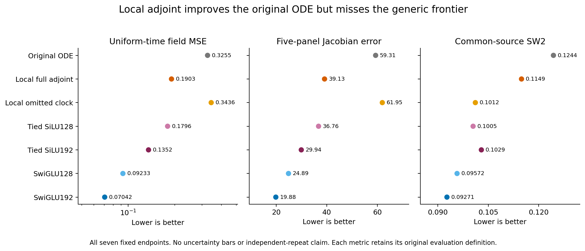
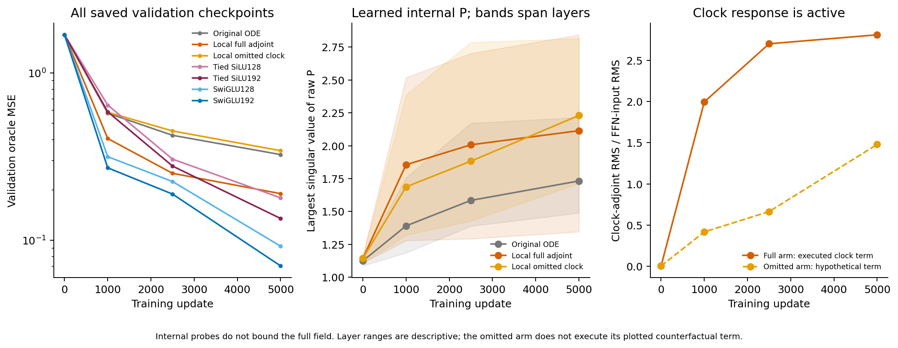

# Local adjoint reuse helps the original ODE, but fails the practical comparison

The candidate lowers Product16 field error from .325527 to .190290 with 29.8% fewer parameters than the original two-solve ODEFFN. It also improves over its omitted-clock control. It does **not** beat the ordinary tied-ridge controls or SwiGLU, and fails both continuation routes and the derivative/sampling guards. Stop this fixed design without another task, longer training or coefficient/width rescue.

## One local change

The original FFN applies two independent conditional K2 maps around SiLU. The candidate uses one unchanged original encoder L and its exact input adjoint:

```text
original: L2(SiLU(L1(h)))
candidate: J_L(h)^T SiLU(L(h))
```

The candidate reuses the encoder parameters instead of learning a second solve. Its clock derivative is included exactly. The omitted-clock control removes that one direct adjoint term, with the same parameter set. It still differentiates the remaining forward expression normally; its clock is not globally detached during training.

If rho'=SiLU, the full candidate is the gradient of sum_j rho(L_j(h)) in its FFN input coordinates. This gives neither a PSD guarantee nor complete-network conservativity after normalization, FiLM, residuals and arbitrary input/output projections. The identity defines the computation; it does not establish superior approximation.

Ordinary tied ridge maps `W^T SiLU(Wh+b)` with 128 and 192 features are the near-parameter and near-matrix-work controls. They are essential prior-art comparators rather than ODE methods. The candidate is compared with them, the original ODE, the omitted-clock local map, and ordinary SwiGLU128/192 under the unchanged training recipe.

## Fixed final results

All seven cells completed 5000 updates on Product16 using the original cached-bank pair loss and common validation/sampling banks. The three old native controls reproduce their prior saved states exactly.

| FFN | Parameters | Field MSE | Jacobian error | SW2 |
|---|---:|---:|---:|---:|
| Original ODE | 83,862 | .325527 | 59.3056 | .124395 |
| Local full adjoint | 58,899 | .190290 | 39.1297 | .114895 |
| Local omitted clock | 58,899 | .343629 | 61.9494 | .101164 |
| Tied SiLU128 | 58,896 | .179585 | 36.7647 | .100493 |
| Tied SiLU192 | 71,376 | .135191 | 29.9408 | .102948 |
| SwiGLU128 | 83,598 | .092326 | 24.8899 | .095722 |
| SwiGLU192 | 108,624 | .070423 | 19.8841 | .092709 |

Field MSE is the uniform-time primary metric. Jacobian error averages five fixed-time panels; SW2 uses common-source Heun32 sampling. They remain separate measurements.



The full adjoint reduces original-ODE error by 41.5% and omitted-clock error by 44.6%. That establishes a useful contrast **inside this failed family**. At essentially the same parameter count, ordinary tied SiLU128 has 5.6% lower error than the candidate; tied SiLU192 also wins. The candidate's field and Jacobian errors are 2.702 and 1.968 times the better SwiGLU values, and SW2 is 23.9% higher. Parameter reduction therefore does not supply quality-preserving efficiency.

Both base contrasts pass, but neither the quality nor parameter-reuse route passes. The derivative and sampling guards fail independently. The omitted-clock arm is a control and cannot be nominated retrospectively because one sampling metric is less poor. The registered [protocol](protocol.md) and independently recomputed decision retain every condition.

## The encoder and its clock did learn



The complete checkpoint curves retain the generic advantage through the fixed endpoint. The full model's final raw-P largest singular values average 2.115, compared with 1.732 for the original and 2.230 for the omitted-clock arm. The full model's mean P drift from initialization is 3.827. These internal matrices have different learned jobs and counts; their spectra are not the complete velocity Jacobian or a stability certificate.

The full model executes a substantial clock-adjoint term: on the recorded probe its RMS/input-RMS ratio averages 2.811 across the three blocks at the final checkpoint, with mean duration standard deviation .0536. The omitted arm's separately measured hypothetical term is not executed. All first-encoder P and controller tensors already move in the three-update preflight. The negative outcome is not a dormant-path result, but activity alone does not establish useful features or identify a repair.

## Cost and interpretation

Actual counted forward/loss-backward MACs are 106,752/317,120 for the candidate versus 106,944/317,696 for original ODE. Parameter sharing removes almost 30% of whole-model parameters without reducing executed matrix work. Tied SiLU128 uses 81,984 forward MACs and fewer CPU milliseconds while also fitting better.

On the isolated one-thread CPU microbenchmark, the candidate is 4.3% slower than original ODE forward and 7.9% slower for loss/backward. It is substantially slower than same-matrix-work SwiGLU192. These are batch-512 CPU timings without optimizer steps, not GPU throughput or full training speed claims. Pointwise derivative computations are not free merely because they reuse parameters.

The preceding population diagnosis localized the large direct-ODE deficit to conditional own-coordinate fitting. This cold experiment tests one way of supplying local derivative-response features without changing the training target or full-model head. It improves the weak ODE reference, but the ordinary tied controls show that the conditional Taylor encoder has not earned its additional executed work here. Neither local gradient structure nor parameter reuse alone solves the measured problem.

No Gaussian/Ring extension is launched. Do not add a scale, activation, extra P, global potential head or longer optimization to rescue this exact setting. The original useful-ODELayer goal remains active; this finite-budget result is not an impossibility theorem for all ODE architectures.

The [full comparison](comparison.csv), [learning curves](learning-curves.csv), [P trajectories](P-trajectories.csv), [statistical/audit appendix](stats-appendix.md), and [figure catalog](figure-catalog.md) preserve the evidence. Submitted Report1 and all earlier frozen runs are unchanged.
