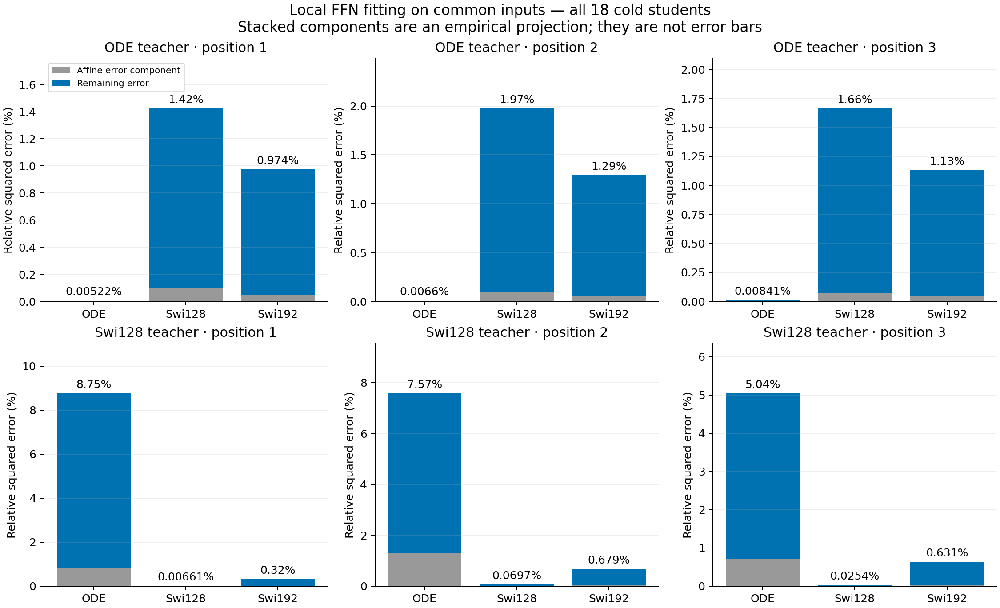
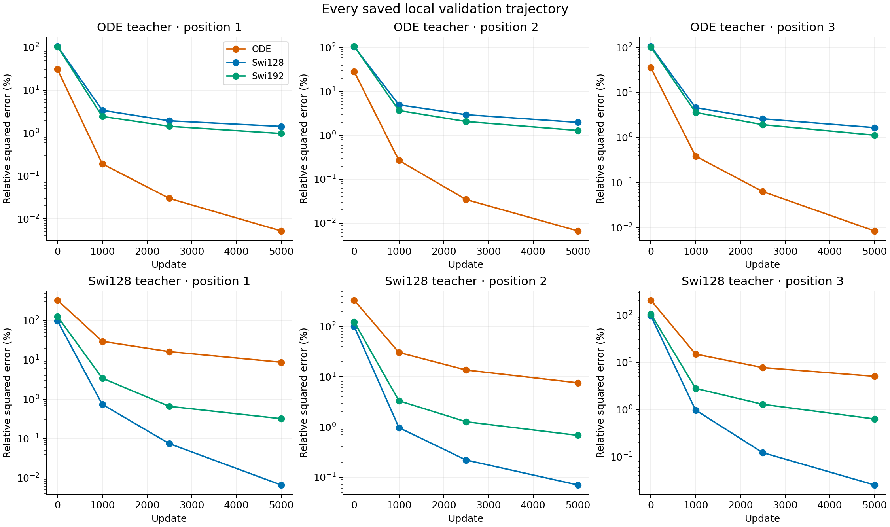
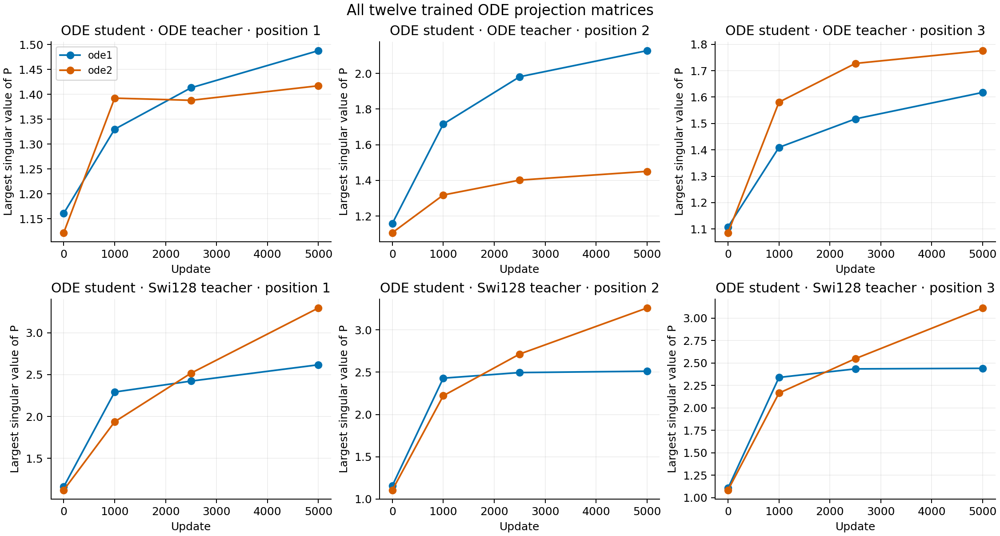

# The fitting gap is already present inside a single FFN

On the same fixed 64-dimensional inputs, the original ODEFFN fits three frozen SwiGLU128 modules with relative squared errors of 8.75%, 7.57%, and 5.04%. SwiGLU128 reaches 0.0066%, 0.0697%, and 0.0254%; SwiGLU192 reaches 0.320%, 0.679%, and 0.631%. The gap therefore appears without training an entire backbone or aligning hidden spaces across models. It remains a finite-budget fitting result, not an expressivity lower bound.

## What was isolated

Each position receives the actual post-LayerNorm, post-FiLM input of the frozen SwiGLU128 backbone. All students and both local teachers receive identical tensors. Targets are the unchanged original-ODE or SwiGLU128 FFN from that position. Only a cold student FFN is trained; no surrounding head, norm, conditioning or prefix is optimized. This avoids a naive transplant between different learned coordinate systems.

The eighteen cells use 100000 cached training inputs, the same batch-index stream, 5000 updates, batch 512, AdamW 3e-4, weight decay 0 and clip 1. Constructors and their position-specific initial tensors match the historical cold checkpoints. All reported risks use the existing 20000-input validation bank; fixed-time panels and derivative diagnostics are secondary. Full details are in the [protocol](protocol.md).

| Local teacher | Position | ODE student | SwiGLU128 student | SwiGLU192 student |
|---|---:|---:|---:|---:|
| Original ODE | 1 | 0.005224% | 1.423347% | 0.974265% |
| Original ODE | 2 | 0.006600% | 1.973376% | 1.291793% |
| Original ODE | 3 | 0.008415% | 1.661934% | 1.130935% |
| SwiGLU128 | 1 | 8.754058% | 0.006607% | 0.319964% |
| SwiGLU128 | 2 | 7.572775% | 0.069739% | 0.678627% |
| SwiGLU128 | 3 | 5.037679% | 0.025396% | 0.630957% |

Values are MSE divided by the corresponding teacher's output energy. They are squared-error percentages, not relative RMS errors or generation metrics. [comparison.csv](comparison.csv) includes every absolute risk and derivative measure.

The predeclared local-gap pattern appears at all three positions: ODE exceeds 5% on the SwiGLU targets, both generic controls remain below 1%, and the ODE/generic error ratios exceed four. ODE self-fitting remains below the declared 5% guard. Position 3 is only slightly above the 5% descriptive cutoff, so the continuous values and ratios matter more than that binary label. Relative to SwiGLU192, ODE errors are 27.36, 11.16, and 7.98 times larger.

## Most excess error is outside the affine component

After viewing aggregate results, an [explicitly exploratory decomposition](protocol-affine-decomposition.md) projected each student-minus-teacher error onto the span of a constant and the common input coordinates. Orthogonality gives an exact empirical split between that affine component and the remainder.



For the SwiGLU targets, the remaining component accounts for 90.85%, 82.94%, and 85.65% of the ODE excess over SwiGLU128; the corresponding shares against SwiGLU192 are 90.77%, 81.82%, and 84.38%. A wrong affine transformation alone is therefore not an adequate description of the measured gap. This is a bank-specific error decomposition, not a learned repair or a lower bound on retrained architectures.

Position 1 provides a concrete example. The ODE student's absolute risk is 0.070100, of which 0.006417 is affine and 0.063683 remains. SwiGLU192's risk is 0.002562, split into 0.000187 and 0.002375. The comparison preserves the affine mismatch while showing that most excess occurs in the remaining response. Every position and both teacher families appear in [error-components.csv](error-components.csv) and [component-contrasts.csv](component-contrasts.csv).

The teacher functions themselves differ. Their nonaffine energy fractions are 6.67%–8.10% for the ODE targets and 15.68%–21.91% for the SwiGLU targets. Absolute nonaffine energies overlap: 0.190–0.228 versus 0.130–0.310. These quantities do not define a complete complexity measure, and amplitude normalization does not make the functions equally demanding.

## This is not universal inability to learn

The ODE modules learn their own targets accurately, while both generic students retain larger errors on those targets. Conversely, the SwiGLU targets strongly favor their own family. Initialization matters: the native ODE begins closer to its own teacher in output space than the generic controls do. The study does not separate that starting advantage from structural compatibility and optimization.



This local ordering also differs from the earlier [complete-network teacher experiment](../research-realizable-teacher-2026-10-26/analysis-report.md), where generic backbones fit the complete ODE teacher more accurately than the original ODE backbone. Whole networks can redistribute computation through their other modules. We should not infer complete-network capacity ordering from one isolated FFN comparison.

The local derivative gap is visible on the fixed first-128-input panel. On the SwiGLU targets, ODE relative Jacobian errors are 2.231, 1.265, and 1.089, versus 0.556, 0.202, and 0.196 for SwiGLU192. These are squared Frobenius-error ratios on that panel, not a full-distribution derivative estimate. [time-panels.csv](time-panels.csv) retains every fixed-time function risk.

## P changes, without identifying a spectral cause



The projections are active and tend to grow more on SwiGLU targets. Larger norms coexist with fitting error, but this observation does not identify spectral instability as its cause. All six ODE cells have zero recorded clipping fraction over the final 500 updates. That window does not describe the full optimization history. Previous rejected spectral and gate settings are not reopened here.

For the original solve, the exact input differential is

```text
Q(a) = I + aP + (a²/2)P²
J_L = Q(a) + (Ph + aP²h) (grad a)^T
J_FFN = J_L2 · diag(SiLU'(L1(h))) · J_L1
```

The scalar-clock contribution is a rank-one update locally; the full composition remains nonlinear and can be full rank. A raw P spectrum therefore does not determine the full module Jacobian. Separate closed formulas agree with native double-precision forwards and Jacobians throughout the audit, with maximum differences 7.11e-15 and 2.89e-15 respectively.

## Implication for the next design

The evidence now places the deficit at a more specific boundary: the original local operator has difficulty fitting the nonaffine response of these trained generic modules under common inputs and the fixed budget. This does not require a whole-network coordination failure to appear. It favors studying the function family produced by two polynomial linear-flow maps around SiLU before adding recurrence or increasing integration accuracy.

The exact cause is unresolved. In particular, this result does not choose extra gates, a new activation, forcing bias, a bigger state, or a mixed generator; related variants already have negative project evidence. The next mathematical question is recorded in [next-question.md](next-question.md). A useful candidate still needs an isolated architectural mechanism, strong ordinary controls, ordinary FM training, transfer and measured cost.

All eighteen training cells and the independent audit are terminal. Training took 72.09 seconds using two one-thread CPU workers; the largest observed summed parent/child RSS was 1.101 GiB. Audit took 10.56 seconds. Lenovo remained unreachable; no GPU was reserved. Existing work and submitted Report1 are preserved, with no commit or push. Workflow provenance is acknowledged in the protocol rather than used as model evidence.
