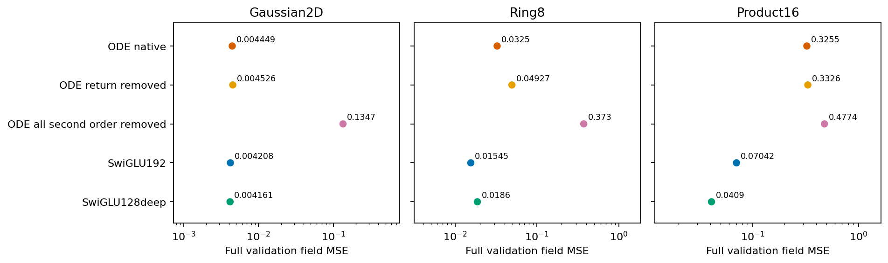
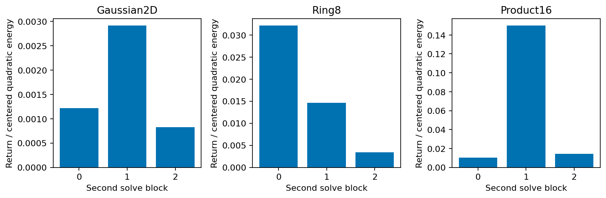

# The internal K2 mean-return path is observable, but deleting it does not help

The registered intervention fails the practical screen on all three tasks. There is no justification here for training a mean-projected second generator or sweeping its strength.

| Task | Native ODE | Return path removed | Change | Entire second-order term removed |
|---|---:|---:|---:|---:|
| Gaussian2D | 0.0044488 | 0.0045258 | +1.73% | 0.1347317 |
| Ring8 | 0.0325026 | 0.0492722 | +51.59% | 0.3730354 |
| Product16 | 0.3255273 | 0.3325865 | +2.17% | 0.4773760 |

Values are full-validation field MSE. SwiGLU192 remains at 0.0042083, 0.0154476 and 0.0704226; SwiGLU128deep at 0.0041615, 0.0185973 and 0.0409026. The latter has a different supervision history and is a practical comparator, not a loss-matched one-factor control.



## The mathematical distinction tested

The preceding study found that deleting a uniform shift from each complete FFN output leaves the final prediction unchanged. It would be incorrect to extend that result to the internal states of the K2 polynomial.

For u=ones/sqrt(d), C=I-u u^T, the second solve has output L_P(z)=z+a(z)Pz+a(z)²/2 P²z. Direct algebra gives

```text
C[L_P(z)-L_(CP)(z)] = a(z)²/2 (C P u)(u^T Pz).
```

A signal along the uniform channel direction after the first multiplication can be returned to a centered direction by the second multiplication. The experiment subtracts just that rank-one return term; independent replay instead changes each actual second-solve matrix to CP and executes the original forward. The first solve, SiLU, once-computed scalar clock, and centered first-order action remain intact. Subsequent states and gates are recomputed.

The two implementations agree across all measured full predictions and complete Jacobians, to maximum absolute differences of 8.44e-15 and 2.84e-14 respectively. This verifies that the measured effect is the specified intervention. It is not evidence for a training benefit. Removing final uniform outputs again leaves predictions/Jacobians unchanged, as required by the separate control.

## What the local measurements show

The return path carries 0.08–0.29% of centered quadratic energy across Gaussian blocks, 0.34–3.21% across Ring8 blocks, and 1.04%, 14.99%, 1.45% across Product16 blocks. These are ratios of summed energies on all five panels, not independent effects or parameter-importance scores. The denominator is only the centered second-order term, not the full FFN or total state energy.



Deleting the complete second-order term causes a substantially larger error increase than deleting the return component. The trained second solve therefore uses more than this particular rank-one pathway. This frozen ablation does not establish whether a model trained without the term could compensate.

The full-network error change can be separated exactly into residual alignment plus finite output-change energy. On Ring8 these average contributions are +0.004634 and +0.012136, summing to the observed +0.016770 MSE. On Product16 alignment is slightly negative (-0.000985), but the finite change energy (+0.008044) dominates. A locally favorable component of error alignment does not make the registered finite deletion beneficial, and does not trigger a coefficient search.

A case fixed before outcomes—Product16, t=.5, input 0, block 1—has return-term RMS 0.12349. The global deletion slightly improves this input's field error, 0.390775→0.387668, while worsening the aggregate. Only 37.59% of full-validation Product16 inputs improve; the single example is retained to illustrate heterogeneity, not to nominate a method.

## Scope and decision

Nine checkpoints and their original source/data were restored. Native float32 predictions and derivatives reproduce all saved panels bitwise. The diagnosis includes 24 full-field arrays, 120 full panel Jacobians, 45 local path checks, and per-input risk identities on fields and panels. Five actual-model/algebra/finite-difference unittest cases passed before freezing source. The complete matrices were edited only in independent in-memory copies; prior weights and runtimes are unchanged.

This result rejects advancing the declared mean-return deletion at these trained weights. It does not prove that every normalization-compatible ODE architecture fails, that the return path causes the ODE's baseline gap, or that a small path energy makes it unimportant. It does establish that the exact final-mean invariance is insufficient grounds for centering P inside a K2 solve.

The run used one CPU thread on Mac mini, with nine process snapshots: 11.75 seconds through the last model, peak RSS 447 MiB, and at least 4.752 GiB available memory. Plot generation follows those measurements. No GPU, new training, sample-generation continuation or tuning was used. Lenovo remained offline when checked. The broader research goal remains active; this setting is stopped.

Protocol: [fixed before outcomes](../protocol.md). Algebraic derivation: [normalization and the return path](../../research-normalized-geometry-2026-10-26/mathematics.md). Measurement detail: [appendix](stats-appendix.md). Procedural skills and their source are recorded in [notes](../notes.md); they are not model evidence.
