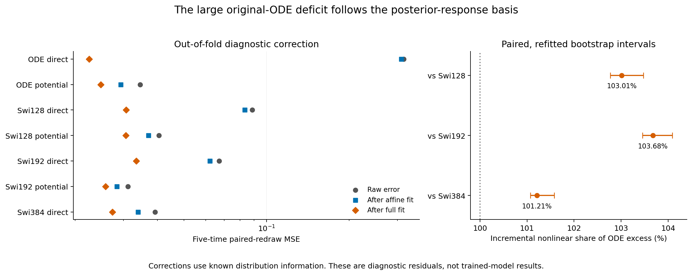
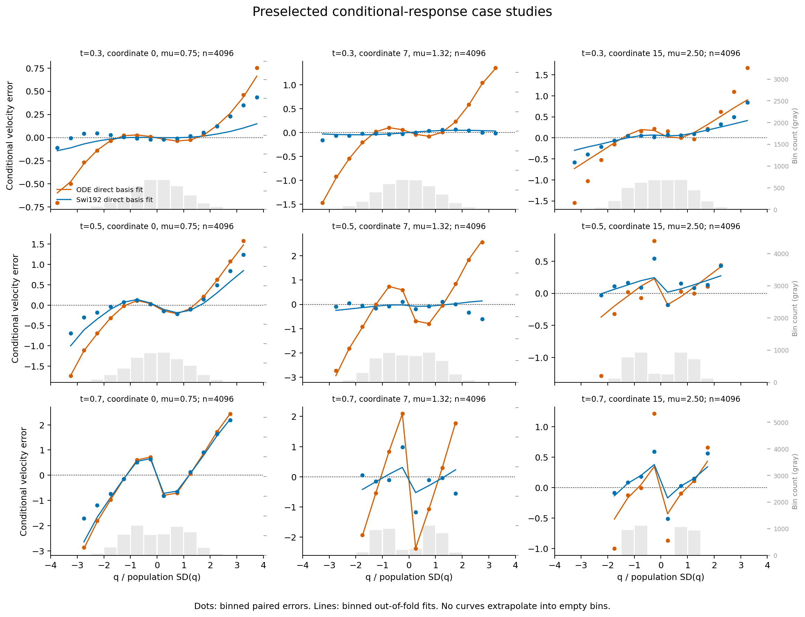

# The original ODE misses the coefficients of a simple conditional response

The new diagnostic localizes almost all of the original ODE's own-coordinate error to a three-function response basis. On Product16, an out-of-fold fit using a constant, the input coordinate and the known posterior nonlinearity accounts for .294207 of its .297768 conditional-response error, or98.8%. An affine fit accounts for only .006793. The large remaining deficit is therefore consistent with an incorrect combination of linear and nonlinear responses, rather than a need for a complicated new response shape on these probes.

This is a diagnosis of fixed models. The fit uses the known target distribution and rotation; its corrected residuals are not results achieved by a trained architecture. Alignment with this basis does not show that the native model already contains the missing nonlinear feature: even a purely linear prediction has an error in this basis. The result does not separate an absent feature from an incorrectly weighted feature.

## What was tested

The earlier redraw experiment separated error along the relevant coordinate from dependence on the other coordinates. This follow-up asks what form the conditional error takes. All seven original final predictors, all five times and all4096 row pairs are retained under the [fixed protocol](protocol.md). No model is retrained or re-evaluated.

For this population, Gaussian conditioning gives the exact latent-coordinate target

```text
v*(q,t) = alpha(t)*q + beta_i(t)*tanh(kappa_i(t)*q).
```

We fit each model's paired conditional error using the affine basis[1,q/SD] and then the full basis[1,q/SD,tanh(kappa*q)]. Each half of the rows fits the correction evaluated on the other half. The full basis changes coefficients, not the nonlinear argument kappa. The risk reduction is computed on held-out rows, and256 paired bootstrap resamples refit both folds each time.

## Main observations

| Fixed model | Raw paired risk | Conditional-response risk | Affine-fit reduction | Full-basis reduction | Conditional risk left |
|---|---:|---:|---:|---:|---:|
| ODE direct | .316705 | .297768 | .006793 | .294207 | .003561 |
| Swi128 direct | .088685 | .069347 | .005441 | .057962 | .011385 |
| Swi192 direct | .067145 | .046815 | .005002 | .033685 | .013130 |
| Swi384 direct | .039185 | .021503 | .005245 | .011780 | .009723 |

These five-time population-redraw risks differ from the uniform-time primary training evaluation. Full tables include all three potential-readout arms and every time.



Relative to direct Swi128/192/384, the incremental nonlinear component accounts for103.01%,103.68% and101.21% of the total ODE excess. Their95% refitted-bootstrap intervals are[102.77,103.48]%,[103.46,104.09]% and[101.07,101.58]%. Every registered majority condition passes. Values above100% are retained: after this privileged correction, the ODE has less residual error than the respective reference. They are signed differences of risk reductions, not probabilities or a deployable performance advantage.

The potential-readout ODE has much less raw error, but still retains .006211 conditional risk after the same full-basis fit. Thus the projection does not remove every model's conditional error automatically. The original model's particular deficit is unusually well aligned with this response family.

## A concrete case



Coordinates0,7,15 and times.3,.5,.7 were chosen before this fit. At t=.7, coordinate7 has true linear/nonlinear coefficients(-2.482,3.601). Averaging the two training-fold coefficient fits gives approximately(.898,.047) for the ODE and(-1.867,2.939) for Swi192. The ODE's fitted response is almost linear there. At the same time, coordinate15 is much closer: its true nonlinear coefficient is6.843, compared with6.137 for the ODE and6.381 for Swi192. This is a case of uneven learning across coordinates at one fixed time, not merely an aggregate score difference.

These coefficients describe projections of the complete predictor. They do not assert that a literal tanh feature exists inside either network. Early-time basis functions can also be nearly collinear; the worst condition number is2228. The displayed t=.7 examples have condition numbers about5–11, and independent QR fitting confirms the numerical results. All coordinates and both fold coefficients remain in the exported table.

## What follows

This result makes a narrower question worth pursuing: why does the original ODE learn the strength of some conditional nonlinear responses while missing others, when the full response family remains simple? The answer still needs to distinguish shared parameter coupling, learned features and optimization. This diagnostic alone does not choose a new P constraint, activation or training recipe.

The independently audited [local-adjoint screen](../research-local-adjoint-2026-10-26/analysis-report.md) remains negative against ordinary tied-SiLU and SwiGLU. No stopped branch is reopened, and no new architecture is nominated here. Any next design must address the measured response-learning disparity and survive ordinary controls without access to the oracle basis.

The [audit appendix](stats-appendix.md), [complete aggregates](aggregate.csv), [all-time results](all-times.csv), [all coefficients](all-coefficients.csv), [primary contrasts](contrasts.csv) and [case-bin counts](case-bins.csv) preserve the evidence. Submitted Report1 is unchanged.
