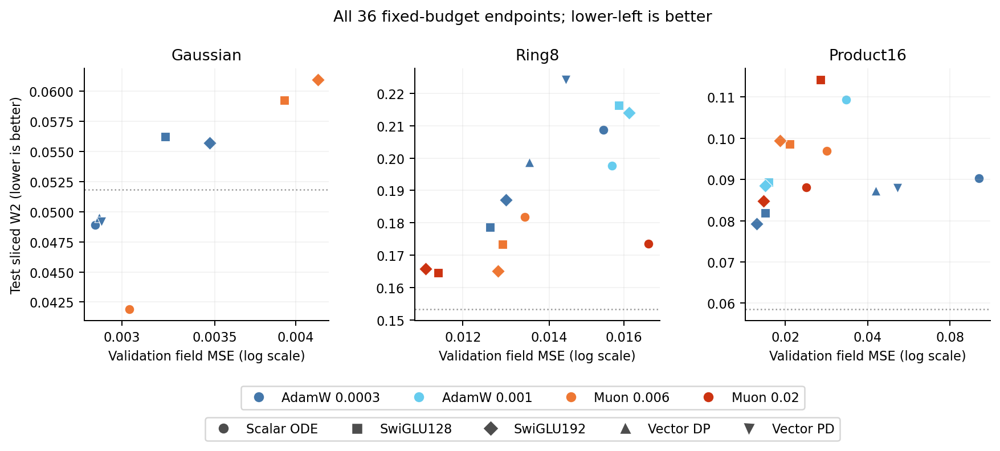
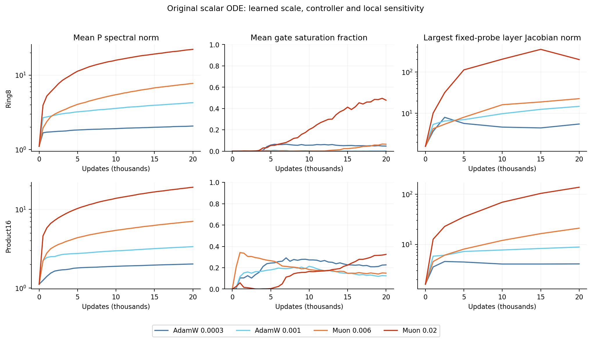
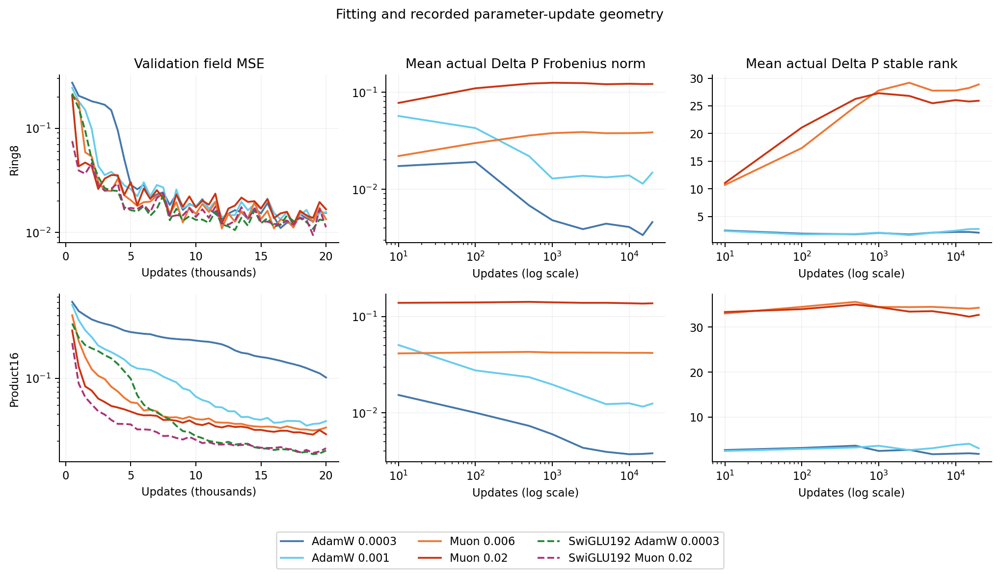

# Replayed first-wave evidence and the next counterfactuals

Muon improves the original scalar ODE on Product16, but neither scalar Muon nor
the vector placements surpass the ordinary controls. Larger matrix updates,
higher effective update rank, growing P norms and increased hidden-layer
sensitivity occur together. The first wave does not identify which causes the
fit improvement. This is the reason for the registered second wave.

## Verification

All36 final checkpoints were restored on the original host/device, including
nonpersistent buffers. Regenerated4096-point test samples match the saved arrays
exactly. Field MSE was accumulated independently in float64; maximum absolute
deviation from the recorded scalar was4.41e-10. Independent NumPy projection,
sorting and distance calculation reproduced test SW2 within1.01e-8. Data hashes,
checkpoint/config/manifest identities and sample targets were checked.

[verification.json](verification.json) summarizes the checks. `endpoints.csv` contains independently
replayed values and checkpoint hashes; `curves.csv` and `updates.csv` contain
the recorded time series. The executable auditor is `audit_completed.py`.

## Quality comparison

Lower-left is better. All36 configurations are included; dotted lines show the
reference-versus-reference sample floor. Gaussian, Ring8 and Product16 need
separate interpretations. Field error and sampling distance do not give the
same ordering, particularly on Ring8. No image-generation conclusion follows.

Selected fixed-budget Product16 contrasts (both metrics lower-is-better):

| Configuration | Field MSE | Test SW2 |
|---|---:|---:|
| Scalar ODE AdamW0.0003 |0.102262|0.090331|
| Scalar ODE AdamW0.001 |0.033431|0.109359|
| Scalar ODE Muon0.006 |0.028314|0.096885|
| Scalar ODE Muon0.02 |0.023849|0.088098|
| Vector DP AdamW0.0003 |0.042745|0.087277|
| Vector PD AdamW0.0003 |0.051505|0.087924|
| SwiGLU128 AdamW0.0003 |0.016855|0.081848|
| SwiGLU192 AdamW0.0003 |0.015668|0.079206|

Raising AdamW's selected-matrix learning rate already closes much of the gap.
Muon0.02 improves field error by28.7% over that stronger scalar AdamW control,
yet its error remains52.2% above the wider SwiGLU. Both ordinary widths beat
the scalar ODE on field and sample error in this comparison. The full exact
table, including the remaining optimizer settings, is in the parent endpoint
audit and [complete endpoints](../../endpoints/all-configurations.csv).

## Case study: growing P and saturation

At Muon0.02, P norms grow throughout training. On Product16 the mean spectral
norm rises to19.17, versus3.37 for AdamW0.001. The largest recorded local ODE-layer
Jacobian norm is137.9, versus8.88 for that stronger AdamW control. On Ring8 the
corresponding values are200.4 and14.76. These are maxima over two fixed hidden
inputs in each of six ODE solves, not global Lipschitz bounds or Jacobians of the
complete velocity network.

Saturation is heterogeneous across layers. Product16's first Muon0.02 solve has
mean gate0.2038 and95.3% saturated probe entries; the six-layer average saturation
is32.5%. Reporting95.3% as a whole-model value would be wrong. The comparable
default-AdamW first solve has mean gate0.8275 and no saturated entries, although
other layers do saturate. The vector gates have substantial channel variation;
their failure to beat the baseline cannot be dismissed as every gate staying
constant.

These observations motivate controlled decay of the selected matrices. They do
not establish that large P caused a quality failure: the original scalar model
actually fits better under Muon despite these larger local sensitivities.

## Case study: update magnitude is a confound

The Muon updates have much larger stable rank, but also much larger Frobenius
norm. On Product16, their magnitude stays nearly constant while AdamW's declines.
The higher-rate Muon run therefore changes both direction geometry and scale.
The first wave cannot attribute the gain solely to spectral flattening.
The registered normalized-momentum counterfactual keeps the raw momentum
direction at the same current-gradient hypothetical Muon norm. SwiGLU receives
the same counterfactual so an ordinary optimizer effect is not mislabeled an
ODE-specific mechanism.

## Claim candidates

- **Keep:** Muon improves this original scalar ODE's20k Product16 field fitting.
  Evidence: replayed endpoints and fitting curves. Allowed wording is confined
  to this registered task/budget. Do not say ODEFFN beats SwiGLU. Next check:
  magnitude-matched direction control and growth-controlled Muon.
- **Revise:** the benefit comes from a more balanced update spectrum. Update rank
  increases, but update magnitude also changes. This is a hypothesis, not an
  identified cause. Next check: within-state norm matching, with ordinary controls.
- **Discard as a result claim:** PD improves on DP. First-wave PD has worse field
  MSE on all three tasks. Next check: explicitly registered optimizer interaction
  and balanced sandwich placement, retaining the negative original comparison.
- **Keep as a diagnostic:** P growth coexists with gate saturation and larger
  local ODE Jacobians. Do not claim whole-model instability or certified spectral
  bounds. Next check: selected-matrix decay, actual-update norm decomposition,
  and unchanged quality metrics.

No new training family follows automatically from these hypotheses. See the
registered wave2 protocol for the exact30 new cells and decision rules.
