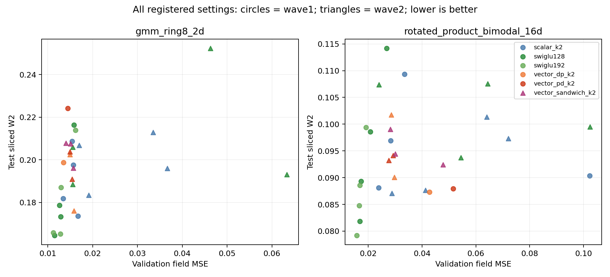

# Second-wave findings

All 30 new configurations completed 20,000 updates. Replaying their checkpoints
reproduced saved generated samples exactly; independently calculated NumPy SW2
agreed within 1.33e-8. The complete comparison includes all 28 first-wave
nonlinear-task controls. Neither new diagonal placement nor matrix decay
establishes an ODEFFN advantage over SwiGLU.

## Direction versus magnitude

At Product16 LR0.02, scalar Muon has field MSE0.023849 versus0.041233 for
norm-matched raw momentum (42.2% lower). At LR0.006 the difference is much
smaller:0.028314 versus0.028808 (1.7% lower). The update direction matters in
these comparisons, especially at the larger rate. This does not isolate a single
spectral statistic: trajectories and gradients diverge after the first updates.

Sampling does not follow this field ordering: the momentum controls give
SW2 0.087624/0.087059 at0.02/0.006, versus Muon's0.088098/0.096885.
On Ring8, Muon improves both metrics over momentum at both rates. SwiGLU128
also benefits in field MSE from Muon versus matched momentum at all four
rate/task combinations. The benefit therefore is not specific to ODE layers.

## Shrinking P is not sufficient

Product16, original scalar ODE, Muon LR0.02:

| Matrix decay | Field MSE | Test SW2 | Mean P spectral norm | Max local layer Jacobian | Mean gate saturation |
|---|---:|---:|---:|---:|---:|
|0|0.023849|0.088098|19.173|137.87|0.325|
|0.1|0.072046|0.097299|2.601|2.96|0.446|
|0.5|0.064032|0.101349|1.097|1.76|0.520|

The intervention achieves smaller matrices and local sensitivity, but field
fitting becomes about2.7–3.0 times worse. Saturation does not improve uniformly.
Ring8 also loses quality; ordinary SwiGLU loses field accuracy under these decay
settings as well. This rejects these tested decay settings as useful repairs,
not every possible weak or scheduled decay.

The original layer is F(h)=h+sPh+(sP)^2h/2. Shrinking P by a factor c changes
its first-order term by c and its second-order term by c^2, at fixed h and s.
Thus weight decay changes available computation as well as sensitivity. The
measured Product16 second-term/input RMS ratio falls from14.95 without decay
to0.868/0.062. These are learned-run associations, not a controlled proof that
losing the second term caused the error. Gate saturation and external residual
mixing also prevent equating these local Jacobians with whole-network stability.

## Placement has an optimizer interaction, not an established advantage

Product16 field MSE:

| Placement | AdamW0.0003 | Muon0.006 | Muon0.02 |
|---|---:|---:|---:|
|Scalar|0.102262|0.028314|0.023849|
|DP|0.042745|0.028568|0.029682|
|PD|0.051505|0.029183|0.027648|
|sqrt(D) P sqrt(D)|0.047802|0.028237|0.030054|

PD becomes better than DP at the larger Muon rate; it was worse under AdamW.
However, neither beats scalar Muon0.02, and the strongest ordinary control is
still SwiGLU192 AdamW0.0003 (MSE0.015668,SW2 0.079206). Ring8's strongest
ordinary field control is SwiGLU192 Muon0.02 (0.011231); no new arm beats it.
The near tie between sandwich and scalar at Muon0.006 on Product16 is not a
convincing new architecture result and does not beat the better scalar rate.

## Next decision

Stop expanding the placement grid and do not carry these decay settings into
image training. Retain official Muon as an optimizer candidate. The focused next
question is whether its gain requires the tied second-order term at all.

A cold K1-versus-K2 comparison should keep the same scalar controller, P,
initialization, data stream, backbone, loss and20k budget, cross both orders with
the existing AdamW/Muon rates, and retain both ordinary widths. K1 changes only
`h+sPh`; K2 adds `(sP)^2h/2`. Record term magnitudes, gradients, spectral evolution
and wall time alongside field and SW2. Equal updates do not mean equal compute.
The existing K2 controls can be reused only after native identity checks.

Historical order studies already exist. Audit their optimizer and training
settings before registering this interaction as new; do not repeat an answered
comparison or describe a frozen K2-to-K1 substitution as a cold K1 training result.
No third-wave training was launched in this analysis pass. Both completed queues
have released their GPUs. This is synthetic vector-field evidence, not image FID.

## Artifacts and reproduction

`endpoints.csv` contains all30 replayed endpoints and checkpoint hashes;
`all-comparisons.csv` includes every wave1/wave2 nonlinear setting; `curves.csv`
and `updates.csv` preserve recorded trajectories and sparse update diagnostics.
`verification.json` records maximum replay errors. Run `audit_completed.py
--wave2` against each frozen runtime and pass its JSON receipts to
`wave2/summarize_results.py --out <this folder> <145 receipt> <Lenovo receipt>`.
Keep raw checkpoints and data outside Git. Report PDFs remain unchanged.
