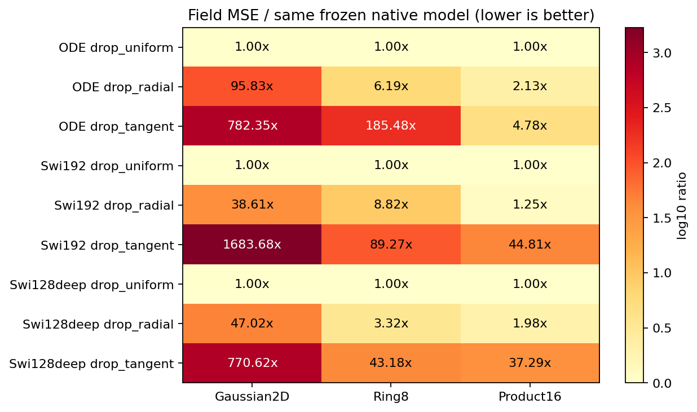
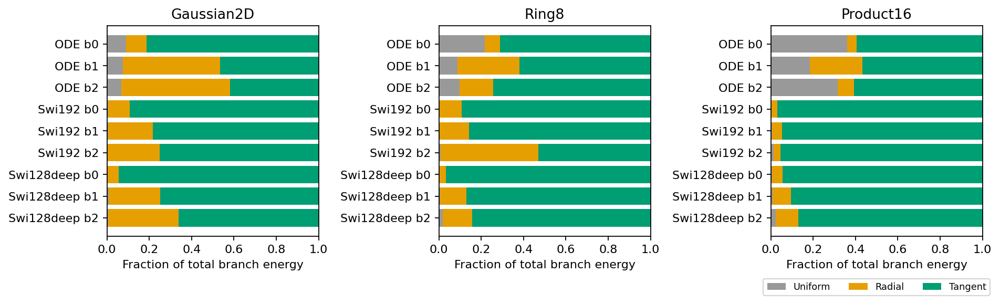
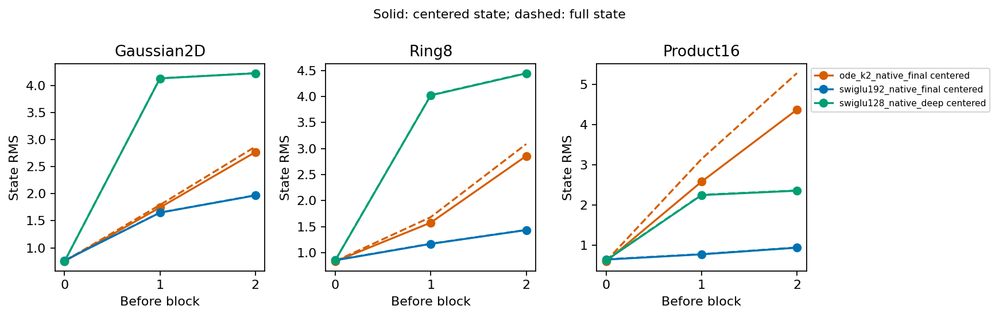
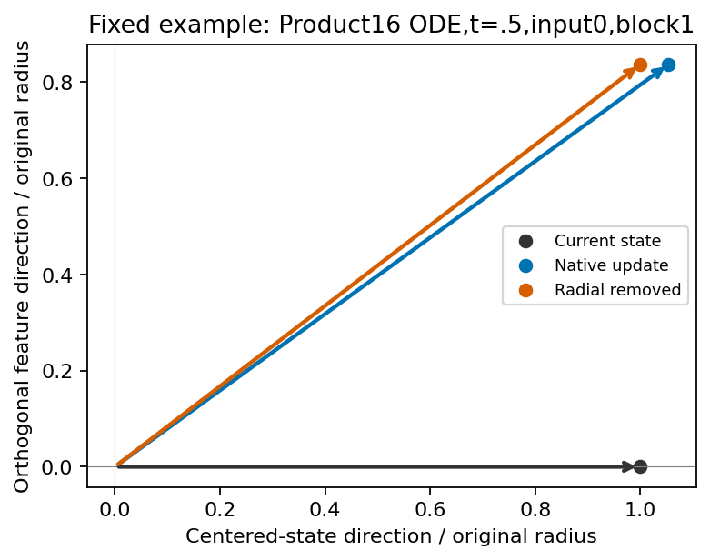

# Normalized hidden geometry: completed diagnosis

The frozen-checkpoint experiment does not justify a new geometric projection architecture. Removing the radial branch worsens every tested native predictor; no setting qualifies for sampling or training under the registered rule.

| Task | Original ODE field MSE | Radial removed | Tangent removed |
|---|---:|---:|---:|
| Gaussian2D | 0.0044488 | 0.4263188 | 3.4804990 |
| Ring8 | 0.0325026 | 0.2013009 | 6.0287373 |
| Product16 | 0.3255273 | 0.6938830 | 1.5574351 |

The ordinary SwiGLU controls also worsen when radial or tangential components are removed. These interventions change a trained function; they do not establish impossibility for a retrained architecture.

A separate exact control is informative. Removing the uniform channel shift from every FFN branch preserves the complete network prediction and input Jacobian. On Product16, this direction accounts for 36.1%, 18.4% and 31.6% of the original ODE's branch energy in blocks 0–2. A large component can therefore be unobservable to the task. This does not establish wasted parameters, wasted computation, or the cause of the ODE/SwiGLU gap.

Centering does not remove all feature growth: the ODE's centered state RMS on Product16 grows from 0.603 before block 0 to 2.583 and 4.374 before blocks 1–2. Its later angular updates are around 33 degrees, compared with around 30 degrees for SwiGLU192. Neither “everything is an invisible mean shift” nor “the ODE cannot rotate features” is an adequate description of these traces.

The fixed case study uses Product16 ODE, t=.5, input 0, block 1. Radial removal moves the centered next-state coordinate from (1.05355, .83698) to (1, .83698), in the plane of the old state and its orthogonal update. Its individual field error slightly decreases, .390775→.386914, despite the worse aggregate result. This illustrates why one favorable example cannot nominate a method.

Independent replay through native-model hooks verified all 36 full validation arrays, 450 panel predictions, 180 full panel Jacobians and 135 native geometry groups. Maximum absolute replay differences were 3.67e-11 for predictions and 2.82e-7 for Jacobians. The very large Jacobians in some tangent-removal interventions are retained in comparison.csv; no derivative failures or inconvenient outcomes are excluded. The analyzer did not audit every altered trace angle as a new numerical invariant.

This result shifts the question from raw norm magnitude to observable computation. The [mathematical note](../mathematics.md) derives a precise limitation of the shift argument: in K2, an internal mean-direction excursion can return to a centered direction during the second multiplication by P. A [separately registered follow-up](../../research-mean-return-2026-10-26/results/analysis-report.md) subsequently tested that internal path; its removal worsens all three full-validation fields and does not justify a constrained-P training run.

No new training or GPU allocation was used. The one-thread check recorded nine resource snapshots, reaching about 539 MiB RSS with at least 4.738 GiB available memory. Source and prior training runtimes are preserved. Lenovo was offline. Submitted Report1 was not modified.

Procedural attribution: the hypothesis-generation, experimental-design, daily-coding and planning-with-files skills informed the workflow. See Kassis et al. (2026), [Scientific Agent Skills](https://doi.org/10.48550/arXiv.2609.00065); this is workflow attribution, not evidence for the model mechanism.
