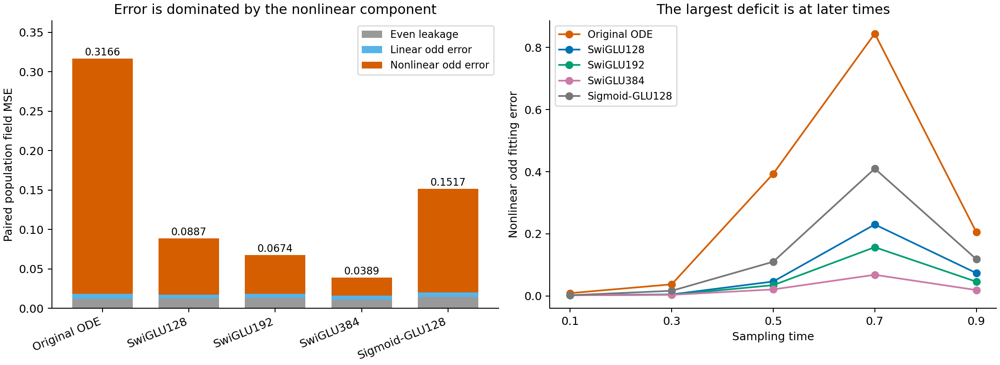
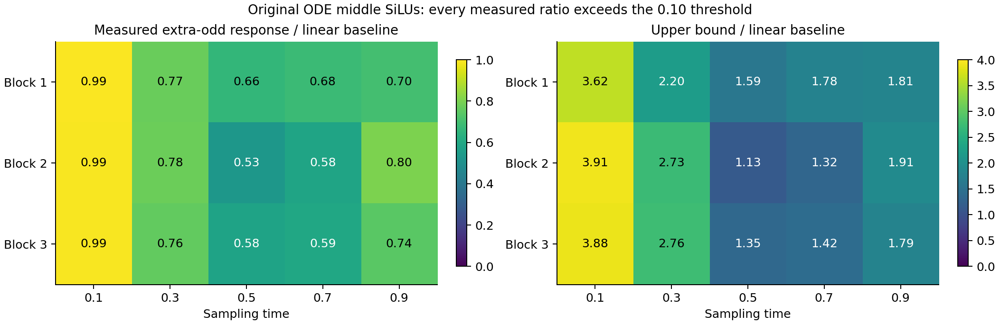

# The nonlinear fitting deficit is real; the small-SiLU-response explanation fails

The original ODE's deficit is concentrated in its nonlinear response. The actual learned middle SiLUs depart substantially from the centered linear-odd formula, so that formula does not explain the deficit. This study selects no activation replacement or new architecture.

We evaluate five frozen final predictors on the same 4096 population rows at each of five times, pairing every physical input x with exactly -x. Product16's analytic velocity is odd. The models retain their original weights, buffers and training seed 0. No model is fitted or updated in this study; the linear projections describe saved fields.

For these input pairs, total field error splits exactly into even leakage, a linear part of the odd prediction error, and its residual nonlinear part. The projection uses the raw 16 input coordinates without a target-specific nonlinear basis. These are finite-panel components, not independently trained models.

| Predictor | Total MSE | Even leakage | Linear odd error | Nonlinear odd error |
|---|---:|---:|---:|---:|
| Original ODE | 0.316568 | 0.012117 | 0.006473 | 0.297978 |
| SwiGLU128 | 0.088724 | 0.012788 | 0.004435 | 0.071500 |
| SwiGLU192 | 0.067377 | 0.013601 | 0.005120 | 0.048656 |
| SwiGLU384 | 0.038919 | 0.010872 | 0.005338 | 0.022709 |
| Sigmoid-GLU128 | 0.151666 | 0.014579 | 0.005642 | 0.131445 |

Against the three SwiGLU references, the nonlinear component accounts for 99.14–100.05% of the total excess error. Signed even-leakage contributions range from -0.60% to 0.45%. A fraction above 100% means another component partly offsets the nonlinear deficit; fractions are not clipped. Merely symmetrizing this ODE field would remove its 0.012117 even leakage and leave 0.304451 error, still far above the ordinary references.

| Reference | Nonlinear share of ODE excess | Central 95% refitted resample range |
|---|---:|---:|
| swiglu128 | 99.40% | [98.80%, 99.23%] |
| swiglu192 | 100.05% | [99.45%, 99.86%] |
| swiglu384 | 99.14% | [98.56%, 98.94%] |

The registered majority criterion passes for nonlinear error and fails for even leakage. These are paired row-resample ranges for fixed predictors. The nonlinear percentile ranges lie below their full-panel point estimates; they are reported as registered sensitivity ranges rather than calibrated population confidence bounds. See [statistical details](stats-appendix.md).

The local mathematical question was narrower. Centered SiLU satisfies `SiLU(d)-SiLU(-d)=d`, making its odd part linear in d. For learned preactivations `m+d` and `m-d`, an additional term R appears. We measured `eta=R_RMS/(d/2)_RMS` and its analytic upper-bound ratio zeta, retaining the actual paired centers.

All 15 middle-SiLU cases exceed the predeclared 0.10 threshold: eta ranges from 0.531 to 0.993. The bound ratios range from 1.129 to 3.908, so the small-center certificate also fails. The learned network is not close to the bias-free centered special case in this measurement. A large R does not prove useful nonlinear features: d can itself be nonlinear in the raw input, and subsequent transformations can discard or misalign a response.

At time 0.7, after removing each field's best raw-linear component, the original ODE's coefficient along the oracle's remaining signal is 0.274, versus 0.809 for SwiGLU192. Their relative residual RMS values are 0.472 and 0.862. This describes both weak magnitude and imperfect alignment in the ODE's nonlinear prediction. The complete [time table](field-by-time.csv) includes every time; at 0.1 the oracle's nonlinear energy is tiny, making normalized ratios especially sensitive.

Sigmoid-GLU128's 0.151666 total error lies between original ODE and SwiGLU128. Its idealized zero-center product has a linear odd part, yet its complete biased, conditioned network learns a nonlinear field. Thus the local SiLU/GLU/SwiGLU algebra does not rank the complete trained predictors by itself. The stored product moments are descriptive, not interventions that attribute causal contributions to gates or centers.

The six learned ODE clocks are also not uniformly constant: paired odd/even duration RMS ratios span 0.0010–0.2697. This does not identify a better clock. It further limits using the constant-clock linear-map analogy as a description of every learned layer.

The evidence narrows the design question to useful nonlinear fitting, while rejecting a simple local activation explanation. It does not justify changing SiLU, imposing exact odd symmetry, or claiming that a new ODE operator will improve images. A next architecture needs a separate mechanism linking its internal response to prediction accuracy and must still beat strong ordinary FFN controls. Product16 symmetry is a property of this diagnostic population, not an assumption about natural images.

The full [protocol](protocol.md), [component table](field-components.csv), [activation statistics](activation-statistics.csv), [primary contrasts](primary-contrasts.csv), and [figure catalog](figure-catalog.md) preserve the measurements. Manual forwards replay all 50 paired field tensors bitwise; independent weighted QR in rotated coordinates reproduces the projections and decisions. The main calculation took 6.82 seconds and its independent audit 13.73 seconds on one Mac mini CPU thread. Lenovo SSH remained unreachable, and no GPU was reserved. No training, sampling run, commit or push was launched. Earlier results and Report1 are unchanged.
