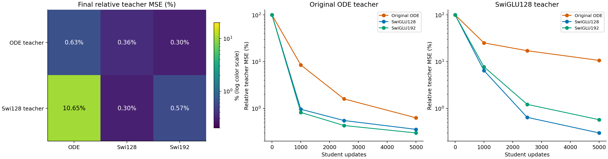
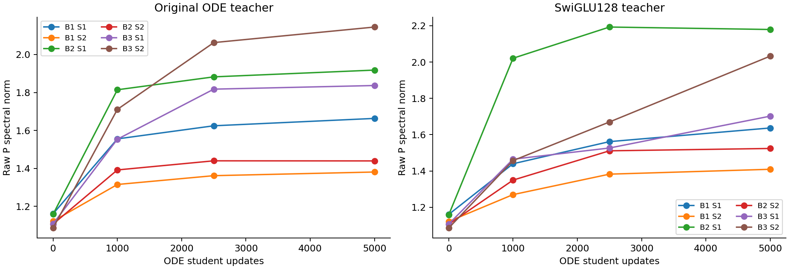

# A cold ODE learns its own teacher, but fits the SwiGLU teacher poorly

The original ODE student reaches 0.63% relative squared error on a frozen teacher of its own architecture. On the SwiGLU teacher it remains at 10.65%, compared with 0.30% for SwiGLU128 and 0.57% for SwiGLU192. The experiment establishes useful within-function contrast, but does not identify whether the harder target exceeds the ODE's finite function class or is harder to optimize.

This was six new cold seed-0 regressions on the same Product16 input stream, with unchanged architectures, 5000 updates, batch 512, AdamW 3e-4, weight_decay 0 and clip 1. The targets were complete frozen teacher outputs. The ODE teacher's weights and actual buffers are an explicit zero-risk representer in the ODE student's class; they were restored only in a separate procedural control, never copied into a cold student.

| Teacher | Cold student | Teacher MSE | Relative teacher MSE | Mean panel Jacobian error |
|---|---|---:|---:|---:|
| Original ODE | Original ODE | 0.008687 | 0.629% | 1.2531 |
| Original ODE | SwiGLU128 | 0.004921 | 0.357% | 0.8084 |
| Original ODE | SwiGLU192 | 0.004123 | 0.299% | 0.7024 |
| SwiGLU128 | Original ODE | 0.170694 | 10.652% | 28.5413 |
| SwiGLU128 | SwiGLU128 | 0.004791 | 0.299% | 0.9338 |
| SwiGLU128 | SwiGLU192 | 0.009184 | 0.573% | 1.8530 |

Teacher MSE uses all 20000 fixed uniform-time validation inputs. Relative MSE divides by the corresponding teacher's mean squared output. It is a squared-error percentage, not relative RMS error or a generation-quality score. Derivative error averages all five fixed-time 512-input panels; all time-specific rows are in [all-panels.csv](all-panels.csv).

The predeclared severe learning-difficulty pattern does **not** pass. The ODE self-teacher error is below the 5% cutoff. In addition, same-budget SwiGLU128 is better but does not halve that self-teacher error. The near-compute SwiGLU192 does approximately halve it. All controls remain visible rather than selecting the more favorable comparison. On the SwiGLU teacher, the ODE's error is 35.6 times SwiGLU128's and 18.6 times SwiGLU192's. That is a measured fitting gap, not an impossibility theorem.

The teachers have different local variation. Their output energies are similar, but their fixed-panel derivative energies differ:

| Frozen teacher | Uniform-time field energy | Mean panel Jacobian energy |
|---|---:|---:|
| Original ODE | 1.3801 | 19.4822 |
| SwiGLU128 | 1.6025 | 39.7596 |

These energies do not define a complete complexity measure or causal explanation. They prevent treating the targets as equally demanding merely because one can normalize their amplitudes. The larger SwiGLU192 student also fits the SwiGLU128 teacher worse than the same-width student at this endpoint, which limits a simple parameter-count explanation.

The two ODE students change all six P matrices during fitting. Their complete saved norm trajectories are below; [P-trajectories.csv](P-trajectories.csv) also retains Frobenius norms and symmetric minima. Different teacher risks coexist with modest P norms. Those internal norms do not certify full-network stability or determine the achievable nonlinear field.

The final-window clipping fractions are 0.000 on the ODE teacher and 0.010 on the SwiGLU teacher for ODE students. This describes the recorded last 500 updates; it neither characterizes every earlier step nor selects a clipping or optimizer intervention.

The realizable control excludes the absence of the ODE teacher from its own hypothesis class as an explanation for residual error on that function. Its accurate self-fit does not prove that the analytic population target or the SwiGLU teacher is representable by the same finite ODE. Earlier [parity](../research-parity-2026-10-26/analysis-report.md) and [P-tangent](../research-generator-tangent-2026-10-26/analysis-report.md) measurements remain separate: a nonlinear-fitting deficit was observed, while a small centered-SiLU response and severe K2 derivative-route cancellation were not supported.

This study does not nominate a new architecture, use distillation as a rescue method, or change the ordinary FM acceptance criteria. It leaves a more specific question: what structural limitation or learning mechanism makes the ODE predictor lose accuracy on the more strongly varying target? A proposed answer still needs a mathematically specified operator, an isolated cold comparison, strong generic controls, and ordinary FM/transfer/cost evidence.

All six cells finished in 96.3 seconds including cache preparation, using two one-thread Mac CPU workers. The largest observed sum of parent/child RSS was 1.43 GiB. One training-label pass per teacher reduced batch-label evaluations from 30000 to 10000; no GPU was reserved. Lenovo SSH remained unreachable. The independent audit took 18.9 seconds and replayed the full input/label stream, all 24 checkpoints and all 30 native endpoint panels. Separate explicit float64 forwards and Jacobians agree exactly. Submitted Report1 and every earlier runtime remain unchanged; no commit or push occurred.

The [protocol](protocol.md), [statistical and audit scope](stats-appendix.md), [comparison table](comparison.csv), [training metrics](training-metrics.csv), [figure catalog](figure-catalog.md), and [execution notes](notes.md) preserve the evidence. The useful-ODELayer objective remains active and unachieved.
