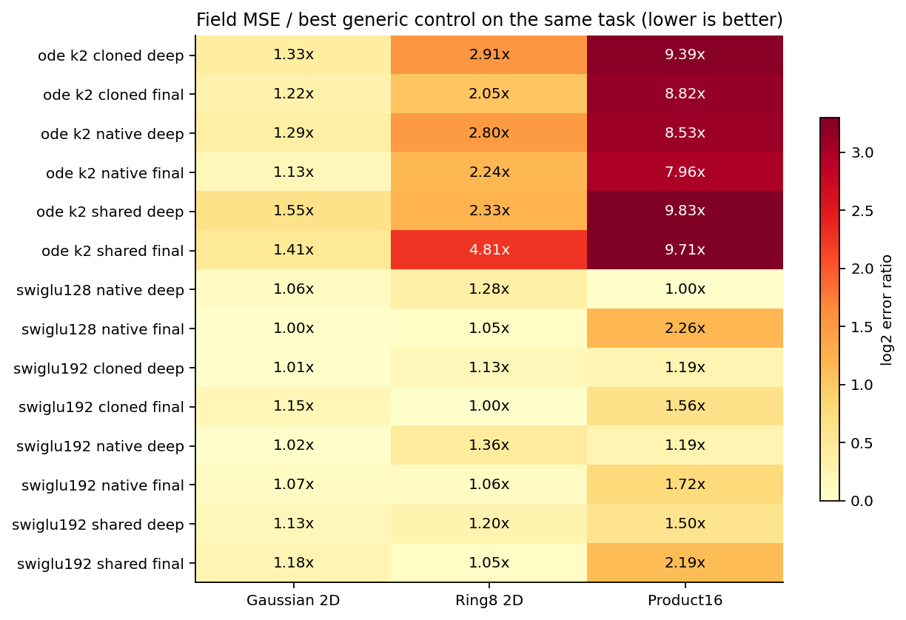
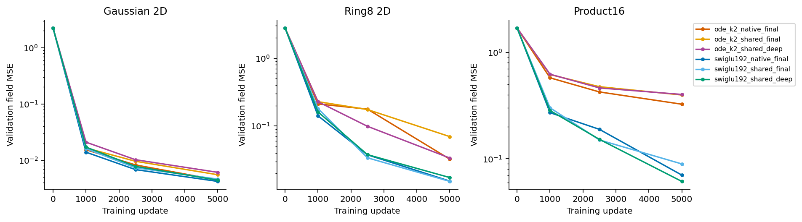
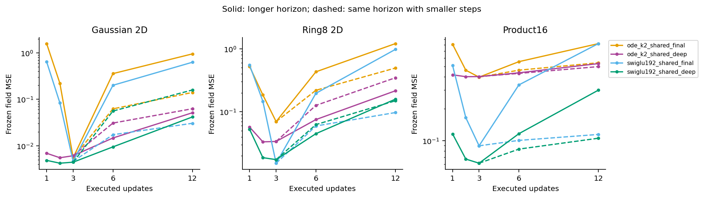
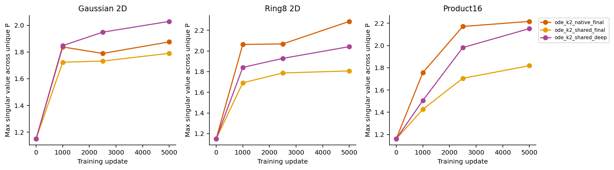

# Audited recurrent-depth analysis

The registered screen does not support an original-ODELayer quality or parameter-efficiency claim. No training-depth candidate or extended-sampling eligibility condition passed. The setting stops without additional sampling or20K continuation.

| Task | Best ODE field MSE | Best generic field MSE | ODE/generic |
|---|---:|---:|---:|
| gaussian_aniso_2d | 0.0044488 | 0.0039273 | 1.133 |
| gmm_ring8_2d | 0.0297260 | 0.0145355 | 2.045 |
| rotated_product_bimodal_16d | 0.3255274 | 0.0409026 | 7.959 |

The complete42-cell table is comparison.csv. Original scalarK2 FFNs remain unchanged; the factors are parameter sharing, independent-versus-cloned initialization, and final-only-versus-normalized intermediate supervision. Training uses seed0,5000updates, uniform-time direct pair-velocity targets, matched surrounding initialization and identical actual input streams per task. Source,168checkpoints, buffers, saved arrays and per-visit captures passed the independent audit.

Intermediate supervision changes behavior, but does not isolate an ODE-specific advantage. On Ring8 it reduces shared ODE field MSE from.0698944 to.0338066; on Product16 it changes.3972584 to.4019761. Shared SwiGLU benefits on Product16 (.0895918 to.0614098). Every loss comparison uses identical starting tensors and normalized loss weights. Paired fixed-weight evaluation differences and their conditional intervals are in paired-evaluation.csv; they are not significance claims about training variability.

Extra shared applications fail the registered nonlinear eligibility rule. For ODE shared-deep,3-to6 updates change field MSE .0338066 to.0752202 on Ring8 and.4019761 to.4363181 on Product16. Reducing the step at a fixed horizon also worsens the saved three-update predictor; it is not a retrained architecture. This rejects assuming that more accurate or longer hidden evolution must improve prediction. It does not identify a unique cause.

P trajectories are preserved per unique matrix; activation records retain each executed visit. The selected arms' maximum singular values remain numerically finite, around1.8–2.3 at the endpoint, while field errors differ substantially. Their spectra are not the complete conditioned-network Jacobian. In the last Product16 window, shared ODE clipping fractions are.004 for both losses, so pervasive clipping is not an adequate description of that endpoint gap. No spectral rescue is selected.

## Claim candidates

- Keep: the registered whole-network recurrence/deep-supervision setting fails the practical ODE-versus-generic screen. Evidence: full comparison and decision.json. Do not strengthen this to impossibility for all ODE architectures or image tasks.
- Keep: supervision stabilizes early readouts in some tasks without closing the ODE gap. Evidence: paired loss arms and frozen depth curves. Do not call it an ODE-specific mechanism.
- Revise: repeated forward computation is useful only if its update and task are learned appropriately; these results motivate a bounded test of input-anchored correction. Evidence: shared endpoints and depth behavior, together with the IIET primary-paper precedent. Anchoring is a new hypothesis, not a conclusion from this screen.

Four figures were visually inspected; the first heatmap's original cramped layout is retained in figures-v1 and replaced with a readable aspect ratio. Submitted Report1 and all raw runs are unchanged. The next protocol is [input-anchored correction](../../research-anchored-corrector-2026-10-26/protocol.md).
