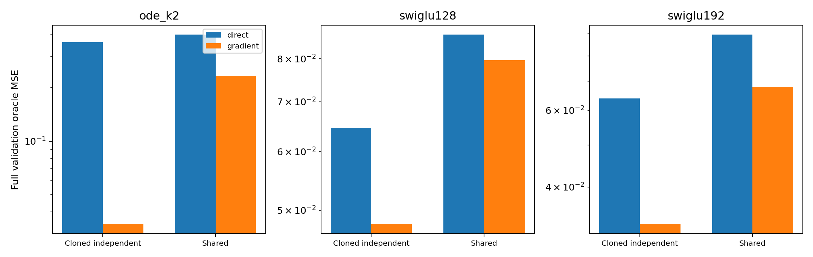
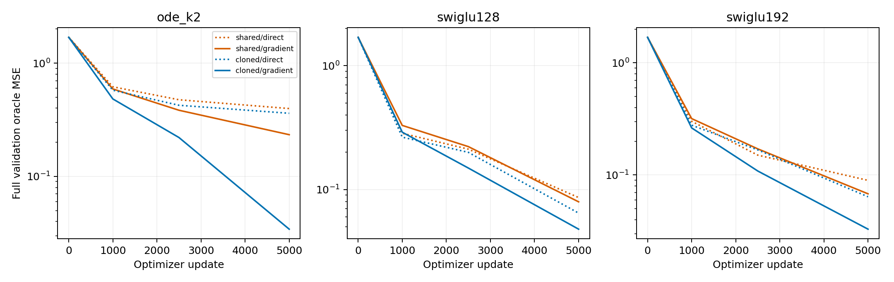
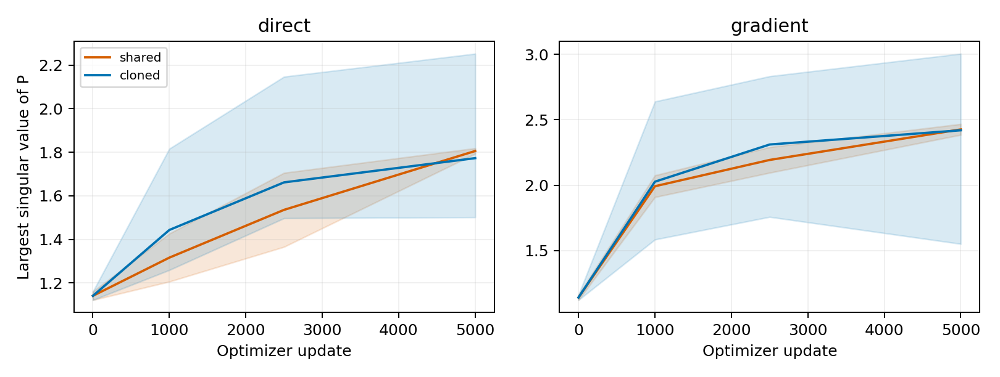

# Sharing the hidden field suppresses the useful ODE potential fit

The shared-field/full-potential model fails the Product16 screen. At matched starting functions, original ODE field MSE is.23353 with one shared block versus.03423 with three independently trainable cloned blocks. Both SwiGLU controls also lose under sharing, but the ODE penalty is substantially larger. Neither the quality nor the parameter-efficiency route qualifies, so this exact factor stops without other-task expansion or tuning.

The experiment completes one missing interaction. Earlier recurrence trials used direct velocity prediction, and earlier potential trials used native independent layers. Here the scalar potential and full reverse sensitivity are unchanged while the hidden field is shared across three Euler updates. Cloned independent controls repeat the same initial block with distinct parameter objects, so they start with exactly the same raw and complete-potential functions as the shared model. Their subsequent parameters can diverge.

| Backbone/layout | Direct field MSE | Complete-gradient MSE |
|---|---:|---:|
| ODE cloned | .360862 | .034229 |
| ODE shared | .397258 | .233525 |
| SwiGLU128 cloned | .064546 | .047905 |
| SwiGLU128 shared | .086167 | .079599 |
| SwiGLU192 cloned | .063975 | .032890 |
| SwiGLU192 shared | .089592 | .067962 |

All values are final full uniform-time validation oracle MSE on Product16, lower is better. Eight cells are new cold runs; four direct ODE/Swi192 controls were independently replayed from the old recurrence study. Native direct/A/B and wide direct generic controls remain in comparison.csv. Every arm uses seed0,5000updates,batch512 and the same actual pair-target stream and optimizer recipe.

## What the paired layout comparison identifies

For ODE, sharing raises MSE1.10x under direct readout and6.82x under the complete-gradient readout. The ratio of those two effects is6.20. Swi128 and192 have corresponding ratios1.24 and1.48. Thus the useful ODE potential fit transfers poorly to this specific shared-field restriction; adding the full potential does not make ordinary recurrence successful automatically. These are descriptive paired effects, not a unique separation of representation and optimization.

The cloned ODE potential is modestly better than the old native-independent potential (.03423 versus.03732). Cloning changes initialization within the same independent-layer function family. It is not a parameter-sharing gain or a newly accepted architecture. The generic frontier remains.03254, and the nominated shared ODE is far from it. No favorable cloned result replaces the preregistered shared candidate.

## Parameters, derivatives and sampling

Shared ODE has33682 parameters versus83862 for cloned ODE, about60% fewer. Both potential models execute183104 dense inference MACs and545152 loss-forward/backward MACs in the measured implementation. Sharing reduces unique parameters, not the number of block applications. At almost the same parameter budget, shared Swi128 (33594 parameters) attains.07960, substantially below shared ODE's.23353; no useful parameter-efficiency gain is established.

ODE shared/cloned potential Jacobian errors are45.18/8.34, while SW2 is.09523/.08842. Sampling distances remain relatively close despite the large field discrepancy, so all metrics stay visible. The shared candidate fails the derivative guard as well as the primary quality/parameter routes. Concurrent training intervals are recorded without an isolated throughput claim.

There are two unique learned P matrices in shared ODE and six in cloned ODE, with six actual solve visits in either forward pass. The complete trajectories and visit records are preserved. Over the last500updates, shared-potential ODE clips4% of updates versus10% for cloned potential. Persistent clipping is therefore not a sufficient account of the worse shared endpoint. Spectra remain internal descriptions, not complete-field stability certificates.

## Scope of the ODE interpretation

The shared model performs three Euler updates of one autonomous-in-depth hidden field, conditioned on the fixed outer generation time. Its existing step is1/sqrt(3), over an internal interval of sqrt(3). It keeps the original two scalar K2 solves and SiLU inside the field. No intermediate supervision, internal-depth embedding, solver change or altered potential was introduced. Shared parameters still yield state-dependent, generally different Jacobians at different visits; sharing does not make all local derivative matrices identical or commuting.

This result rejects advancing this three-step autonomous shared instance. It does not imply that every continuous-depth or nonautonomous architecture fails. In particular, smooth outer generative dynamics alone provide no theorem that hidden computation must use a depth-independent field. Any further design needs to justify the hidden restriction it imposes and retain the strong generic comparison.

## Validation

All twelve native full fields,60 complete derivative panels and12 generated-sample arrays replay bitwise. The audit regenerates actual input streams and checks48 checkpoints and64 unique-P snapshots. Independent full raw-Jacobian readouts reproduce complete double-precision fields within8.00e-15. Sixty input and12 parameter finite differences pass with maximum relative errors1.99e-10 and4.32e-11. Preflight checks matched nonzero-head functions, tied-gradient addition, actual visits/costs, eight trainer reloads, two exact CLI repetitions and bitwise native-potential compatibility on three learned backbones.

Training ran on two one-thread Mac mini CPU workers with ten-second process monitoring. Lenovo remains offline. No previous frozen run or submitted report was changed. The registered decision is [STOP](decision.json); there is no accepted useful ODE architecture from this setting.
