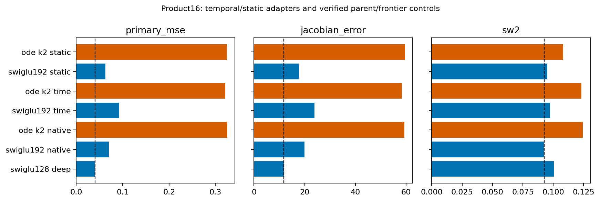
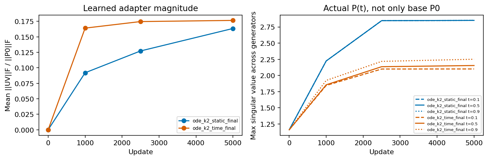

# Time-dependent generator Phase A

| Arm | Origin | Field MSE | Jacobian error | SW2 | Params | Dense MACs |
|---|---|---:|---:|---:|---:|---:|
| ode_k2_static_final | new adapter screen | 0.3251001 | 59.58715 | 0.10824 | 86934 | 113088 |
| swiglu192_static_final | new adapter screen | 0.0632464 | 17.75695 | 0.09504 | 114768 | 112704 |
| ode_k2_time_final | new adapter screen | 0.3213988 | 58.41827 | 0.12320 | 86934 | 113088 |
| swiglu192_time_final | new adapter screen | 0.0923640 | 23.85861 | 0.09732 | 114768 | 112704 |
| ode_k2_native_final | verified reused control | 0.3255274 | 59.30564 | 0.12440 | 83862 | 106944 |
| swiglu192_native_final | verified reused control | 0.0704226 | 19.88407 | 0.09271 | 108624 | 106560 |
| swiglu192_native_deep | verified reused control | 0.0487047 | 14.21999 | 0.09302 | 108624 | 106560 |
| swiglu192_cloned_final | verified reused control | 0.0639749 | 18.12841 | 0.09950 | 108624 | 106560 |
| swiglu192_cloned_deep | verified reused control | 0.0486151 | 14.00887 | 0.10118 | 108624 | 106560 |
| swiglu128_native_final | verified reused control | 0.0923258 | 24.88991 | 0.09572 | 83598 | 81792 |
| swiglu128_native_deep | verified reused control | 0.0409026 | 11.73333 | 0.10063 | 83598 | 81792 |

Decision: stop this setting. All four new endpoints and all seven reused controls were replayed from actual weights for full field predictions, five Jacobian panels and generated samples. Initial common tensors, static/time adapter draws and all saved batch streams match their declared references.

The base P0 and time-dependent P(t) are different objects. Effective spectra are independently recomputed from actual saved factors at every declared checkpoint/time. Neither their norms nor adapter activity is a full-model stability or accuracy certificate. No novelty is claimed for time-aware low-rank adaptation.

The time-dependent ODE changes field MSE .3255274→.3213988 (1.27% lower) and improves over its static-adapter control by1.14%; both are below the registered5% own-control threshold. The best practical generic value remains.0409026, a7.86-fold field-error gap. The ODE time arm also misses the derivative and sampling guards. The time-adapted ordinary SwiGLU is worse than both its parent and static counterpart, so temporal variation is not a general practical gain in this cold-training setting.

The learned delta-generator norm reaches about17.6% of the base-generator Frobenius norm on average, while static adaptation reaches about16.3%. The branch is active; activity does not establish useful predictions. All48 base and240 time-dependent matrices have separately verified full singular spectra and real/imaginary eigenvalue components in spectrum-and-input-audit.json, with202 raw-file bindings.

No Ring8/Gaussian extension, rank/time-basis sweep or20K continuation is triggered. This rules out advancing this declared rank4 linear-time setting; it does not establish that all time-dependent operators are ineffective.
