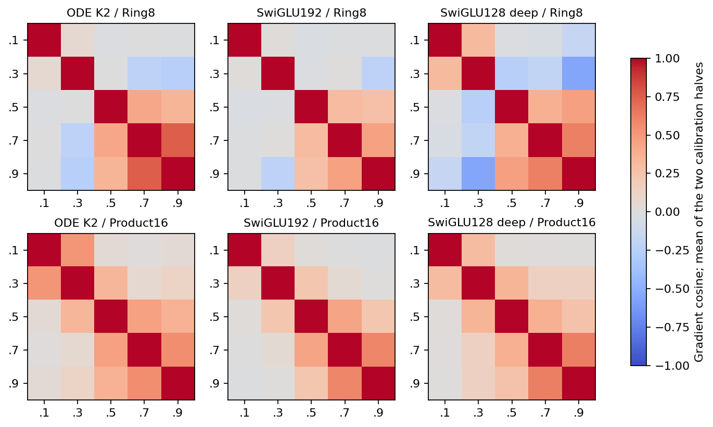
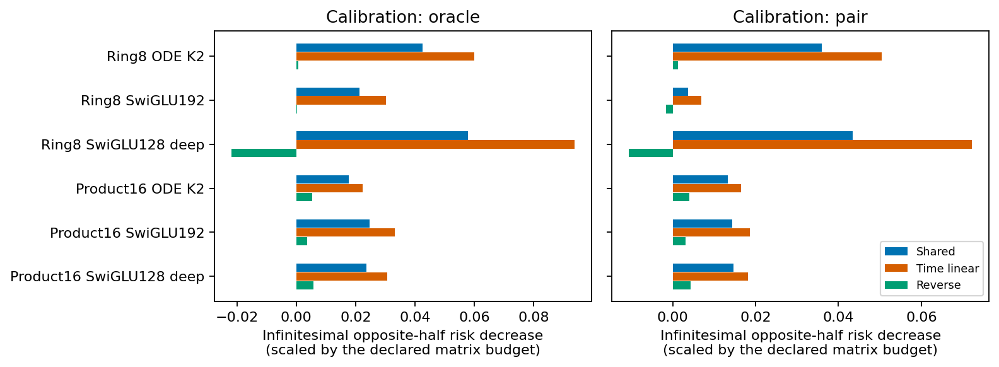
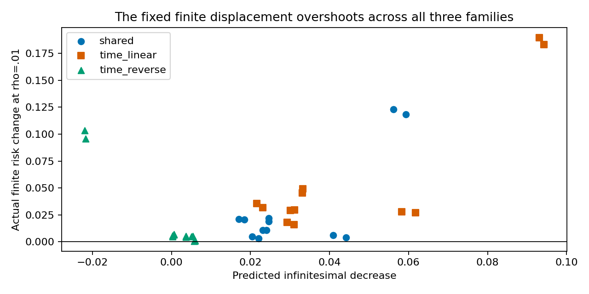

# Time-dependent operator diagnostic

The same-budget temporal tangent direction transfers across the two analysis halves, but the effect also occurs in both ordinary FFN comparators. The registered1% finite displacement overshoots even for the shared-gradient control. This makes the finite experiment inconclusive about whether a properly trained time-dependent operator would help; it is not evidence for rejecting time conditioning.

| Dataset | Arm | Calibration teacher | Temporal/shared local gain | Better in both halves |
|---|---|---|---:|---|
| gmm_ring8_2d | ode_k2_native_final | oracle | 1.412 | True |
| gmm_ring8_2d | ode_k2_native_final | pair | 1.404 | True |
| gmm_ring8_2d | swiglu192_native_final | oracle | 1.417 | True |
| gmm_ring8_2d | swiglu192_native_final | pair | 1.863 | True |
| gmm_ring8_2d | swiglu128_native_deep | oracle | 1.623 | True |
| gmm_ring8_2d | swiglu128_native_deep | pair | 1.662 | True |
| rotated_product_bimodal_16d | ode_k2_native_final | oracle | 1.262 | True |
| rotated_product_bimodal_16d | ode_k2_native_final | pair | 1.232 | True |
| rotated_product_bimodal_16d | swiglu192_native_final | oracle | 1.349 | True |
| rotated_product_bimodal_16d | swiglu192_native_final | pair | 1.291 | True |
| rotated_product_bimodal_16d | swiglu128_native_deep | oracle | 1.298 | True |
| rotated_product_bimodal_16d | swiglu128_native_deep | pair | 1.245 | True |

The displayed gain concerns an infinitesimal direction conditional on the frozen weights, a declared matrix metric and exposed panel inputs. It is not a trained quality improvement. The larger calibration tangent space already guarantees a local fit advantage; opposite-half transfer checks that this is not only calibration fitting. It still does not establish an ODE-specific mechanism, useful extra computation, or that conflicting time gradients cause the observed practical quality gap.

Negative off-diagonal entries describe time-specific local gradient disagreement. Their presence is not sufficient to nominate a new architecture. Selected parameter dimensions and norms are preserved in parameter-metadata.json at the raw output.

Both loss-label definitions and both cross-fit orientations are retained. The generic ordinary FFNs display similar local temporal benefits. The actual training-bank objective was not optimized or reconstructed by this diagnostic.

A positive first-order descent prediction with a finite risk increase shows that the chosen radius is outside a reliable local approximation for these directions. No radius sweep, rank search, new loss or architecture is selected. The exact finite output changes and polarization components are in aggregate.csv; the original scope and stopping boundary remain intact.

Decision: do not train a time-dependent-P variant from this evidence alone. Keep the shared temporal-direction question as generic conditional-computation evidence, not an explanation unique to the ODE gap. The broader research goal remains active.
